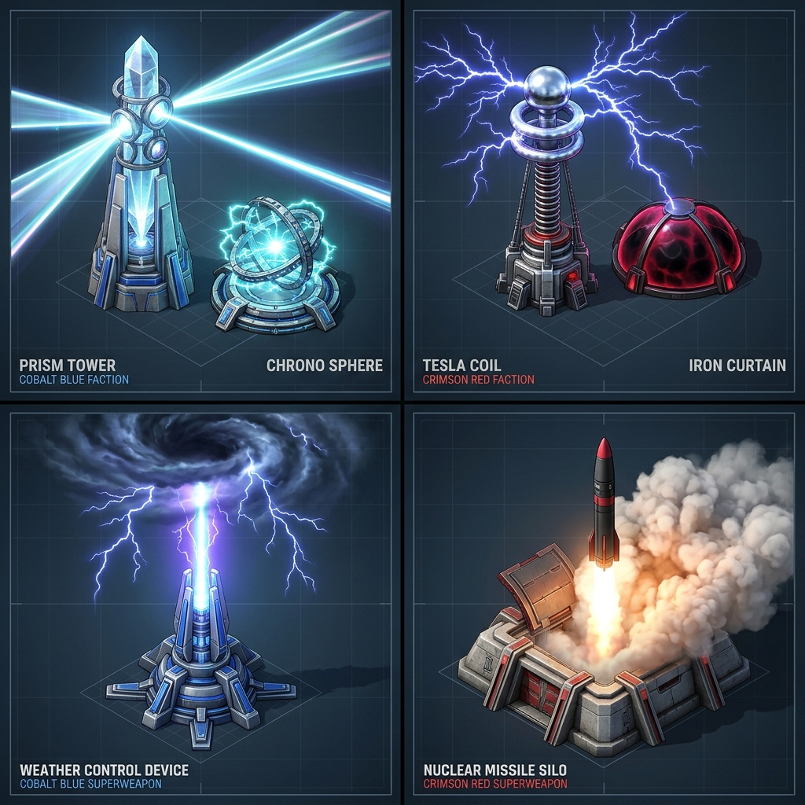

# RedAlert3A — 《墨陆：赤潮警戒》(Mò Lù: Red Tide Alert)

> 次世代高画质桌面 WebGL2 3D 即时战略（RTS）游戏项目（v2.0 架构），由独立创作者 **墨陆 (`mullvadcat`)** 主创设计，致敬经典《红色警戒 2》，由 [`3Agame`](https://github.com/mullvadcat/3Agame)（《墨陆：暗潮泊位》）技术与世界观演进升级而来。
>
> **v2.0 核心宣言**：彻底解除单文件 `< 2 MB` 体积限制，以**电影级 3D 画质、完整陆海空立体战、双终极超级武器体系与 12 关深度连续剧情战役**为第一制作标准！

---

## 全陆海空兵种与超级武器概念图鉴

### 暗潮同盟 (Abyssal Pact) —— 光棱科技、装甲与海空联合舰队


### 赤铁重工 (Crimson Foundry) —— 天启巨兽、基洛夫空艇与深海舰队


### 特种步兵军团与单兵武备 / 阵地防御与四大超级武器
| 特种步兵与单兵武器 (8 大兵种) | 阵地激光/磁暴塔与双阵营超级武器 |
| :---: | :---: |
|  |  |

---

## 核心特性（v2.0 无妥协高配版）

- **3A 质感次世代 WebGL2 渲染（不限体积）**：
  - 采用 **Vite 模块化工程 + 2K BasisU(.ktx2) PBR 材质集 + 多部件高精机械模型**，彻底告别低模粗糙感；
  - 集成 **4 级联软阴影（CSM）**、**GTAO 环境光遮蔽**、**Gerstner 物理海浪与海岸白沫**、**多阶段建筑物理坍塌碎片** 与 **持久地面弹坑/核辐射贴花池**。
- **完整陆 · 海 · 空立体协同战争**：
  - **陆军**：光棱坦克（5 重链式折射）、天启坦克（双联重炮 + 防空导弹 + 战场自修）、V3 远程弹道火箭、灰熊/犀牛坦克、多功能步兵车（载兵动态变形）；
  - **空军**：基洛夫重型空艇、风暴鹰舰载战机（停机坪自动起降补弹）、隐身夜鹰运输直升机、火箭飞行兵；
  - **海军**：造船厂开启制海战线，涵盖**暗潮航空母舰、神盾防空巡洋舰、无畏级导弹战列舰、深潜隐形台风攻击潜艇**与两栖气垫登陆艇。
- **双超级武器博弈 & 指挥官战术秘策**：
  - 每阵营同时配备 **战术级超武（超时空传送仪 / 铁幕无敌护盾）** 与 **毁灭级超武（天气控制机闪电风暴 / 战术核弹发射井）**，叠加侦察卫星、伞兵空降、纳米维修与 EMP 航弹四大主动秘策。
- **承接前作的 12 关史诗剧情战役**：
  - 主角**指挥官墨陆**从《墨陆：暗潮泊位》“四号泊位”事件继续前行，围绕“2040 赤晶危机”与深海觉醒母脑“零号赤潮”，演绎 **暗潮同盟《蔚蓝折光》(6 关)** 与 **赤铁重工《赤铁洪流》(6 关)** 两条分支完整战役剧本，支持人物立绘无线电通讯、过场镜头演出与配音字幕。

---

## 设计文档导航

| 文档 | 内容说明 | 路径 |
| :--- | :--- | :--- |
| **产品需求文档 (PRD v2.0)** | 世界观与角色群像、全部陆海空建筑/单位数值矩阵、双超武与秘策、12 关完整剧情战役剧本、高画质验收指标 | [`docs/PRD.md`](docs/PRD.md) |
| **软件设计方案 (SDD v2.0)** | Vite 流式高精资产管线、CSM/GTAO/Gerstner 物理海浪架构、三层海陆空寻路、双超武状态机与剧情导演引擎 `director.js` | [`docs/SDD.md`](docs/SDD.md) |

---

## 规划项目目录结构 (v2.0)

```text
RedAlert3A/
├── README.md                     # 项目总览与概念图鉴展示
├── index.html                    # 主入口与渐进式加载 HUD
├── vite.config.js                # 现代 ES 模块构建与流式资源分包配置
├── package.json                  # dev / build / bench 工程脚本
├── assets/                       # 2K PBR 贴图集 (.ktx2)、glTF 高模、角色立绘、交响音轨与配音
├── docs/
│   ├── assets/                   # 兵种、武器与超武概念图鉴
│   ├── PRD.md                    # 产品需求文档 v2.0
│   └── SDD.md                    # 软件设计方案 v2.0
└── src/
    ├── core/                     # 30Hz 确定性模拟核心、资产缓存与配置表
    ├── render/                   # HDR 管线、CSM 级联阴影、Gerstner 物理海浪、256×256 战争迷雾、持久弹坑池
    ├── world/                    # 海陆网格地形、高模与多阶段建筑摧毁碎片物理
    ├── gameplay/                 # 三层海陆空导航、经济队列、航母/潜艇机制、超武/秘策与三层效用 AI
    ├── story/                    # 剧本导演引擎 (director.js)、立绘无线电对话窗与 12 关战役剧本
    └── ui/                       # 经典红警 5 页签右侧 Sidebar、互动雷达小地图与战区主菜单
```

---

## 研发里程碑路线图（M1 – M6）

| 阶段 | 里程碑目标 | 核心交付物 |
| :--- | :--- | :--- |
| **M1** | **次世代渲染底座与水陆地形** | Vite + KTX2/GLB 流式加载、4 级联阴影 CSM、GTAO、Gerstner 物理海浪与 `256×256` 战争迷雾 |
| **M2** | **经典右栏与经济建造闭环** | 5 页签 Sidebar、动态立绘无线电通讯面板、多阶段建筑展开与倒塌碎裂、矿车自动采矿循环 |
| **M3** | **全陆海空兵种与三层导航** | 8 步兵 + 8 陆军 + 3 空军 + 5 海军实体落地、潜艇深潜/航母舰载机机制、IFV 变形与光棱/磁暴特效 |
| **M4** | **双超级武器与海陆空 AI** | 超时空传送/铁幕/闪电风暴/核弹 4 大超武、指挥官秘策、支持跨海抢滩与超武反制的遭遇战 AI |
| **M5** | **12 关深度剧情战役与动态交响** | `director.js` 过场演出引擎、《蔚蓝折光》6 关 + 《赤铁洪流》6 关完整剧本与 32 轨战斗动态混音 |
| **M6** | **全画质调优与正式发行** | Ultra/High/Balanced 三档画质分级、`250+` 单位同屏 `60 FPS` 压测验收与静态/桌面离线分发 |
