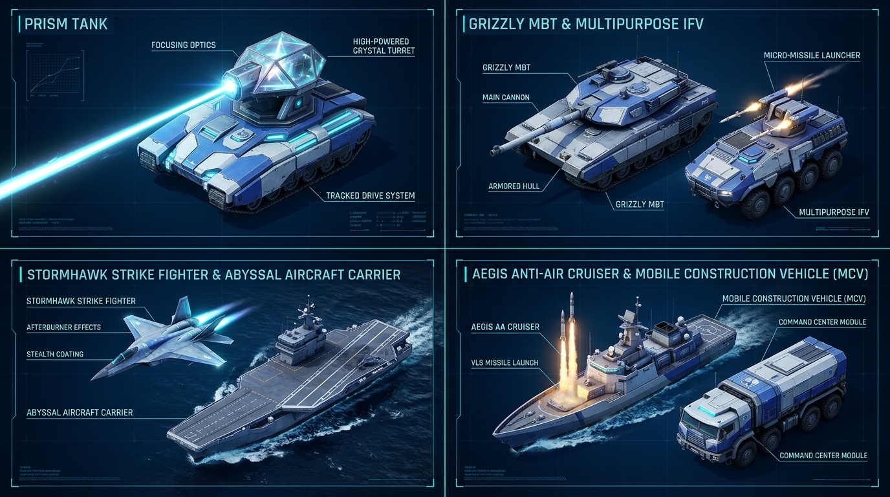
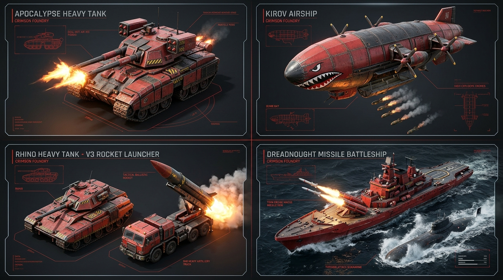
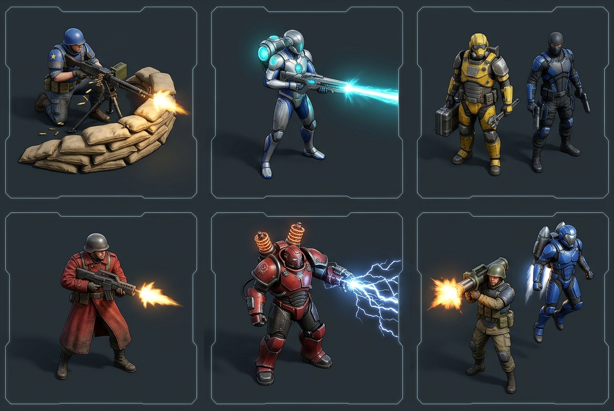

# RedAlert3A — 《墨陆：赤潮警戒》(Mò Lù: Red Tide Alert)

> 次世代高画质桌面 WebGL2 3D 即时战略（RTS）游戏项目（**v2.2 · M1–M6 核心研发已完成**，最新进度见 [`docs/DEVELOPMENT_PLAN.md`](docs/DEVELOPMENT_PLAN.md#5-研发进度与验收台账live-progress-ledger--2026-11-15)），由独立创作者 **墨陆 (`mullvadcat`)** 主创设计，致敬经典《红色警戒 2》，由 [`3Agame`](https://github.com/mullvadcat/3Agame)（《墨陆：暗潮泊位》）世界观与技术体系全面演进升级而来。
>
> **v2.2 核心宣言**：彻底解除单文件 `< 2 MB` 体积限制，以**电影级 3D 画质、陆海空全维度平衡立体战、双终极超级武器体系与 12+1 关深度连续剧情战役**为第一制作标准！

---

## 全陆海空兵种与超级武器概念图鉴

### 暗潮同盟 (Abyssal Pact) —— 光棱科技、装甲与海空联合舰队


### 赤铁重工 (Crimson Foundry) —— 天启巨兽、基洛夫空艇与深海舰队


### 特种步兵军团与单兵武备 / 阵地防御与四大超级武器
| 六宫格展示代表步兵与单兵武备（全游戏共 9 种，含 2 英雄） | 阵地激光/磁暴塔与双阵营超级武器 |
| :---: | :---: |
|  |  |

---

## 双阵营特色速览对比

| 维度 | 暗潮同盟 (Abyssal Pact · 蔚蓝 `#2d7eff`) | 赤铁重工 (Crimson Foundry · 赤红 `#e83b3b`) |
| :--- | :--- | :--- |
| **战术风格** | 高机动穿插、光棱折射拆迁、防空海空压制、特种突袭 | 重装甲正面碾压、高压磁暴区域拒止、超远火力洗地 |
| **王牌步兵** | 战术大兵（沙袋阵地）、火箭飞行兵、超时空军团兵、幽影 | 动员兵（低价人海）、磁暴步兵（防碾压/充能）、爆破王“重锤” |
| **王牌陆军** | 光棱坦克（5 重激光折射）、灰熊坦克、万能变形 IFV | 天启坦克（双 `120mm` 炮+防空+自修）、犀牛坦克、V3 火箭 |
| **王牌海空** | 暗潮航空母舰、神盾防空巡洋舰、海豚声呐艇、风暴鹰战机 | 无畏级导弹战列舰、台风隐形潜艇、赤蝎防空炮艇、基洛夫、赤刃战机 |
| **战术/终极超武** | **超时空传送仪**（空间折跃突袭）+ **天气控制机**（闪电风暴） | **铁幕装置**（15 秒绝对无敌）+ **核弹发射井**（战术核爆） |

---

## 核心特性（v2.2 无妥协高配版）

- **3A 质感次世代 WebGL2 渲染（混合高精资产管线）**：
  - 采用 **Vite 模块化工程 + 内置 GPU 2048 PBR 烘焙/程序化多部件底座（支持 glTF `.glb` & `.ktx2` 无缝热替换）**，保障从研发第一天起 100% 零阻塞运行；
  - 集成 **相机紧包络 4K 纹素对齐软阴影 + GTAO**、**单 Draw Call 顶点部件驱动 & GPU 战术血条**、**X-Ray 建筑遮挡剪影 & 高度自适应轮廓光**、**Gerstner 岸深衰减物理海浪** 与 **确定性解析碎片坍塌 / 1024 持久弹坑池**。
- **完整陆 · 海 · 空三栖平衡立体战**：
  - 双阵营均完备对地、对空、对海、反潜与两栖登陆链条（含**赤蝎防空炮艇**与**赤刃重型攻击机**补齐赤铁海空短板），支持**可破坏桥梁**修毁与四层流场寻路。
- **双超级武器、老兵晋升与指挥官秘策**：
  - 还原三级老兵晋升（新兵 / 老兵 `↑` / 精英回血暴击 `★`）、五通道并发生产队列，以及侦察卫星、伞兵空降、纳米维修与 EMP 航弹四大主动秘策。
- **承接前作的 12+1 关史诗剧情战役与检查点存档**：
  - 主角**指挥官墨陆**承接前作《墨陆：暗潮泊位》四号泊位事件，在首关结束后触发命运分歧，演绎 **《蔚蓝折光》(6 关)** 与 **《赤铁洪流》(6 关)**；双线通关后解锁双科技树同屏决战的 **隐藏第 13 关《破晓深渊：双星合流》**，依托 `IndexedDB` 自动保存检查点进度。
- **原生多语种国际化架构（默认内置中/英双语）**：
  - 默认标配 **简体中文 (`zh-CN`)** 与 **English (`en-US`)** 全量词库，支持快捷键 `L` 或设置面板**战局内实时热切换**且不中断游戏；
  - 支持**文本/字幕语种**与 **EVA/角色配音语种**独立搭配（例如中文界面 + 经典英文 EVA 语音 `"Unit Ready" / "Kirov Reporting"` 或全中文配音），并预留多语种扩展包注册接口。

---

## 设计文档导航

> **文档权威裁决顺序**：玩法机制、单位数值表、快捷键与战役规则以 [`docs/PRD.md`](docs/PRD.md)（v2.2）为准；渲染架构、`< 140 Draw Calls` 门禁与工程方案以 [`docs/SDD.md`](docs/SDD.md)（v2.2）为准；两者交叉时以 SDD 技术决策覆盖旧 PRD 表述，游戏落地后运行时数值唯一真理源为 `src/core/config.js`（详见 [`docs/README.md`](docs/README.md)）。

| 文档 | 内容说明 | 路径 |
| :--- | :--- | :--- |
| **文档中心索引 (docs/README)** | 权威裁决规则、全单位/建筑统一命名与规划内部 ID 对照表、v1.0–v2.2 演进日志 | [`docs/README.md`](docs/README.md) |
| **产品需求文档 (PRD v2.2)** | 世界观与角色群像、非目标与 M1 DoD、陆海空数值矩阵、无冲突快捷键、5 页签映射、12+1 关与存档状态机 | [`docs/PRD.md`](docs/PRD.md) |
| **软件设计方案 (SDD v2.2)** | Vite 混合高精资产管线、`16.6ms` 帧预算与 4K 纹素软阴影/GPU 部件合批、`7×6` 护甲矩阵、防溢出、平衡压测与风险预案 | [`docs/SDD.md`](docs/SDD.md) |
| **AI 工程开发计划 (Playbook v2.2)** | 面向 AI Coding Agent 的架构红线、核心数据结构/接口契约、M1–M6 共 27 项原子施工任务（`T1.1`~`T6.3`）与验收门禁 | [`docs/DEVELOPMENT_PLAN.md`](docs/DEVELOPMENT_PLAN.md) |

---

## 规划项目目录结构 (v2.2)

```text
RedAlert3A/
├── README.md                     # 项目总览、阵营速览与概念图鉴
├── index.html                    # 主入口与渐进式加载 HUD
├── vite.config.js                # 现代 ES 模块构建与流式资源分包配置
├── package.json                  # dev / build / sim:balance / bench 工程脚本
├── scripts/
│   └── balance-sim.mjs           # Node.js 无头 1000× 自动对抗与数值平衡压测器
├── assets/                       # 可选高精外部覆盖资源池 (KTX2 贴图、glTF 高模、立绘、音轨配音)
├── docs/
│   ├── assets/                   # 兵种、武器与超武概念图鉴
│   ├── README.md                 # 文档中心索引、权威裁决顺序与统一命名表
│   ├── PRD.md                    # 产品需求文档 v2.2
│   ├── SDD.md                    # 软件设计方案 v2.2
│   └── DEVELOPMENT_PLAN.md       # AI Agent 工程开发计划 (M1–M6 原子任务手册)
└── src/
    ├── core/                     # 30Hz 确定性模拟核心、i18n 多语种运行时、IndexedDB 存档 (save.js) 与配置表
    ├── locales/                  # 默认内置中/英双语词库 (zh-CN / en-US) 与多语种扩展注册器
    ├── render/                   # HDR 管线、4K 紧包络纹素软阴影、GPU 血条广告牌、Gerstner 物理海浪、迷雾与弹坑池
    ├── world/                    # 声明式地图编译器、顶点驱动高模工厂与解析抛物线碎片池
    ├── gameplay/                 # 128×128+256×256 逻辑Tick分片流场、CPU视野索敌、pendingDamage释放与三层 AI
    ├── story/                    # 剧本导演引擎 (director.js)、军用无线电滤波对话与 12+1 关声明式战役
    └── ui/                       # 经典红警 5 页签右侧 Sidebar、互动雷达小地图与 8 图遭遇战大厅
```

---

## 快速启动与验收调试参数

> 当前 **M1–M6 共 28 项任务** 已完成源码落地与无头/构建门禁验收，可通过以下命令本地启动或运行测试：

```bash
npm run dev                       # 启动本地源码开发服务器
npm run build                     # 纯模拟红线校验 + 打包静态发行包 -> dist/
npm run preview                   # 预览 dist/ 离线静态构建包
npm run check:i18n                # 校验 zh-CN / en-US 词库与 49 实体 100% 对等
npm run sim:balance               # 运行 Node.js 无头 200 场千倍速 AI 对抗与数值平衡压测
npm run test:m1                   # 依次支持 test:m1 ~ test:m6 分阶段回归门禁
```

- `?lang=zh-CN` / `?lang=en-US`：指定初始默认语种进入游戏（战局内按 `L` 键可随时热切换中/英）
- `?show=gallery`：进入全 3D 可旋转双阵营模型检阅展厅（查看战损效果、武器开火与展开动画）
- `?mission=A01..A06 / C01..C06 / EX13`：直达任意一关战役剧本调试触发器与过场演出
- `?nofog=1&fastbuild=1`：全图透视 + 10 倍速建造调试双超武与海陆空 AI
- `?bench=1`：启动 `250+` 单位同屏大混战 60 秒性能与 Draw Call 自动压测
- `?quality=ultra|high|balanced`：指定初始渲染画质档位

---

## 研发里程碑进度（M1 – M6）

| 阶段 | 里程碑目标 | 核心交付物 | 当前状态 |
| :--- | :--- | :--- | :---: |
| **M1** | **次世代渲染底座 + 单图陆军最小可玩闭环** | GPU 2K PBR 烘焙、紧包络 4K 纹素软阴影 + GTAO、Gerstner 岸深衰减海浪、`256×256` 迷雾，以及 MCV 展开、电厂/精炼厂/战车工厂、采矿车与灰熊/犀牛基础交战闭环 | **已完成 (`7af7bd9`)** |
| **M2** | **经典右栏与基建防御/语音体系** | 5 页签 Sidebar、军用无线电滤波语音窗、造船厂近岸放置、防空/光棱/磁暴防御塔、维修/变卖与解析碎片坍塌 | **已完成 (`48fef3f`)** |
| **M3** | **全 28 种陆海空兵种与高可读性战场** | 9 步兵+8 陆军+4 空军+7 海军顶点部件合批、X-Ray 遮挡剪影、GPU 血条、按逻辑 Tick 分片流场与 `pendingDamage` 防溢出索敌 | **已完成 (`a08d9fe`)** |
| **M4** | **双超级武器与海陆空平衡 AI** | 带 `6s` 预警反制窗口的 4 大超武、光棱递减、指挥官秘策、8 图海陆空 AI 与千倍速无头平衡压测 | **已完成 (`54b316c`)** |
| **M5** | **12+1 关剧情战役与检查点存档** | `director.js` 过场演出、《蔚蓝折光》6 关 + 《赤铁洪流》6 关 + 隐藏终章 `EX-13`、IndexedDB 存档与自适应混音 | **已完成 (`ed9d412`)** |
| **M6** | **全画质调优与正式发行** | `Ultra/High/Balanced` 热切换、`webglcontextlost` 恢复、`250+` 单位同屏压测面板与全量静态分发包 | **已完成 (`c3bd208`)** |

---

## 开源协议与文档协作 (License & Contributing)

- **开源协议**：本项目规划采用 **MIT License**（后续代码落地时在根目录补充完整 `LICENSE` 文件）。
- **文档协作约定**：修订数值、单位命名或技术架构时，请同步核对 [`docs/README.md`](docs/README.md) 中的权威裁决顺序与统一命名对照表，避免 [`docs/PRD.md`](docs/PRD.md) 与 [`docs/SDD.md`](docs/SDD.md) 之间产生口径漂移。
