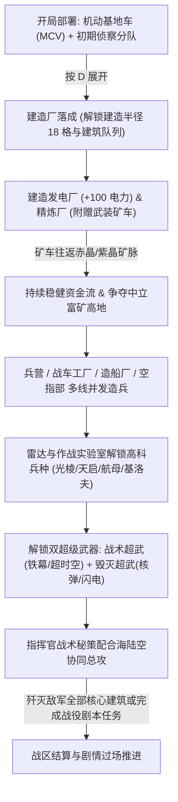
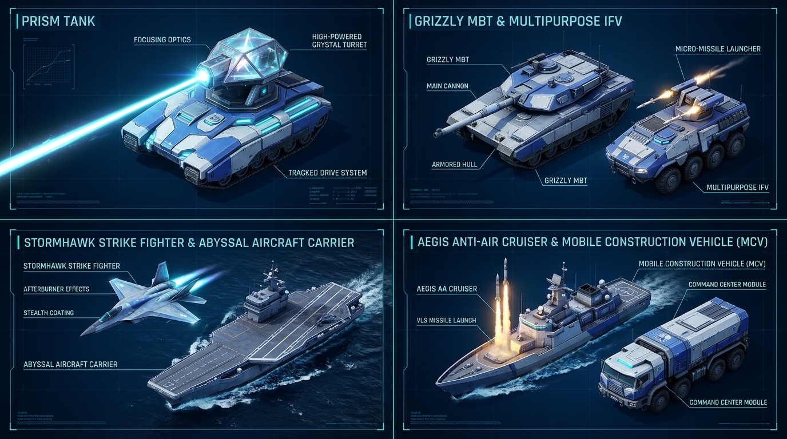
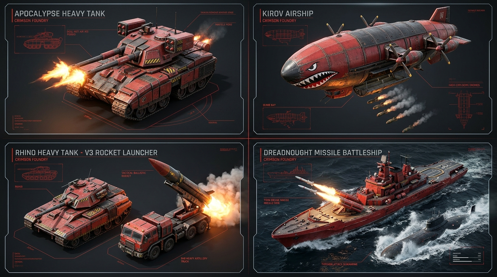
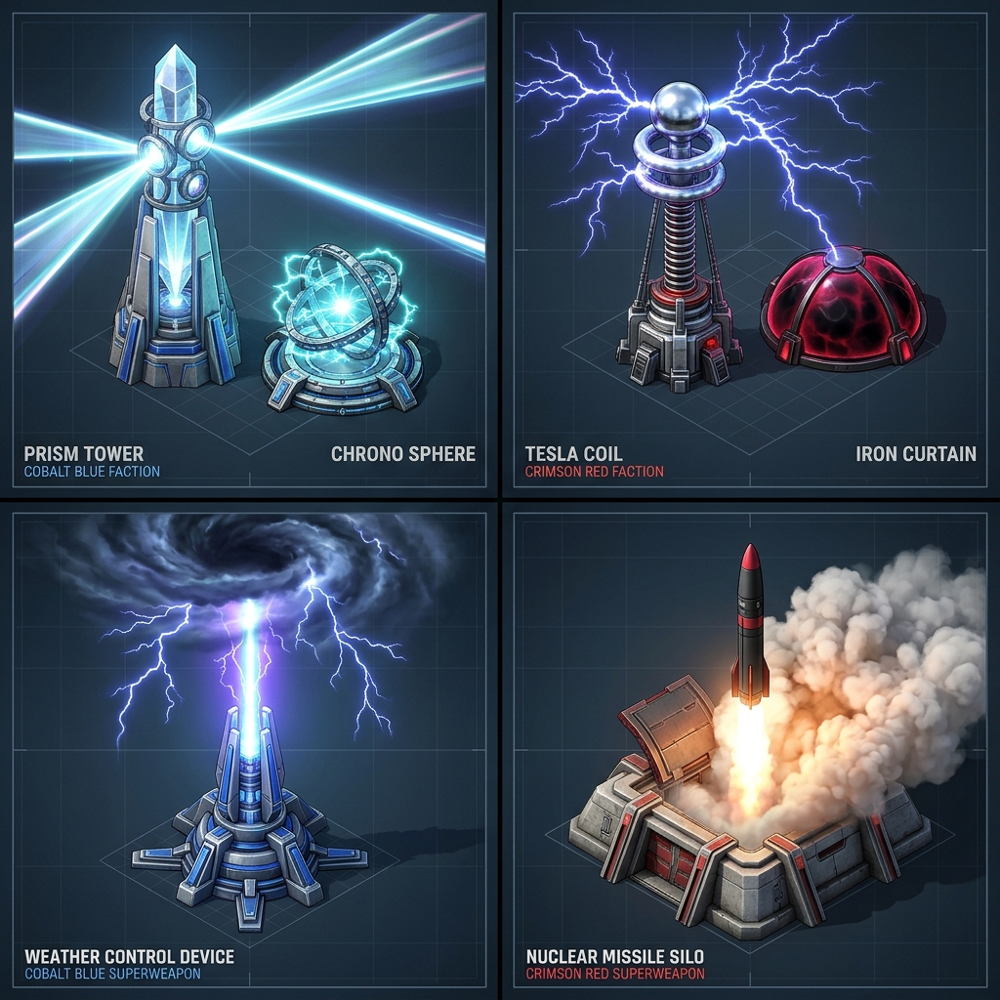
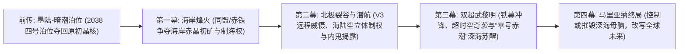

# 《墨陆：赤潮警戒》(Mò Lù: Red Tide Alert) 产品需求文档 (PRD v2.0)

- **文档版本**：v2.0（高画质 · 全陆海空兵种 · 完整剧情战役版）
- **项目代号**：`RedAlert3A`
- **作者 / 主创**：墨陆 (`mullvadcat`)
- **技术路线**：高画质模块化 WebGL2 PBR 渲染 + 精细多部件机械高模 + 交响化电子配乐与全剧情过场演出（**取消 `< 2 MB` 单文件限制**，优先保证画质、战场体量、音效质感与故事沉浸感）

---

## 1. 文档概述与产品愿景

### 1.1 产品定位（v2.0 架构升级）
《墨陆：赤潮警戒》是一款立足现代桌面浏览器的**次世代高画质全 3D 即时战略（RTS）大作**，在玩法上深度致敬经典《命令与征服：红色警戒 2》。

相比早期实验性的“零外部资产 `< 2 MB` 单文件”设想，**v2.0 正式确立“品质优先、不设体积上限”的开发原则**：
- 允许使用高分辨率 PBR 法线/金属度/粗糙度/环境遮蔽贴图集（2K KTX2 / PNG 纹理集）、精细多部件关节机械模型、物理真实水面与动态天气系统；
- 允许接入多轨动态工业金属交响音轨、真实高采样炮火爆炸音效库、角色立绘与双语战术配音及局内电影化过场剧情演出；
- 打造真正拥有**陆海空立体协同作战**、**4 种终极与战术超级武器**、以及**双阵营 12 关深度连续剧情战役**的精品级 WebGL2 3D RTS 体验。

### 1.2 核心设计支柱
1. **3A 质感复古硬核 RTS 体验**：忠实还原经典《红警》右侧战术边栏（Sidebar）、建造半径扩展、采矿车自动往返经济、多厂加速与高能攻防拉锯。
2. **陆·海·空全维度立体战争**：不仅包含坦克洪流与步兵拉扯，更完整引入**航空母舰、神盾巡洋舰、无畏级导弹战列舰、台风潜艇、风暴鹰战机与基洛夫空艇**，重现跨海抢滩与海空对决名场面。
3. **双超级武器与指挥官战术秘策**：每一阵营同时拥有“**战术型超武**（超时空传送仪 / 铁幕装置）”与“**毁灭型超武**（天气控制机 / 核弹发射井）”，并配合主动冷却的**指挥官秘策**提升微操翻盘空间。
4. **有血有肉的连续长篇战役剧情**：直接承接前作《墨陆：暗潮泊位》(3Agame) 的世界观伏笔，主角**指挥官墨陆**从港区暗夜撤离后卷入席卷全球的“赤晶矿脉”能源冷战与深海未知智能体危机，提供**双阵营各 6 关（共 12 关）带人物立绘、无线电演出、伏击反转与多结局的完整剧情**。

### 1.3 运行环境与画质分级
- **目标平台**：桌面端 Chrome / Edge / Safari / Firefox（WebGL2 + WebAudio + IndexedDB 本地存档），支持离线静态部署与可选桌面端封装。
- **三档画质预设**：
  - **极致影视档（Ultra）**：4K/1440p 原生分辨率、级联软阴影（CSM）、GTAO 环境光遮蔽、物理海浪反射、多阶段建筑坍塌残骸、2K PBR 纹理、HDR Bloom。
  - **高清竞技档（High · 默认）**：`1080p` 稳定 `60 FPS`，完整开启阴影、战争迷雾体积过渡、全量粒子与动态光效。
  - **轻量流畅档（Balanced）**：适配集显与轻薄本，保持清晰 PBR 着色与完整玩法体验。

---

## 2. 世界观剧本、时代背景与核心角色

### 2.1 世界观背景：从“四号泊位”到“2040 赤潮危机”
> *“那晚我在四号泊位夺回的不只是实验样本，而是撬动整颗星球能源格局的第一块多米诺骨牌。”* —— 墨陆战地日志

- **2038 年（前作《墨陆：暗潮泊位》事件）**：在深水货轮“墨陆远洋号”沉寂的港区夜色中，特遣干员**墨陆 (Mò Lù)** 成功突围并带出了沉海集装箱内的未知高能晶体核心。
- **2040 年（赤晶涌现与分裂）**：受深海地壳异常共振影响，全球海底裂谷与极地矿区同时喷涌出极具高能量密度且呈现“受刺激自增殖”特性的神秘矿物——**赤晶矿（Crimson Ore）**与更高纯度的**紫晶矿（Violet Crystal）**。人类能源联合体彻底破裂，分裂为理念水火不容的两大军事集团：
  - **暗潮同盟 (Abyssal Pact · 蔚蓝 `#2d7eff`)**：由原海洋科考与沿海防御联盟改组，主张以光学棱镜聚焦技术、时空量子折跃与大气干涉武器封控深海晶矿。
  - **赤铁重工 (Crimson Foundry · 赤红 `#e83b3b`)**：由北方极寒重工业联合体与矿业军团整合，奉行重装甲饱和洪流、高能特斯拉磁暴防线与战术核威慑，主张彻底开采并掌控所有赤晶矿脉。

### 2.2 核心角色群像（含战役过场语音演出）

| 角色姓名 / 代号 | 所属阵营 | 职务与身份 | 性格与剧情弧光 |
| :--- | :---: | :--- | :--- |
| **指挥官 墨陆 (Mò Lù)** | 双阵营主角视角 | 前港区特遣王牌 / 现前线战区最高野战指挥官 | 冷静果决、擅长以少胜多的机动奇袭。同盟线代表正义控场与深海解密；赤铁线则展现他在能源危机与内部背叛中铁腕重铸秩序的枭雄一面 |
| **林汐博士 (Dr. Lin Xi)** | 暗潮同盟 / 中立科研 | 深海量子物理学家、四号泊位晶体最初解码者 | 理性克制却背负秘密。早在 2038 年就发现了赤晶矿底部连通着名为 **“零号赤潮 (Abyss-0)”** 的史前地核生物电网络，与墨陆在多场战役中合作破解真相 |
| **雷泽将军 (Gen. Viktor Reznikov)** | 赤铁重工 | 北方重装集团军总司令、天启与铁幕计划督造者 | 强硬傲慢的钢铁军阀信徒，坚信唯有绝对的重炮与核威慑才能阻止文明因能源枯竭而内爆，既是强敌也是赤铁战役中的严苛导师 |
| **EVA-09 / “女武神”** | 通用战术中枢 | 战区 AI 副官系统（同盟版“林音” / 赤铁版“红星”） | 全程提供语音播报、敌情预警、过场简报与战役紧急决策选项 |
| **“零号赤潮” (Abyss-0)** | 隐藏终极威胁 | 沉睡于马里亚纳裂谷的古晶体母脑网络 | 剧情后半段重大反转：所有赤晶矿都是它唤醒地表的触须，最终引发同盟与赤铁联手或彼此抢夺控制权的终局高潮 |

---

## 3. 核心玩法闭环与胜负规则

### 胜负与特殊占领规则
- **标准胜利条件**：敌方所有建筑与所有机动基地车（MCV）全部被摧毁（可选开启“必须全歼所有可攻击单位”）。
- **中立油井 / 科技机场 / 修复厂占领**：地图重要战略节点分布可被**工程师**进驻占领的中立建筑，例如**科技钻油井（每 4 秒源源不断产出 `$40` 被动资金）**、**科技机场（解锁快速伞兵增援秘策）**、**秘密医院（附近己方步兵自动回血）**。

---

## 4. 完整陆海空武器与兵种图鉴及数值矩阵

### 4.1 暗潮同盟（Abyssal Pact）主力装甲与海空兵种图鉴

### 4.2 赤铁重工（Crimson Foundry）重装洪流、空艇与海军舰队图鉴

### 4.3 全阵营六大特种步兵与单兵武器图鉴

### 4.4 步兵单位数值矩阵（共 8 种）

| 单位名称 | 阵营 | 造价 | 耗时 | 移速 | HP | 护甲 | 伤害 / 射速 | 射程 | 前置需求 | 特性与部署技能 |
| :--- | :---: | :---: | :---: | :---: | :---: | :---: | :---: | :---: | :--- | :--- |
| **战术大兵 (GI)** | 暗潮同盟 | `` `$200` `` | `2.5s` | `3.6` | `120` | 无甲 | `16` / `0.35s` | `10m` | 兵营 | 按 `D` 展开沙袋重机枪阵地，射程升至 `15m`、伤害 `26` 并免疫直接炮弹秒杀 |
| **动员兵 (Conscript)** | 赤铁重工 | `` `$100` `` | `1.8s` | `3.8` | `110` | 无甲 | `12` / `0.40s` | `9m` | 兵营 | 极其廉价的人海前锋，适合占领城市中立建筑与吸纳敌方第一轮火力 |
| **防空步兵 (Flak Trooper)** | 通用 | `` `$300` `` | `3.2s` | `3.5` | `140` | 无甲 | 地 `20` / 空 `38` | `15m` | 兵营 | 破片防空高炮兼顾对地压制，成本低廉的对空早期防线 |
| **战地工程师 (Engineer)** | 通用 | `` `$500` `` | `4.5s` | `3.4` | `85` | 无甲 | 无武装 | `1.5m` | 兵营 | **直接占领敌方受损或完整建筑**、占领科技油井、或瞬间满血修复受损友军建筑 |
| **火箭飞行兵 (Rocketeer)** | 暗潮同盟 | `` `$600` `` | `5.0s` | `7.2` (高空) | `150` | 无甲 (空) | `22` / `0.45s` | `13m` | 兵营+空指部 | 单兵喷射背包无视地形峡谷与水面巡航，高空机动骚扰矿车与狙杀无防空部队 |
| **磁暴步兵 (Tesla Trooper)** | 赤铁重工 | `` `$500` `` | `5.0s` | `3.0` | `240` | 重装步兵 | `68` / `1.4s` | `9m` | 兵营+雷达 | **不可被坦克碾压**；高能电弧秒杀常规步兵，2 名贴身可令断电磁暴线圈继续开火 |
| **超时空军团兵 (Chrono)** | 暗潮同盟 | `` `$1,500` `` | `10s` | 瞬移 | `200` | 无甲 | 空间抹除 | `14m` | 作战实验室 | 全图可见点瞬移（按距离计算空间硬直），持续冻结并在数秒后彻底抹除目标单位/建筑 |
| **英雄特种兵（幽影 / 重锤）** | 阵营限 `1` | `` `$1,800` `` | `12s` | `4.8` | `450` | 特种甲 | 双枪 `120` / 破甲 C4 | `14m` | 作战实验室 | **幽影（同盟）**：秒杀步兵 + C4 瞬间爆破建筑与游水；**重锤（赤铁）**：超远狙击枪 + 反装甲强拆爆破筒 |

### 4.5 陆军载具、空军战机与海军战舰数值矩阵

#### 陆军装甲载具（共 8 种）

| 单位名称 | 阵营 | 造价 | 耗时 | 移速 | HP | 护甲 | 主炮/武器性能 | 射程 | 前置需求 | 战术定位 |
| :--- | :---: | :---: | :---: | :---: | :---: | :---: | :--- | :---: | :--- | :--- |
| **武装采矿车** | 通用 | `` `$1,400` `` | `10s` | `4.2` | `1050` | 重甲 | 自卫机枪 `14` | `10m` | 精炼厂 | 自动寻矿开采，满载自动返回卸矿；同盟版支持高速超时空跳矿返厂（高科可选） |
| **灰熊主战坦克** | 暗潮同盟 | `` `$700` `` | `6.5s` | `6.4` | `370` | 重甲 | `105mm` 炮 `68` / `1.6s` | `15m` | 战车工厂 | 高机动包抄与集群穿插，配合光棱突破防线 |
| **犀牛主战坦克** | 赤铁重工 | `` `$900` `` | `7.5s` | `5.4` | `490` | 重甲 | `120mm` 炮 `98` / `1.8s` | `16m` | 战车工厂 | 正面抗伤与火力对轰胜过灰熊，赤铁装甲绝对基石 |
| **多功能步兵车 (IFV)** | 暗潮同盟 | `` `$600` `` | `5.5s` | `8.4` | `260` | 轻甲 | 导弹 `48` / `1.2s` | `16m` | 战车工厂 | 对空/对地极速防空车；载步兵变形（工程师=维修车，大兵=重机枪车，军团兵=光束抹除车） |
| **V3 火箭发射车** | 赤铁重工 | `` `$800` `` | `7.5s` | `4.6` | `240` | 轻甲 | 战术弹道火箭 `260` / `7s` | `34m` | 重工+雷达 | 超视距抛射攻城火箭，飞弹可被爱国者/神盾防空拦截 |
| **光棱坦克 (Prism Tank)** | 暗潮同盟 | `` `$1,200` `` | `10.5s` | `5.6` | `250` | 轻甲 | 激光 `115` + 5 折射线 | `22m` | 作战实验室 | 极远射程群伤拆建神器，需重坦在前线充当肉盾掩护 |
| **天启坦克 (Apocalypse)** | 赤铁重工 | `` `$1,750` `` | `14s` | `4.0` | `980` | 超重甲 | 双 `120mm` (`2×88`) + 对空导弹 | `18m` | 作战实验室 | 全地形碾压霸主，陆空全能且具备脱离战斗慢速自我修复 |
| **机动基地车 (MCV)** | 通用 | `` `$3,000` `` | `20s` | `3.8` | `1300` | 重甲 | 无武装 | - | 维修车间 | 按 `D` 展开/打包移动分矿扩展 |

#### 空军战机与空中堡垒（共 3 种）

| 单位名称 | 阵营 | 造价 | 耗时 | 移速 | HP | 护甲 | 武器与挂载 | 射程 | 前置需求 | 战术定位 |
| :--- | :---: | :---: | :---: | :---: | :---: | :---: | :--- | :---: | :--- | :--- |
| **夜鹰运输直升机 (Nighthawk)** | 通用 | `` `$1,000` `` | `8s` | `7.8` | `380` | 轻型空甲 | 自卫机炮 + 容纳 `5` 名步兵 | `10m` | 战车工厂+雷达 | **在敌方标准雷达上隐身**，适合搭载工程师/幽影秘密空降偷袭后方建筑 |
| **风暴鹰攻击机 (Stormhawk)** | 暗潮同盟 | `` `$1,200` `` | `10s` | `12.5` | `320` | 轻型空甲 | 4 枚制导穿透航弹 `300` | `18m` | 空指部（停机坪×4） | 高速俯冲精准定点摧毁重坦、V3 与电厂，投弹后自动返航补弹 |
| **基洛夫空艇 (Kirov)** | 赤铁重工 | `` `$2,000` `` | `16s` | `3.0` | `2000` | 重型空甲 | 无限量重型高爆航弹 `360` / `2.2s` | 正下方 | 战车工厂+高科 | 出厂触发全图低沉号角警告，摧毁力极强，需神盾与火箭飞行兵联合拦截 |

#### 海军舰船体系（共 5 种 · 造船厂生产）

| 单位名称 | 阵营 | 造价 | 耗时 | 移速 | HP | 护甲 | 武器与弹药 | 射程 | 前置需求 | 战术定位 |
| :--- | :---: | :---: | :---: | :---: | :---: | :---: | :--- | :---: | :--- | :--- |
| **两栖气垫运输艇** | 通用 | `` `$900` `` | `7s` | `6.5` | `450` | 轻甲 | 无（可装载 `12` 格单位/多辆坦克） | - | 造船厂 | 水陆两栖无缝登陆抢滩核心载具 |
| **海豚侦察艇 / 巡逻炮艇** | 暗潮 / 赤铁 | `` `$500` `` | `5s` | `9.2` | `280` | 轻甲 | 声呐脉冲炮 / 双联速射舰炮 | `13m` | 造船厂 | 早期制海权争夺与高优先级**反潜声呐探测单位** |
| **神盾防空巡洋舰 (Aegis)** | 暗潮同盟 | `` `$1,200` `` | `9s` | `5.8` | `750` | 重甲 | 垂直连发防空导弹（秒伤极高） | `28m` | 造船厂+雷达 | 全图制空绝对天敌，5 秒内击落基洛夫空艇 |
| **台风攻击潜艇 (Typhoon)** | 赤铁重工 | `` `$1,000` `` | `8s` | `5.2` | `580` | 重甲 | 重型反舰直航鱼雷 `140` / `2.6s` | `14m` | 造船厂+雷达 | 静止或巡航时**深潜隐形**，开火时短暂上浮露出潜望塔 |
| **暗潮航空母舰 / 无畏战列舰** | 同盟 / 赤铁 | `` `$2,000` `` | `16s` | `3.6` | `1300` | 超重甲 | 4 架舰载轰炸机 / 双联巡航导弹 | `38~40m` | 造船厂+作战实验室 | 终极海上移动炮台与远距离岛屿/沿岸基地夷平机器 |

---

## 5. 建筑、防御塔与双超级武器矩阵

### 5.1 基地与功能生产建筑

| 建筑名称 | 阵营 | 占地 | 造价 | 电力 | HP | 核心作用 |
| :--- | :---: | :---: | :---: | :---: | :---: | :--- |
| **建造厂 (Construction Yard)** | 通用 | `4×4` | `3000 (MCV)` | `+20` | `2400` | 基地心脏，辐射 `18` 格建造半径，开启主建筑与防御队列 |
| **发电厂 / 磁能反应炉** | 通用 | `2×2` | `` `$800` `` | `+100` | `850` | 基础供电中心 |
| **核子反应堆 (Nuclear Reactor)** | 赤铁重工 | `3×3` | `` `$1,500` `` | `+350` | `1100` | 高效巨型发电站；被摧毁时引发高杀伤辐射爆炸并波及友军 |
| **矿石精炼厂 (Ore Refinery)** | 通用 | `3×3` | `` `$2,000` `` | `-50` | `1300` | 附赠 1 辆矿车并支持矿车入坞卸矿结算资金 |
| **兵营 / 战车工厂 / 造船厂** | 通用 | `2×3` / `4×3` / `3×5` | `` `$500` `` / `` `$2,000` `` / `` `$1,000` `` | `-10` ~ `-30` | `900~1600` | 步兵、装甲与海军生产线；同种建筑多座建造叠加提速 |
| **空指部 / 雷达站 (Airforce & Radar)** | 通用 | `2×3` | `` `$1,200` `` | `-50` | `900` | 激活实时小地图雷达、提供 `4` 个风暴鹰战机停机坪、解锁高科分支 |
| **维修车间 (Service Depot)** | 通用 | `3×3` | `` `$1,200` `` | `-25` | `1000` | 按秒扣费极速修复破损载具，且作为 MCV 生产前置 |
| **作战实验室 (Battle Lab)** | 通用 | `3×3` | `` `$2,000` `` | `-100` | `1200` | 解锁终极武器兵种（光棱/天启/基洛夫/航母/无畏）与全部超级武器 |

### 5.2 阵地防御与“双超级武器”系统（每阵营 2 种超武）

| 建筑名称 | 阵营 | 类型 | 造价 | 电力 | 冷却 / 射程 | 核心机制 |
| :--- | :---: | :---: | :---: | :---: | :---: | :--- |
| **机枪碉堡 / 哨戒炮** | 通用 | 无需电力防御 | `` `$500` `` | `0` | `14m` | 无惧停电，高效绞杀前期步兵骚扰 |
| **爱国者导弹 / 高射炮** | 通用 | 对空防御塔 | `` `$1,000` `` | `-50` | `24m` | 专职防空，拦截战机、V3 火箭与基洛夫 |
| **光棱塔 (Prism Tower)** | 暗潮同盟 | 高科激光塔 | `` `$1,500` `` | `-75` | `22m` | 低电停机；相邻多座光棱塔激光汇聚协同增幅至 `300%` 伤害 |
| **磁暴线圈 (Tesla Coil)** | 赤铁重工 | 高科电弧塔 | `` `$1,500` `` | `-75` | `19m` | 超高单体电击秒杀坦克；**2 名磁暴步兵在旁充能可无视全基地停电强行开火** |
| **超时空传送仪 (Chrono Sphere)** | 暗潮同盟 | **战术超武** | `` `$2,500` `` | `-200` | `210s` / 全图 | 将 `3×3` 范围内的己方光棱/灰熊坦克直接瞬移空投至敌后核心（步兵会被时空湮灭） |
| **铁幕装置 (Iron Curtain)** | 赤铁重工 | **战术超武** | `` `$2,500` `` | `-200` | `210s` / 全图 | 赋予 `3×3` 范围内的己方天启/犀牛/基洛夫长达 **`15 秒` 的绝对无敌护盾**（步兵触碰即死） |
| **天气控制机 (Weather Control)** | 暗潮同盟 | **终极超武** | `` `$5,000` `` | `-200` | `300s` / 全图 | 召唤覆盖 `18m` 半径的深蓝紫色雷暴乌云旋涡，持续 `12s` 随机劈下 `18` 道毁灭闪电 |
| **核弹发射井 (Nuclear Silo)** | 赤铁重工 | **终极超武** | `` `$5,000` `` | `-200` | `300s` / 全图 | 全图发射导弹并倒计时预警；中心核爆直接汽化建造厂，残留 `30s` 高辐射污染区 |

### 5.3 指挥官战术秘策（Commander Doctrines · 战局中解锁）
- **侦察卫星瞬扫**（冷却 `60s`）：临时驱散目标 `20m` 半径战争迷雾 `15s` 并显影隐形潜艇与夜鹰运输机。
- **空降伞兵支援**（占领科技机场后开启，冷却 `90s`）：从战场边缘呼唤运输机空降 `6` 名精锐战术大兵 / `8` 名动员兵奇袭侧翼。
- **战区紧急维修波**（高科解锁，冷却 `120s`）：对半径 `12m` 内己方装甲部队释放纳米修复云雾，瞬间恢复 `35%` 生命值。
- **电磁脉冲轰炸（EMP）**（高科解锁，冷却 `150s`）：令半径 `12m` 内机械载具与敌方防御塔陷入 `8s` 瘫痪停机，克制冲锋期天启或辅助拆解光棱阵。

---

## 6. 经济、电力与经典 Sidebar UI 交互规范

- **双色晶矿再生**：**赤晶矿（单车 `$700`）** 与 **高纯度紫晶矿（单车 `$1,400`）**，地图关键矿区设再生矿柱防止终局资源枯竭。
- **电力三态**：绿电 `100%` 正常运转 → 黄电生产速度降至 `50%` 且高科防御塔/雷达离线 → 红电降至 `35%` 并响起 EVA 高频警告。
- **高质感经典右侧战术 Sidebar**：
  1. 顶部琥珀色机械跳字资金栏与左侧实时超武倒计时挂件；
  2. 互动高精度 `180×180` 实时战术雷达小地图（支持左键视角瞬移、右键远程进攻下令、显示单位红蓝点与核弹预警标记）；
  3. `[维修]` `[变卖]` `[指挥官秘策]` `[系统设置]` 功能区；
  4. **五分类生产页签**：`主建筑` / `防御与超武` / `步兵` / `陆军载具` / `海军与空军`；
  5. **电影级剧情通话弹窗**：战区上方侧边保留半透明立绘无线电通讯面板（显示林汐、雷泽将军或 EVA 副官动态头像与台词字幕，不影响下方正常框选微操）。

---

## 7. 深度剧情剧本与双阵营 12 关完整战役设计

> 本作战役严格承接前作《墨陆：暗潮泊位》(3Agame)，讲述 **指挥官墨陆** 在 2040 年赤潮爆发后的两条命运分歧，并最终汇入同一真相：**“零号赤潮 (Abyss-0)” 深海觉醒计划**。

### 7.1 四幕主线故事脉络

### 7.2 暗潮同盟战役：《蔚蓝折光》(The Azure Refraction · 6 关)

| 关卡 | 战役标题 | 核心战局与机制特色 | 剧情主线与过场剧本亮点 |
| :---: | :--- | :--- | :--- |
| **A-01** | **重返四号泊位** | 抢滩登陆战术教学 + 占领科技油井 + 守护港口船坞 | 墨陆率领先遣 MCV 重返两年前突围的“墨陆港区四号泊位”，发现当年沉船残骸周围已蔓延出大片赤红晶体。林汐博士通过加密频道告警：赤铁先遣团正在强行抽取码头底层的原生晶核。 |
| **A-02** | **极海破冰舰队** | 造船厂制海权 + 神盾巡洋舰反空艇 + 两栖登陆 | 赤铁海军封锁北海补给航道并派出第一架实验型基洛夫空艇压境。墨陆必须建造造船厂，以神盾巡洋舰击落空艇，并以气垫艇运载灰熊坦克突破双桥堡垒。 |
| **A-03** | **孤峰雷达站** | 火箭飞行兵翻山奇袭 + 夜鹰隐形空降 + 限时拆除 V3 炮阵 | 赤铁指挥官雷泽将军在悬崖高地架设重兵与 V3 火箭阵地，连续炮击我方研究站。常规陆军无法登山，玩家需操纵火箭飞行兵与夜鹰运输机载工程师突袭敌后并夺取雷达站。 |
| **A-04** | **紫晶风暴谷** | 光棱坦克首秀 + 多塔协同激光阵 + 抵抗三路天启与铁幕突袭 | 林汐博士破译“零号赤潮”声呐信号，确定深海晶体拥有集群意识。同时雷泽亲自督战派遣附带无敌铁幕护盾的天启坦克群发起毁灭强攻，玩家必须用超时空军团兵逐一冻结并配合光棱阵线守住矿谷。 |
| **A-05** | **量子奇点突袭** | 超时空传送仪首次启用 + 多线微操避核弹 | 赤铁方在孤岛深处建起两座核弹发射井（15 分钟双倒计时），外围是密集海岸磁暴线圈与无畏战列舰。常规渡海伤亡惨重，玩家需用**超时空传送仪**将 9 辆满星光棱坦克直接瞬移进敌方核电心脏进行斩首拆毁。 |
| **A-06** | **深渊归零之战** | 终极海陆空大决战：天气控制机 vs 暴走核威慑与母脑防线 | 终局在马里亚纳人工浮岛爆发：赤铁强行启动地核开采导致“零号赤潮”失控暴走，紫色能量风暴开始同化岛上双方单位。墨陆必须动用**天气控制机**与航空母舰编队强行突穿赤铁总部防线，在核爆倒计时归零前完成深海封印（**同盟结局：蓝海封存，晶矿退潮，林汐成为人类和平观察哨指挥官，墨陆转入隐秘深海巡逻**）。 |

### 7.3 赤铁重工战役：《赤铁洪流》(Crimson Iron Tide · 6 关)

| 关卡 | 战役标题 | 核心战局与机制特色 | 剧情主线与过场剧本亮点 |
| :---: | :--- | :--- | :--- |
| **C-01** | **北极铁幕破晓** | 重工动员兵海 + 犀牛装甲推进 + 夺取跨海桥梁 | 极北工业联合体能源告急，雷泽将军征召转入赤铁阵线的战略家墨陆出山：“同盟把能源锁在海底，而冰原的工厂将在冬天熄火！”墨陆用廉价动员兵占领中立油井并依靠犀牛坦克正面碾碎同盟前沿哨所。 |
| **C-02** | **暗海伏击战** | 台风隐形潜艇实战 + 猎杀同盟航空母舰舰队 + 磁暴步兵护矿 | 同盟依托神盾与航母封锁极东钻井平台。墨陆指挥台风潜艇群在声呐探测盲区下潜抵近，用齐射鱼雷击沉护航舰并摧毁敌方海上补给基地。 |
| **C-03** | **天空阴影：基洛夫首飞** | V3 远程洗地 + 双基洛夫编队跨谷轰炸 + 停电磁暴绝地反击 | 同盟特遣部队切断了主基地发电站使防线濒临断电。关键时刻玩家派驻磁暴步兵贴身为磁暴线圈手动供电守住隘口，随后升起首批三艘“基洛夫空艇”越过天险将同盟内陆重工基地夷为平地。 |
| **C-04** | **背叛者雪原** | 天启坦克军团 + 铁幕装置无敌冲锋 + 内战清剿 | 赤铁内部爆发财团叛变：一名前线副官企图将赤晶高纯样本私下卖给林汐博士。雷泽震怒下令镇压，玩家首次部署**铁幕装置**，为精英天启坦克小队套上 15 秒无敌护盾强行踏平多座光棱协同防御塔集群。 |
| **C-05** | **风暴眼夺还战** | 超高烈度双超武反制：反制超时空突袭 + 强拆天气控制机 | 同盟在太平洋要塞部署了天气控制机并开始蓄能闪电风暴，同时不断利用超时空传送仪把坦克空投到我方后排矿区。玩家需要布设严密的防空高炮 + 磁暴防线护住基座，并集结无畏级导弹战列舰隔海远程齐射捣毁风暴核心。 |
| **C-06** | **赤潮纪元降临** | 核弹发射井实战威慑 + 击败同盟精锐与深海失控体 | 在最终裂谷底座，“零号赤潮”试图反向熔毁地壳矿柱。雷泽决定破釜沉舟启用深海开采终极开关，而墨陆站在命运十字路口：摧毁同盟最后两座航母与核心建造厂并释放战术核弹清除失控母脑触须（**赤铁结局：以核火净化深海失控体后，墨陆接管全人类最大赤晶能源中枢，开启重工帝国时代，留下墨陆深望深海全息投影的悬念伏笔**）。 |

---

## 8. 品质与性能验收指标（KPI）

| 指标维度 | 目标要求（v2.0 无体积上限标准） | 验证方式 |
| :--- | :--- | :--- |
| **视觉与音画品质** | 2K PBR 材质纹理集、CSM 动态级联软阴影、GTAO 环境遮蔽、Gerstner 物理海浪、多部件旋转炮塔与折叠展开动画、32 轨无缝工业金属动态交响配乐 | 实机截图视觉审查（陆地光影、海战反光、超武特效）与音频混音台监控 |
| **陆海空同屏规模** | `1080p` 高画质档下，同屏 **`250+` 个陆海空活跃单位 + 动态海浪 + 双通道战争迷雾 + 粒子轰炸** 保持 `>= 60 FPS` | `?bench=1` 全兵种大混战 60 秒自动压测 |
| **剧情与游戏体量** | 完整提供 **12 关剧情战役（含角色立绘对话、局内剧情反转触发器与双结局过场）** + **8 张遭遇战地图（2人/4人/海陆混合/纯陆/纯岛屿）** | 全战役剧本状态机自动化回归校验 |
| **稳定性与内存** | 连续激战 60 分钟无显存与 JS 堆内存泄漏，所有弹孔、碎片、海浪波纹与粒子使用固定容量池 | Chrome DevTools Heap Snapshot 与 WebGL 资源计数监测 |
