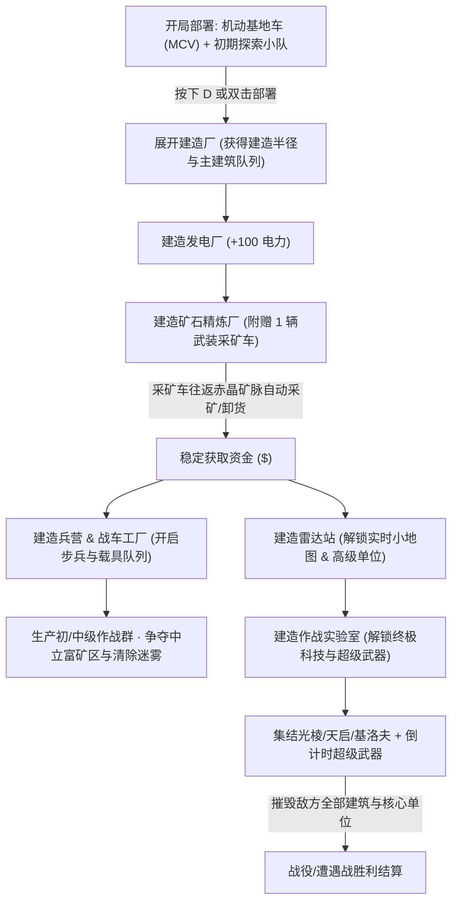

# 《墨陆：赤潮警戒》(Mò Lù: Red Tide Alert) 产品需求文档 (PRD)

- **文档版本**：v1.0
- **项目代号**：`RedAlert3A`
- **作者 / 主创**：墨陆 (`mullvadcat`)
- **技术路线**：零外部资产依赖（Zero-Asset）· 纯代码过程化 WebGL2 + WebAudio · 单文件 HTML5 3D RTS

---

## 1. 文档概述与产品愿景

### 1.1 产品定位
《墨陆：赤潮警戒》是一款运行在现代桌面浏览器中的**全 3D 即时战略（RTS）游戏**，核心玩法深度致敬经典《命令与征服：红色警戒 2》。项目继承自 `3Agame`（《墨陆：暗潮泊位》）验证成功的纯代码过程化引擎，彻底摆脱外部图片、3D 模型与音频文件的下载等待，实现**单 HTML 文件（`< 2 MB`）双击即玩、百单位同屏流畅激战**的复古硬核 RTS 体验。

### 1.2 核心设计支柱
1. **经典红警操控与节奏**：忠实还原右侧建造边栏（Sidebar）、基地辐射范围建筑放置、采矿车自动往返经济、多工厂加速与“电厂-矿场-重工-超武”经典攀科技节奏。
2. **双阵营鲜明不对称博弈**：提供科技感高精打击（光棱/超时空）与重装洪流磁暴（天启/基洛夫/磁暴线圈）两条差异显著的战术路线。
3. **高爽感过程化视听反馈**：利用 WebGL2 后处理 Bloom 与实时粒子表现光棱链式折射、磁暴高压电弧、基洛夫巨型空投炸弹、核弹蘑菇云及狂暴天气闪电风暴，辅以电子工业金属进行曲与 EVA 战术播报。
4. **即开即玩与高度可扩展**：既提供直接开战的“遭遇战（Skirmish）”，也提供衔接前作港区世界观的 3 关精选战役。

### 1.3 目标用户与运行约束
- **目标受众**：《红警 2》/《命令与征服》老玩家、WebGL 3D 独立游戏爱好者、喜欢无需安装随时开一局的 RTS 玩家。
- **平台边界**：桌面端 Chrome / Edge / Safari / Firefox（WebGL2），主交互围绕键鼠左键框选 + 右键指令优化，支持 `1280×720` 至 `4K` 自适应缩放。

---

## 2. 世界观与双阵营设定

### 2.1 时代背景：2040“赤晶”危机
2038 年“墨陆港区四号泊位”事件（前作《墨陆：暗潮泊位》）平息两年后，全球深水港海底裂谷骤然喷涌出兼具超高能量密度与强辐射性的新型结晶矿物——**赤晶矿（Crimson Ore）**与富集变种**紫晶矿（Violet Crystal）**。

围绕赤晶矿的开采权与能源主导权，海上能源联合体分裂为两大军事集团，在北海港口、冰川矿脉与远洋海峡展开全面武装冲突。

### 2.2 双阵营特色设定

| 维度 | 暗潮同盟 (Abyssal Pact · 蔚蓝系) | 赤铁重工 (Crimson Foundry · 赤红系) |
| :--- | :--- | :--- |
| **主题色** | 战术蔚蓝 `#2d7eff` + 冷钢灰 | 工业赤红 `#e83b3b` + 焦炭黑 |
| **战术哲学** | 高机动、精准光棱折射打击、视野压制、远程防空导弹网 | 重装甲集群碾压、高压磁暴区域拒止、巨型空中堡垒 |
| **标志武器体系** | 光棱聚焦光束（溅射折射）、电磁火箭弹、超时空冷冻/传送 | 双联重炮、高压电弧线圈、超重型航空炸弹 |
| **专属明星兵种/建筑** | **光棱坦克**、**光棱塔**、**多功能步兵车**、**天气控制机** | **天启坦克**、**基洛夫空艇**、**磁暴步兵/线圈**、**核弹发射井** |
| **玩家默认代号** | 指挥官 **墨陆 (Mò Lù)** | 指挥官 **墨陆 (Mò Lù)**（可选双阵营视角） |

---

## 3. 核心玩法闭环（Core Gameplay Loop）

### 胜负判定规则
- **胜利条件**：敌方所有带有建造或核心标记的**建筑**及敌方**机动基地车（MCV）**全部被摧毁（可选“必须全歼所有作战单位”开关）。
- **失败条件**：己方全部建筑与 MCV 被摧毁。
- **开局标准状态**：基地车（MCV）1 辆、基础侦察步兵 2 名、初始资金 `$10,000`（可在遭遇战中调整为 `$5,000 / $10,000 / $30,000`）。

---

## 4. 建筑体系与数值设计矩阵

所有建筑必须放置在己方核心建造半径内（建造厂辐射半径 `18 格`，其余友军建筑可提供 `8 格` 二次延伸建造半径；每格边长 `2m`），且占据整格地面，仅可建在平坦可通行陆地上。

### 4.1 基础设施与生产建筑

| 建筑名称 | 阵营归属 | 占地网格 | 造价 ($) | 建造时间 (s) | 电力收支 | 生命值 (HP) | 前置需求 | 核心机制与说明 |
| :--- | :--- | :---: | :---: | :---: | :---: | :---: | :--- | :--- |
| **建造厂 (Construction Yard)** | 通用 | `4 × 4` | 3000 (MCV) | - | `+20` | 2000 | MCV 展开 | 基地核心，提供建筑与防御建造能力及 `18 格` 建造半径 |
| **发电厂 / 磁能反应炉** | 通用 | `2 × 2` | 800 | 8s | `+100` | 800 | 建造厂 | 核心供电建筑，血量越高/受损时按比例降低发电量 |
| **核子反应堆 (Nuclear Reactor)** | 赤铁重工 | `3 × 3` | 1500 | 14s | `+350` | 1000 | 作战实验室 | 超高功率发电，被摧毁时引发半径 `6 格` 核爆溅射伤害 |
| **矿石精炼厂 (Ore Refinery)** | 通用 | `3 × 3` | 2000 | 16s | `-50` | 1200 | 发电厂 | 建造完成自动附赠 1 辆武装采矿车，设卸矿坡道 |
| **兵营 (Barracks)** | 通用 | `2 × 3` | 500 | 6s | `-10` | 900 | 发电厂 | 解锁步兵队列；多座兵营提升步兵生产速度 |
| **战车工厂 (War Factory)** | 通用 | `4 × 3` | 2000 | 18s | `-25` | 1500 | 精炼厂 | 解锁载具与空艇队列，带展开顶门与集结点旗帜 |
| **雷达站 / 空指部 (Radar Tower)** | 通用 | `2 × 2` | 1200 | 12s | `-50` | 850 | 精炼厂 | 通电时激活右下/右上小地图，显示敌我红蓝点与核弹预警 |
| **维修车间 (Service Depot)** | 通用 | `3 × 3` | 1200 | 10s | `-25` | 1000 | 战车工厂 | 友军载具驶入中心停机坪自动按秒扣款快速修复，可建造 MCV |
| **作战实验室 (Battle Lab)** | 通用 | `3 × 3` | 2000 | 20s | `-100` | 1100 | 雷达 + 战车工厂 | 解锁双方终极武器单位（光棱/天启/基洛夫）及超级武器 |

### 4.2 防御建筑与超级武器

| 建筑名称 | 阵营归属 | 占地网格 | 造价 ($) | 建造时间 (s) | 电力收支 | 生命值 (HP) | 射程 (m) | 前置需求 | 战斗特性 |
| :--- | :--- | :---: | :---: | :---: | :---: | :---: | :---: | :--- | :--- |
| **机枪碉堡 / 哨戒炮** | 通用 | `1 × 1` | 500 | 5s | `0` | 600 | 14m | 兵营 | **无需电力**，高射速机枪压制，对无甲步兵极强 |
| **爱国者导弹 / 高射炮** | 通用 | `1 × 1` | 1000 | 8s | `-50` | 700 | 22m | 雷达站 | 仅对空目标开火，高爆破片高效拦截基洛夫空艇 |
| **光棱塔 (Prism Tower)** | 暗潮同盟 | `1 × 1` | 1500 | 14s | `-75` | 650 | 20m | 作战实验室 | 低电断电停机；**协同充能**：附近多座光棱塔可向主塔汇聚光束提升 `150%` 伤害 |
| **磁暴线圈 (Tesla Coil)** | 赤铁重工 | `1 × 1` | 1500 | 14s | `-75` | 750 | 18m | 作战实验室 | 低电断电停机；高爆发单体电弧秒杀轻中甲，**2 名磁暴步兵在旁可为其充能使其低电也能发射** |
| **天气控制机 (Weather Control)** | 暗潮同盟 | `3 × 3` | 5000 | 35s | `-200` | 1500 | 全图 | 作战实验室 | **超级武器**：每 `300s`（测试模式可设 `90s`）就绪一次，对目标区域降下持续 `12s` 的毁灭性闪电风暴 |
| **核弹发射井 (Nuclear Silo)** | 赤铁重工 | `3 × 3` | 5000 | 35s | `-200` | 1500 | 全图 | 作战实验室 | **超级武器**：每 `300s` 就绪一次，发射洲际战术核弹，引发中心秒杀、外圈辐射尘埃的毁灭核爆 |

---

## 5. 单位体系与数值设计矩阵

### 5.1 步兵单位

| 单位名称 | 阵营归属 | 造价 ($) | 耗时 (s) | 移速 (m/s) | HP | 护甲类型 | 单发伤害 / 射速 | 射程 (m) | 前置需求 | 特性与部署技能 |
| :--- | :--- | :---: | :---: | :---: | :---: | :---: | :---: | :---: | :--- | :--- |
| **战术大兵 (GI)** | 暗潮同盟 | 200 | 2.5s | 3.6 | 120 | 无甲 | 15 / 0.35s | 10m | 兵营 | 按 `D` 就地展开沙袋重机枪阵地，射程升至 `15m`、伤害 `24`、获得抗炮减伤 |
| **动员兵 (Conscript)** | 赤铁重工 | 100 | 1.8s | 3.8 | 110 | 无甲 | 12 / 0.4s | 9m | 兵营 | 极其廉价，适合人海推进与吸引光棱/坦克第一轮火力 |
| **防空步兵 (Flak Trooper)** | 通用 | 300 | 3.2s | 3.5 | 140 | 无甲 | 对地 20 / 对空 35 (0.9s) | 15m | 兵营 | 兼顾对空对地破片弹幕，保护早期装甲集群免受空中威胁 |
| **工程师 (Engineer)** | 通用 | 500 | 4.5s | 3.4 | 80 | 无甲 | 无武装 | 1.5m | 兵营 | 进驻敌方建筑可**直接占领归己所有**；进驻受损己方建筑瞬间满血修复 |
| **磁暴步兵 (Tesla Trooper)** | 赤铁重工 | 500 | 5.0s | 3.0 | 220 | 重装步兵 | 65 / 1.4s | 9m | 兵营+雷达 | 发射高能电弧且**无法被坦克碾压**；可为己方磁暴线圈充电增幅 |
| **超时空军团兵 (Chrono)** | 暗潮同盟 | 1500 | 10.0s | 闪现 | 200 | 无甲 | 抹除式冻结 | 14m | 作战实验室 | 点击目标瞬移（距离越远硬直越久），持续照射可将任意载具/建筑从时空抹除 |

### 5.2 装甲载具与空中单位

| 单位名称 | 阵营归属 | 造价 ($) | 耗时 (s) | 移速 (m/s) | HP | 护甲类型 | 单发伤害 / 射速 | 射程 (m) | 前置需求 | 核心战术定位 |
| :--- | :--- | :---: | :---: | :---: | :---: | :---: | :---: | :---: | :--- | :--- |
| **武装采矿车 (Harvester)** | 通用 | 1400 | 10s | 4.2 | 1000 | 重甲 | 自卫机枪 14 (仅反击) | 10m | 精炼厂 | 自动寻矿开采，满载自动返回精炼厂卸矿并增加资金 |
| **灰熊主战坦克 (Grizzly)** | 暗潮同盟 | 700 | 6.5s | 6.2 | 360 | 重甲 | 65 / 1.6s | 15m | 战车工厂 | 机动性强、价格适中的标准主力坦克，可碾压普通步兵 |
| **犀牛主战坦克 (Rhino)** | 赤铁重工 | 900 | 7.5s | 5.4 | 480 | 重甲 | 95 / 1.8s | 16m | 战车工厂 | 正面火炮对轰胜过灰熊，赤铁重工前中期装甲中坚 |
| **多功能步兵车 (IFV)** | 暗潮同盟 | 600 | 5.5s | 8.2 | 260 | 轻甲 | 对地/空导弹 45 (1.2s) | 16m | 战车工厂 | 高速防空导弹车，支持载入步兵改变武器形态（载工程师变维修车） |
| **V3 火箭发射车 (V3)** | 赤铁重工 | 800 | 7.5s | 4.6 | 240 | 轻甲 | 240 (高爆大弹头) / 7s | 34m | 战车工厂+雷达 | 超远距离曲射重型火箭，导弹实体飞行可被防空火力击落 |
| **光棱坦克 (Prism Tank)** | 暗潮同盟 | 1200 | 10.5s | 5.6 | 240 | 轻甲 | 主激光 110 + 5 条折射 (2.2s) | 22m | 作战实验室 | 极远射程激光炮，命中后向周围敌单位与建筑散射高热折射激光，推平集群神兵 |
| **天启坦克 (Apocalypse)** | 赤铁重工 | 1750 | 14s | 4.0 | 950 | 超重甲 | 双联 120mm 炮 `2×85` (1.7s) + 防空导弹 | 18m | 作战实验室 | 陆战终极巨兽，兼具碾压装甲与防空导弹，自带慢速自我修复（晋升后加速） |
| **基洛夫空艇 (Kirov)** | 赤铁重工 | 2000 | 16s | 3.0 (高空) | 2000 | 重型空甲 | 巨型航空炸弹 `350` / 2.2s | 正下方投弹 | 作战实验室 | 全游戏最高血量飞行堡垒，无视地形，全图广播警告，投弹可瞬间摧毁基地 |
| **机动基地车 (MCV)** | 通用 | 3000 | 20s | 3.8 | 1200 | 重甲 | 无武装 | - | 维修车间 | 开局核心，可在平坦区域按 `D` 再次打包/展开扩张分矿基地 |

### 5.3 三级老兵晋升规则（Veterancy）
单位击杀总价值达到自身造价一定倍率后自动晋升：
- **新兵（0 级）**：基础属性。
- **老兵（1 级 · 单杠 ↑，累计击杀价值 ≥ `1.5×` 自身造价）**：伤害 `+20%`、移动速度 `+15%`、视野 `+1` 格。
- **精英（3 级 · 闪耀星 ★，累计击杀价值 ≥ `4.0×` 自身造价）**：伤害 `+45%`、射速提升 `25%`、生命上限 `+25%`、脱离战斗后自动缓速回血、攻击弹道升级为炫目等离子/双联暴击粒子！

---

## 6. 经济、电力与维修/变卖规则

### 6.1 矿产资源系统
- **普通赤晶矿（Red Ore）**：地面发光红橙色矿物晶体簇，单格含矿量 `100`（价值 `$25`/单位采集动作），单辆采矿车满载 `28` 动作即 **`$700`**。
- **富集紫晶矿（Gem / Violet Ore）**：高危高价值紫色矿物，单格采掘收益加倍，单车满载高达 **`$1,400`**。
- **矿柱再生（Ore Drill）**：矿脉中心竖立一座不可摧毁的深海/地下矿柱（Ore Purifier Spawner），每 `10s` 向四周 2 格内随机播撒新的赤晶矿，确保残局不会死锁，鼓励抢占地图中央与高地矿脉。

### 6.2 电力系统三态惩罚
右上/sidebar 左侧的垂直电量槽实时计算 `总发电量` 与 `总耗电量`：
1. **绿电状态（`发电 >= 耗电`）**：所有建筑 100% 效率运转，生产速度为标准值 `1.0x`。
2. **黄电警告（`0.6 <= 发电 / 耗电 < 1.0`）**：
   - 所有生产队列建造速度降至 **`50%`**；
   - **雷达小地图关闭并显示雪花黑屏**；
   - **光棱塔、磁暴线圈断电停机**（除非磁暴线圈旁有磁暴步兵供电），**超级武器停止倒计时**。
3. **红电瘫痪（`发电 / 耗电 < 0.6`）**：生产速度降至 `35%`，全部高耗能设施离线，EVA 循环警示 *“电力不足”*。

### 6.3 维修与变卖工具（Top of Sidebar）
- **维修模式（扳手图标 / 快捷键 `K`）**：点击受损己方建筑开启持续维修特效，每秒恢复 `35 HP` 并按建筑剩余修复比例扣除资金（大约修复满血消耗建筑造价的 `25%`）。再次点击或资金耗尽停止。
- **变卖模式（美元图标 / 快捷键 `X`）**：点击己方建筑触发“倒放拆解动画”，立刻返还该建筑造价的 **`50%`** 资金（建筑剩余血量越低返还按比例递减），并在兵营/建造厂类建筑变卖后免费留下 `1~2` 名基础步兵。

---

## 7. 3D 镜头、操控与经典红警 Sidebar UI 规范

### 7.1 3D 战术镜头规范
- **初始视角**：正南向正北斜向下俯视，俯仰角 `52°`（可调范围 `38° ~ 68°`），视场角 `FOV = 42°`（减少强透视畸变，确保框选矩形精准）。
- **相机移动与缩放**：
  - `W A S D` 或 `方向键`：镜头在 XZ 平面平滑平移。
  - **鼠标边缘滚屏（Edge Panning）**：全屏/指针锁定或边界 `14px` 触发滚屏（支持在设置中开关）。
  - **鼠标中键拖拽**：自由平移地图；`Alt + 中键拖拽` 围绕视线中心旋转/微调水平方位角，`Double-Click 中键` 一键回正北方。
  - **鼠标滚轮**：镜头高度在 `18m`（近距欣赏坦克履带与涂装细节）到 `56m`（宏观战局掌控）之间平滑插值缩放。

### 7.2 操控与快捷键体系

| 操作方式 | 游戏内行为 |
| :--- | :--- |
| **左键单击 / 拖拽拉框** | 选中单个建筑或框选多个作战单位（步兵与载具同时被框选，建筑不参与拉框） |
| **左键双击单位** | 选中当前屏幕视野内**所有同类型**己方单位 |
| **`Shift` + 左键** | 在当前选中集合中加选 / 反选单位 |
| **右键单击地面 / 敌军 / 友军建筑** | 移动指令（地面绿色扩散波纹反馈）；攻击敌方目标（红色锁定十字）；采矿车右键矿区采矿 / 工程师右键建筑进驻 |
| **`A` + 右键/左键（Attack-Move）** | **攻击移动**：单位向目标点推进过程中自动停火拦截沿途射程内的所有敌人 |
| **`S` 键** | 立即停止当前选中单位一切移动与指令 |
| **`D` 键（Deploy）** | 部署：展开 MCV 为建造厂、战术大兵就地架起沙袋、停下当前选中单位展开动作 |
| **`Ctrl + 1~9` / `1~9`** | 建立数字编队 / 召唤编队（`双击数字键` 镜头平滑跳转至该小队中心） |
| **`H` 键 / `Space` 键** | 镜头瞬间回到己方主基地建造厂 / 跳转至最近一处“遭受攻击报警点” |
| **`Q / W / E / R` 或数字小键盘** | 切换右侧 Sidebar 四大建造页签；在选定建筑模型后按左键放置在有效绿格上，右键取消建造/放置 |

### 7.3 经典红警右侧边栏（Sidebar）布局规范

屏幕右侧固定保留宽度为 `200px` 的深钢工业风战术侧边栏（主战场占左侧剩余视口）：
1. **顶部资金读数栏**：大号琥珀色等宽字体动态数字跳字滚动（如 `$10,000`），金钱变动伴随清脆机械翻牌声。
2. **战术雷达小地图（Minimap `180×180px`）**：
   - 未通电/无雷达时显示深海波纹静态扫描线；有雷达且电力充足时实时渲染地形等高线、红橙矿区、己方蔚蓝点、敌方赤红点及迷雾阴影。
   - **支持交互**：左键点击或拖拽小地图立刻跳转主镜头；右键点击小地图可直接对选中部队下达远距离行军指令。
3. **全局功能按钮条**：`[维修 🔧]` `[变卖 💲]` `[选项 ⚙️]`（居中三联按钮，选中状态高亮边框）。
4. **纵向彩色电力槽（Sidebar 左侧边缘）**：实时对比发电容量与当前耗电刻度条（绿色高亮 → 黄色警告 → 红色闪烁）。
5. **四分类建造页签（Tab 栏）**：
   - **页签 1 · 主建筑（建造厂）**：电厂、核反应堆、精炼厂、兵营、战车工厂、雷达、维修厂、高科实验室。
   - **页签 2 · 防御（防卫设施）**：碉堡、防空炮、光棱塔/磁暴线圈、超级武器。
   - **页签 3 · 步兵（兵营）**：大兵/动员兵、防空步兵、工程师、磁暴/超时空兵。
   - **页签 4 · 载具（战车工厂）**：采矿车、灰熊/犀牛、IFV/V3、光棱/天启、基洛夫、MCV。
6. **双列建造图标网格**：
   - 每个图标由 Canvas 2D 实时绘制等轴侧/正侧高对比度简图 + 中文简称 + 左下角造价；
   - 点击左键开始生产（支持点击叠加队列最多 `99`，右键暂停一次/再次取消并全额退款）；
   - 建造中显示半透明顺时针**扇形倒计时遮罩**与进度百分比；建筑完成后闪烁 **“已就绪 (READY)”** 高亮提示，点击后鼠标变为带格子投影的建筑放置虚影。

---

## 8. 游戏模式：遭遇战（Skirmish）与战役关卡

### 8.1 遭遇战（自由定制单人对抗）
玩家可自由配置并立即开局：
- **可选阵营**：暗潮同盟 vs 赤铁重工（支持同阵营内战）。
- **AI 难度**：
  - *新兵 AI*：慢速采矿，仅建造基础兵种与少量防御，不造超级武器。
  - *标准 AI*：完整攀科技造矿车，周期性组织混编装甲波次进攻，建造防空与光棱/磁暴防线。
  - *冷酷 AI*：多线扩张分矿，针对玩家兵种动态调整配方（玩家暴基洛夫则多补防空），并启用核弹/闪电风暴倒计时威胁。
- **首发 3 张战术地图（均为 `128×128` 网格，`256m×256m`）**：
  1. **四号泊位工业区**：平坦对称港区赛道，两侧各 1 片赤晶主矿 + 中央集装箱通道富矿。
  2. **冰川裂谷双矿**：天然海湾隔断陆路，仅靠东西两座宽桥相连，适合桥头堡卡点与基洛夫跨海空袭。
  3. **赤潮环形山**：四向开阔高台与中心超大紫晶富矿群，快节奏装甲集群绞肉机。

### 8.2 微型战役（3 关精选剧情，承接前作《墨陆：暗潮泊位》）
1. **第一关：暗潮登陆（抢滩立足）**：指挥官墨陆率领先遣 MCV 登陆被赤铁AI残余占据的工业码头，必须在 10 分钟顶住骚扰完成矿场与重工防线建设并清剿敌军前哨。
2. **第二关：断脉矿区（后勤与科技对决）**：争夺岛屿中央富集紫晶矿，抵御敌方 V3 与犀牛装甲集群多路夹击，修复占领中立雷达并首次解锁光棱坦克反推。
3. **第三关：赤潮终局（超武倒计时）**：敌方已建立双重磁暴防线并在地图角落部署核弹发射井（12 分钟倒计时启动），玩家必须顶住天启与基洛夫攻势完成决战清零。

---

## 9. 非功能性需求与性能验收指标（KPI）

| 指标类别 | 目标要求 | 验证手段 |
| :--- | :--- | :--- |
| **产物体积与依赖** | **0 外部网络/文件请求**；最终单文件 HTML 总大小 `< 2.0 MB`（目标 ~`1.5 - 1.8 MB`） | `node scripts/build.mjs --check` & 无断网离线打开检查 |
| **冷启动时长** | 桌面端现代浏览器从点击到进入主菜单 `< 2.5 秒`（WebAudio 生成需异步分片不卡死 UI） | Boot 加载进度条计时 & `performance.now()` |
| **同屏帧率基准** | `1080p` 分辨率下，同屏 **200 个活跃单位 + 满矿区 + 战争迷雾 + 开火特效** 保持 `>= 60 FPS`（低性能集显至少 `>= 45 FPS`） | 内置 `?bench=1` 自动大混战 30 秒压测 |
| **内存与显存控制** | 连续游戏 30 分钟无明显 GC 卡顿与 WebGL Buffer/Mesh 内存泄漏（弹孔/粒子/抛壳均使用固定池循环） | Chrome DevTools Heap Snapshot 对比 |
| **可调试性与展厅** | 保留 `?show=units` / `?show=buildings` / `?show=fx` / `?nofog=1` / `?fastbuild=1` 等 URL 参数便于研发与验收 | 启动参数解析单元测试与实机截图 |
