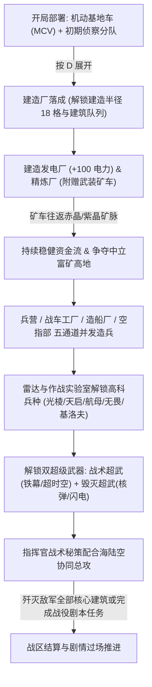
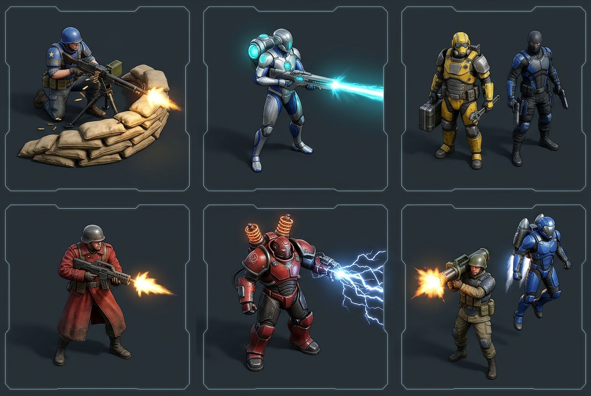
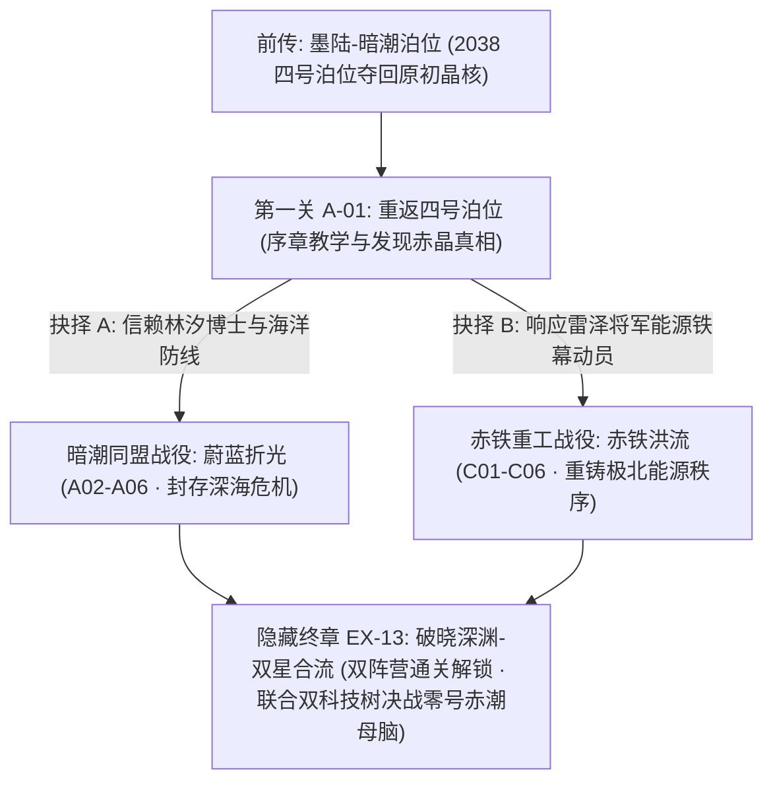

# 《墨陆：赤潮警戒》(Mò Lù: Red Tide Alert) 产品需求文档 (PRD v2.1)

- **文档版本**：v2.1（架构评审修订定稿 · 全陆海空平衡 · 完整操控与 12+1 关战役版）
- **项目代号**：`RedAlert3A`
- **作者 / 主创**：墨陆 (`mullvadcat`)
- **技术路线**：高画质模块化 WebGL2 PBR 渲染 + 程序化/glTF 混合精细多部件高模 + 交响化电子配乐与全剧情过场演出（**不设 `< 2 MB` 单文件体积上限**，优先保证画质、战局平衡、玩法深度与故事沉浸感）

---

## 1. 文档概述与产品愿景

### 1.1 产品定位（v2.1 正式标准）
《墨陆：赤潮警戒》是一款立足现代桌面浏览器的**次世代高画质全 3D 即时战略（RTS）大作**，在玩法上深度致敬经典《命令与征服：红色警戒 2》。

本作摒弃早期“单文件 `< 2 MB`”的人为压缩束缚，全面确立 **“视觉品质与内容深度优先”** 的设计准绳：
- 支持高分辨率 PBR 法线/金属度/粗糙度/环境遮蔽贴图集（`2K` 程序化 GPU 烘焙 + 可选 KTX2/glTF 高模流式加载）、物理真实海浪与动态天气系统；
- 接入多轨动态工业金属交响音轨、高采样炮火爆炸音效库、角色立绘与双语战术配音及局内电影化过场剧本演出；
- 打造真正拥有**陆海空三栖平衡对抗**、**4 种终极与战术超级武器**、**三级老兵晋升与经典键鼠微操**、以及 **12 关双线 + 1 关合流终局（12+1 关）完整剧情战役**的精品级 WebGL2 3D RTS 体验。

### 1.2 核心设计支柱
1. **3A 质感复古硬核 RTS 体验**：忠实还原经典《红警》右侧战术边栏（Sidebar）、建造半径扩展、采矿车自动往返经济、多厂加速与高能攻防拉锯。
2. **陆·海·空全维度平衡博弈**：双阵营在制海权（航空母舰/神盾 vs 无畏战列舰/台风潜艇/赤蝎防空艇）与制空权（风暴鹰 vs 赤刃攻击机/基洛夫）形成完整反制闭环，消除任何单维度无解死角。
3. **双超级武器与指挥官战术秘策**：每一阵营同时拥有“**战术型超武**（超时空传送仪 / 铁幕装置）”与“**毁灭型超武**（天气控制机 / 核弹发射井）”，配合 4 项主动冷却的**指挥官秘策**提升微操翻盘空间。
4. **有血有肉的连续长篇战役剧情**：直接承接前作《墨陆：暗潮泊位》(`3Agame`) 的世界观伏笔，主角**指挥官墨陆**在第一关《重返四号泊位》触发命运分歧，演绎同盟与赤铁各 6 关剧本，并在双线通关后解锁联合执掌双科技树的第 13 关终局大战！

### 1.3 运行环境与画质分级
- **目标平台**：桌面端 Chrome / Edge / Safari / Firefox（WebGL2 + WebAudio + IndexedDB 战役进度与局内检查点存档），支持离线静态部署与可选桌面端封装。
- **三档画质预设**：
  - **极致影视档（Ultra）**：4K/1440p 原生分辨率、4 级联软阴影（CSM）、GTAO 环境光遮蔽、物理海浪反射、多阶段建筑坍塌残骸、2K PBR 纹理、AgX HDR Bloom。
  - **高清竞技档（High · 默认）**：`1080p` 稳定 `60 FPS`，完整开启 CSM 阴影、战争迷雾体积过渡、全量粒子与动态光效。
  - **轻量流畅档（Balanced）**：适配集显与轻薄本，保持清晰 PBR 着色、简化海浪波数与粒子上限，保障战斗帧率流畅。

---

## 2. 世界观剧本、时代背景与核心角色

### 2.1 世界观背景：从“四号泊位”到“2040 赤潮危机”
> *“那晚我在四号泊位夺回的不只是实验样本，而是撬动整颗星球能源格局的第一块多米诺骨牌。”* —— 墨陆战地日志

- **2038 年（前作《墨陆：暗潮泊位》事件）**：在深水货轮“墨陆远洋号”沉寂的港区夜色中，特遣干员**墨陆 (Mò Lù)** 成功突围并带出了沉海集装箱内的未知高能晶体核心。
- **2040 年（赤晶涌现与分裂）**：受深海地壳异常共振影响，全球海底裂谷与极地矿区同时喷涌出极具高能量密度且呈现“受刺激自增殖”特性的神秘矿物——**赤晶矿（Crimson Ore）**与更高纯度的**紫晶矿（Violet Crystal）**。人类能源联合体彻底破裂，分裂为理念水火不容的两大军事集团：
  - **暗潮同盟 (Abyssal Pact · 蔚蓝 `#2d7eff`)**：由原海洋科考与沿海防御联盟改组，主张以光学棱镜聚焦技术、时空量子折跃与大气干涉武器封控深海晶矿。
  - **赤铁重工 (Crimson Foundry · 赤红 `#e83b3b`)**：由北方极寒重工业联合体与矿业军团整合，奉行重装甲饱和洪流、高能特斯拉磁暴防线与战术核威慑，主张彻底开采并掌控所有赤晶矿脉。

### 2.2 核心角色群像（含战役过场语音演出）

| 角色姓名 / 代号 | 所属阵营 | 职务与身份 | 性格与剧情弧光 |
| :--- | :---: | :--- | :--- |
| **指挥官 墨陆 (Mò Lù)** | 双阵营主角视角 | 前港区特遣王牌 / 现前线战区最高野战指挥官 | 冷静果决、擅长以少胜多的机动奇袭。A-01 后因抉择分道扬镳：同盟线代表深海解密与克制控场；赤铁线展现能源危局中铁腕重铸秩序的枭雄一面，最终于第 13 关统合双线 |
| **林汐博士 (Dr. Lin Xi)** | 暗潮同盟 | 深海量子物理学家、四号泊位晶体最初解码者 | 理性克制却背负秘密。早在 2038 年便侦测到赤晶矿底部连通着名为 **“零号赤潮 (Abyss-0)”** 的史前地核生物电网络，与墨陆合力探寻封印之道 |
| **雷泽将军 (Gen. Viktor Reznikov)** | 赤铁重工 | 北方重装集团军总司令、天启与铁幕计划督造者 | 强硬傲慢的钢铁军阀信徒，坚信唯有绝对的重炮、潜艇群与核威慑才能阻止文明因能源枯竭而内爆 |
| **EVA-09 / “女武神”** | 通用战术中枢 | 战区 AI 副官系统（同盟版“林音” / 赤铁版“红星”） | 全程提供语音播报、敌情预警、过场简报与战役紧急决策选项 |
| **“零号赤潮” (Abyss-0)** | 隐藏终极威胁 | 沉睡于马里亚纳裂谷的古晶体母脑网络 | 剧情后半段重大反转：所有赤晶矿都是它唤醒地表的能量触须；第 13 关彻底浮出海面企图同化地表一切机械单位 |

---

## 3. 核心玩法闭环与胜负规则

### 胜负与特殊占领规则
- **标准胜利条件**：敌方所有建筑与所有机动基地车（MCV）全部被摧毁（可选开启“必须全歼所有可攻击单位”）。
- **开局标准状态**：机动基地车 `1` 辆 + 初期侦察步兵 `2` 名，标准初始资金 `` `$10,000` ``（遭遇战大厅可选 `` `$5,000 / $10,000 / $30,000` ``）。
- **中立战略建筑占领**：地图分布可被**战地工程师**进驻占领的中立建筑：
  - **科技钻油井**：占领后立刻奖励 `` `$500` ``，此后每 `4s` 稳定产出 `` `$40` `` 被动资金；
  - **科技机场**：解锁“空降伞兵支援”指挥官秘策与额外空军维护加血效果；
  - **战地医疗站**：自动为半径 `10m` 内的己方步兵持续恢复生命值。

---

## 4. 完整陆海空武器与兵种图鉴及数值矩阵

### 4.1 暗潮同盟（Abyssal Pact）主力装甲与海空兵种图鉴

### 4.2 赤铁重工（Crimson Foundry）重装洪流、空艇与海军舰队图鉴

### 4.3 特种步兵军团（六宫格展示全 8 大核心步兵与单兵武器）

### 4.4 步兵单位数值矩阵（共 9 种 · 含双阵营英雄级特种兵）

| 单位名称 | 阵营 | 造价 | 耗时 | 移速 | HP | 护甲 | 伤害 / 射速 | 射程 | 前置需求 | 特性与部署技能 |
| :--- | :---: | :---: | :---: | :---: | :---: | :---: | :---: | :---: | :--- | :--- |
| **战术大兵 (GI)** | 暗潮同盟 | `` `$200` `` | `2.5s` | `3.6` | `120` | 无甲 | `16` / `0.35s` | `10m` | 兵营 | 按 `D` 展开沙袋重机枪阵地，射程升至 `15m`、伤害 `26` 并获得抗碾压与火炮减伤 |
| **动员兵 (Conscript)** | 赤铁重工 | `` `$100` `` | `1.8s` | `3.8` | `110` | 无甲 | `12` / `0.40s` | `9m` | 兵营 | 极其廉价的人海前锋，适合占领城市中立建筑与吸纳敌方第一轮火力 |
| **防空步兵 (Flak Trooper)** | 通用 | `` `$300` `` | `3.2s` | `3.5` | `140` | 无甲 | 地 `20` / 空 `38` | `15m` | 兵营 | 破片防空高炮兼顾对地压制，成本低廉的早期陆空双防中坚 |
| **战地工程师 (Engineer)** | 通用 | `` `$500` `` | `4.5s` | `3.4` | `85` | 无甲 | 无武装 | `1.5m` | 兵营 | **直接占领敌方完整或受损建筑**、占领科技油井、修理断桥或瞬间满血修复受损友军建筑 |
| **火箭飞行兵 (Rocketeer)** | 暗潮同盟 | `` `$600` `` | `5.0s` | `7.2` (高空) | `150` | 空甲 | `22` / `0.45s` | `13m` | 兵营+空指部 | 单兵喷射背包无视地形峡谷与水面巡航，高空机动骚扰矿车与狙杀无防空部队 |
| **磁暴步兵 (Tesla Trooper)** | 赤铁重工 | `` `$500` `` | `5.0s` | `3.0` | `240` | 重装步兵 | `68` / `1.4s` | `9m` | 兵营+雷达 | **不可被坦克碾压**；高压电弧秒杀常规步兵，2 名贴身可令断电磁暴线圈继续开火 |
| **超时空军团兵 (Chrono)** | 暗潮同盟 | `` `$1,500` `` | `10s` | 瞬移 | `200` | 无甲 | 空间抹除 | `14m` | 作战实验室 | 全图可见点瞬移（按距离计算空间硬直），持续冻结并在数秒后彻底抹除目标单位/建筑 |
| **同盟特种兵“幽影” (Shadow)** | 暗潮同盟 (限 1) | `` `$1,800` `` | `12s` | `5.0` | `420` | 重装步兵 | 双枪 `120` / 瞬爆 C4 | `13m` | 作战实验室 | 极速半自动双枪秒杀所有步兵，贴身埋设 C4 瞬间爆破任意建筑与海军战舰，**可两栖游泳** |
| **赤铁爆破王“重锤” (Sledge)** | 赤铁重工 (限 1) | `` `$1,800` `` | `12s` | `4.5` | `480` | 重装步兵 | 重狙 `150` / 反甲爆破筒 | `16m` | 作战实验室 | 抗碾压重装步兵甲，超远距重狙点杀敌步兵，重型破甲爆破筒高效拆解敌坦克与高科建筑 |

### 4.5 陆军载具、空军战机与海军战舰数值矩阵

#### 陆军装甲载具（共 8 种）

| 单位名称 | 阵营 | 造价 | 耗时 | 移速 | HP | 护甲 | 主炮/武器性能 | 射程 | 前置需求 | 战术定位 |
| :--- | :---: | :---: | :---: | :---: | :---: | :---: | :--- | :---: | :--- | :--- |
| **武装采矿车** | 通用 | `` `$1,400` `` | `10s` | `4.2` | `1050` | 重甲 | 自卫机枪 `14` | `10m` | 精炼厂 | 自动寻矿开采，满载自动返回卸矿；同盟版在高科建成后解锁采完瞬间超时空折跃返厂 |
| **灰熊主战坦克** | 暗潮同盟 | `` `$700` `` | `6.5s` | `6.4` | `370` | 重甲 | `105mm` 炮 `68` / `1.6s` | `15m` | 战车工厂 | 高机动包抄与集群穿插，配合光棱突破防线 |
| **犀牛主战坦克** | 赤铁重工 | `` `$900` `` | `7.5s` | `5.4` | `490` | 重甲 | `120mm` 炮 `98` / `1.8s` | `16m` | 战车工厂 | 正面抗伤与火力对轰胜过灰熊，赤铁装甲绝对基石 |
| **多功能步兵车 (IFV)** | 暗潮同盟 | `` `$600` `` | `5.5s` | `8.4` | `260` | 轻甲 | 导弹 `48` / `1.2s` | `16m` | 战车工厂 | 对空/对地极速防空车；载步兵变形（工程师=维修车，大兵=重机枪车，军团兵=光束抹除车） |
| **V3 火箭发射车** | 赤铁重工 | `` `$800` `` | `7.5s` | `4.6` | `240` | 轻甲 | 战术弹道火箭 `260` / `7s` | `34m` | 重工+雷达 | 超视距抛射攻城火箭，飞弹可被爱国者/神盾防空拦截 |
| **光棱坦克 (Prism Tank)** | 暗潮同盟 | `` `$1,200` `` | `10.5s` | `5.6` | `250` | 轻甲 | 激光 `115` + 5 折射线 | `22m` | 作战实验室 | 极远射程群伤拆建神器，需重坦在前线充当肉盾掩护 |
| **天启坦克 (Apocalypse)** | 赤铁重工 | `` `$1,750` `` | `14s` | `4.0` | `980` | 超重甲 | 双 `120mm` (`2×88`) + 对空导弹 | `18m` | 作战实验室 | 全地形碾压霸主，陆空全能且具备脱离战斗慢速自我修复 |
| **机动基地车 (MCV)** | 通用 | `` `$3,000` `` | `20s` | `3.8` | `1300` | 重甲 | 无武装 | - | 维修车间 | 按 `D` 展开/打包移动分矿扩展 |

#### 空军战机与空中堡垒（共 4 种 · 双阵营制空闭环）

| 单位名称 | 阵营 | 造价 | 耗时 | 移速 | HP | 护甲 | 武器与挂载 | 射程 | 前置需求 | 战术定位 |
| :--- | :---: | :---: | :---: | :---: | :---: | :---: | :--- | :---: | :--- | :--- |
| **夜鹰运输直升机 (Nighthawk)** | 通用 | `` `$1,000` `` | `8s` | `7.8` | `380` | 空甲 | 自卫机炮 + 容纳 `5` 名步兵 | `10m` | 战车工厂+雷达 | **在敌方标准雷达上隐身**，适合搭载工程师/幽影/重锤秘密空降偷袭后方建筑 |
| **风暴鹰攻击机 (Stormhawk)** | 暗潮同盟 | `` `$1,200` `` | `10s` | `13.0` | `310` | 空甲 | 4 枚高精穿甲制导航弹（总 `300`） | `18m` | 空指部（停机坪×4） | 高速俯冲精准定点摧毁重坦、V3 与电厂，投弹后自动返航停机坪补弹 |
| **赤刃重型攻击机 (Crimson MiG)** | 赤铁重工 | `` `$1,200` `` | `10s` | `11.5` | `380` | 空甲 | 2 发高爆燃油航弹（半径 `5m` 持续燃烧溅射 `320`） | `18m` | 空指部（停机坪×4） | 弥补赤铁空指部停机坪战机空缺，擅长俯冲轰炸光棱阵与集群步兵线 |
| **基洛夫空艇 (Kirov)** | 赤铁重工 | `` `$2,000` `` | `16s` | `3.0` | `2000` | 重型空甲 | 无限量重型高爆航弹 `360` / `2.2s` | 正下方 | 战车工厂+高科 | 出厂触发全图低沉号角警告，摧毁力极强，需神盾与火箭飞行兵联合拦截 |

#### 海军舰船体系（共 7 种 · 造船厂生产 · 制海防空闭环）

| 单位名称 | 阵营 | 造价 | 耗时 | 移速 | HP | 护甲 | 武器与弹药 | 射程 | 前置需求 | 战术定位 |
| :--- | :---: | :---: | :---: | :---: | :---: | :---: | :--- | :---: | :--- | :--- |
| **两栖气垫运输艇** | 通用 | `` `$900` `` | `7s` | `6.5` | `450` | 轻甲 | 无（可装载 `12` 格单位/多辆坦克） | - | 造船厂 | 水陆两栖无缝登陆抢滩核心载具 |
| **海豚声呐艇 (Dolphin)** | 暗潮同盟 | `` `$500` `` | `5s` | `9.5` | `260` | 轻甲 | 高频声呐脉冲炮 `55` / `1.4s`（对潜特攻 `150%`） | `13m` | 造船厂 | 同盟高速反潜侦察主力，声呐主动显影潜伏中的台风攻击潜艇 |
| **赤蝎防空炮艇 (Sea Scorpion)** | 赤铁重工 | `` `$600` `` | `5.5s` | `8.8` | `360` | 轻甲 | 对空四联速射高炮 `45` / `0.5s` + 舰炮 `32` | `18m` (空) / `12m` (海) | 造船厂 | **解决赤铁海军防空缺口**：护航无畏舰队高效拦截风暴鹰、火箭飞行兵与航母舰载机，并附带声呐近距反潜 |
| **神盾防空巡洋舰 (Aegis)** | 暗潮同盟 | `` `$1,200` `` | `9s` | `5.8` | `750` | 重甲 | 垂直连发防空导弹（对空 DPS 极高） | `28m` | 造船厂+雷达 | 全图制空绝对天敌，5 秒内击落基洛夫空艇与赤刃攻击机 |
| **台风攻击潜艇 (Typhoon)** | 赤铁重工 | `` `$1,000` `` | `8s` | `5.2` | `580` | 重甲 | 重型反舰直航鱼雷 `140` / `2.6s` | `14m` | 造船厂+雷达 | 静止或巡航时**深潜隐形**，开火时短暂上浮露出潜望塔，专为猎杀航母与神盾而生 |
| **暗潮航空母舰 (Carrier)** | 暗潮同盟 | `` `$2,000` `` | `16s` | `3.6` | `1300` | 超重甲 | `4` 架自动无人/舰载轰炸机编队 | `38m` | 造船厂+作战实验室 | 超视距空袭海上霸主，机库自动修复与重新制造损毁舰载机 |
| **无畏级战列舰 (Dreadnought)** | 赤铁重工 | `` `$2,000` `` | `16s` | `3.5` | `1400` | 超重甲 | 双联超远程巡航导弹 `2×180` / `5.5s` | `40m` | 造船厂+作战实验室 | 隔海夷平内陆基地的终极炮舰，每次齐射两枚巨大巡航导弹（高爆大溅射） |

### 4.6 三级老兵晋升规则（Veterancy）
单位累计击杀敌方单位与建筑总造价达到自身造价一定倍率后自动晋升：
- **0 级 · 新兵**：基础面板属性。
- **1 级 · 老兵（单杠 `↑` · 累计击杀价值 ≥ `1.5×` 自身造价）**：武器伤害 **`+20%`**、移动速度 **`+15%`**、视野半径 **`+2m`**、护甲抗性微幅提升。
- **3 级 · 精英（闪耀星 `★` · 累计击杀价值 ≥ `4.0×` 自身造价）**：武器伤害 **`+45%`**、射速提升 **`25%`**、生命上限 **`+25%`**、**脱离战斗 4 秒后自动缓速回血**，攻击弹道与激光颜色升级为炫目黄金等离子/双联暴击粒子！

---

## 5. 建筑、防御塔与双超级武器矩阵

所有陆地建筑必须在己方建造厂（`18 格`）或其余友军建筑（`8 格`）辐射半径内放置；**造船厂**允许在“任一格紧邻/落入陆地延伸建造半径内的可通航海岸/水域”上放置。

### 5.1 基地与功能生产建筑（完整拆解表）

| 建筑名称 | 阵营 | 占地网格 | 造价 | 耗时 | 电力 | HP | 前置需求 | 核心作用 |
| :--- | :---: | :---: | :---: | :---: | :---: | :---: | :--- | :--- |
| **建造厂 (Construction Yard)** | 通用 | `4×4` | `3000 (MCV)` | - | `+20` | `2400` | MCV 按 `D` 展开 | 基地心脏，辐射 `18` 格建造半径，开启主建筑与防御队列 |
| **发电厂 / 磁能反应炉** | 通用 | `2×2` | `` `$800` `` | `8s` | `+100` | `850` | 建造厂 | 基础供电中心；血量受损时按比例降低发电功率 |
| **核子反应堆 (Nuclear Reactor)** | 赤铁重工 | `3×3` | `` `$1,500` `` | `14s` | `+350` | `1100` | 作战实验室 | 高效巨型发电站；被摧毁时引发高杀伤辐射爆炸并波及周边单位 |
| **矿石精炼厂 (Ore Refinery)** | 通用 | `3×3` | `` `$2,000` `` | `16s` | `-50` | `1300` | 发电厂 | 建成立刻附赠 `1` 辆武装采矿车，设卸矿坡道自动结算资金 |
| **兵营 (Barracks)** | 通用 | `2×3` | `` `$500` `` | `6s` | `-10` | `900` | 发电厂 | 开启步兵生产队列；多座兵营协同提高步兵生产速度 |
| **战车工厂 (War Factory)** | 通用 | `4×3` | `` `$2,000` `` | `18s` | `-25` | `1500` | 矿石精炼厂 | 开启陆军装甲载具生产队列（同盟/赤铁外观不同）；带开启顶盖与集结旗帜 |
| **造船厂 (Naval Yard)** | 通用 | `4×4` (水域) | `` `$1,000` `` | `12s` | `-30` | `1600` | 发电厂+海边建造范围 | 建于近岸水域，开启海军潜艇/巡洋/航母/战列舰生产队列并在船坞内自动维修损伤船只 |
| **空指部 / 雷达站 (Airforce & Radar)** | 通用 | `2×3` | `` `$1,200` `` | `12s` | `-50` | `900` | 矿石精炼厂 | 激活右上角实时小地图雷达、提供 `4` 个风暴鹰/赤刃攻击机停机坪、解锁高科分支 |
| **维修车间 (Service Depot)** | 通用 | `3×3` | `` `$1,200` `` | `10s` | `-25` | `1000` | 战车工厂 | 载具驶入中心停机坪自动按秒扣费极速修复，并作为生产 MCV 的前置条件 |
| **作战实验室 (Battle Lab)** | 通用 | `3×3` | `` `$2,000` `` | `20s` | `-100` | `1200` | 空指部/雷达+战车工厂 | 解锁终极武器兵种（光棱/天启/基洛夫/航母/无畏）与四大超级武器 |

### 5.2 阵地防御与“双超级武器”系统（每阵营 2 种超武）

| 建筑名称 | 阵营 | 类型 | 占地网格 | 造价 | 耗时 | 电力 | HP | 射程 / 冷却 | 前置需求 | 核心机制 |
| :--- | :---: | :---: | :---: | :---: | :---: | :---: | :---: | :---: | :--- | :--- |
| **机枪碉堡 / 哨戒炮** | 通用 | 无需电力防御 | `1×1` | `` `$500` `` | `5s` | `0` | `600` | `14m` | 兵营 | 无惧全基地停电，高效绞杀前期步兵与工兵偷袭 |
| **爱国者导弹 / 高射炮** | 通用 | 对空防御塔 | `1×1` | `` `$1,000` `` | `8s` | `-50` | `700` | `24m` | 空指部/雷达 | 专职防空，拦截战机、火箭飞行兵、V3 火箭与基洛夫 |
| **光棱塔 (Prism Tower)** | 暗潮同盟 | 高科激光塔 | `1×1` | `` `$1,500` `` | `14s` | `-75` | `650` | `22m` | 作战实验室 | 低电停机；相邻多座光棱塔可向主塔汇聚光束使伤害最高增幅至 `300%` |
| **磁暴线圈 (Tesla Coil)** | 赤铁重工 | 高科电弧塔 | `1×1` | `` `$1,500` `` | `14s` | `-75` | `750` | `19m` | 作战实验室 | 超高单体电击秒杀坦克；**2 名磁暴步兵贴身充能可无视全基地停电强行开火** |
| **超时空传送仪 (Chrono Sphere)** | 暗潮同盟 | **战术超武** | `3×3` | `` `$2,500` `` | `22s` | `-200` | `1200` | 全图 / `210s` | 作战实验室 | 将 `3×3` 格内的己方光棱/灰熊坦克直接瞬移至敌后核心（注意步兵会被时空抹除） |
| **铁幕装置 (Iron Curtain)** | 赤铁重工 | **战术超武** | `3×3` | `` `$2,500` `` | `22s` | `-200` | `1200` | 全图 / `210s` | 作战实验室 | 赋予 `3×3` 格内的己方天启/犀牛/基洛夫长达 **`15 秒` 的绝对无敌护盾**（步兵触碰即死） |
| **天气控制机 (Weather Control)** | 暗潮同盟 | **终极超武** | `3×3` | `` `$5,000` `` | `35s` | `-200` | `1500` | 全图 / `300s` | 作战实验室 | 召唤覆盖 `18m` 半径的深蓝紫色雷暴乌云旋涡，持续 `12s` 随机劈下 `18` 道毁灭闪电 |
| **核弹发射井 (Nuclear Silo)** | 赤铁重工 | **终极超武** | `3×3` | `` `$5,000` `` | `35s` | `-200` | `1500` | 全图 / `300s` | 作战实验室 | 全图发射核弹并全图警报倒计时；中心核爆直接汽化建造厂，残留 `30s` 高辐射污染区 |

### 5.3 指挥官战术秘策（Commander Doctrines · 快捷键 `F1~F4`）
- **`F1` 侦察卫星瞬扫**（冷却 `60s`）：临时驱散目标 `20m` 半径战争迷雾 `15s` 并显影隐形潜艇与夜鹰运输机。
- **`F2` 空降伞兵支援**（占领科技机场或空指部建成开启，冷却 `90s`）：呼唤运输机空降 `6` 名战术大兵 / `8` 名动员兵奇袭侧翼。
- **`F3` 战区紧急维修波**（高科解锁，冷却 `120s`）：对半径 `12m` 内己方装甲部队与船只释放纳米修复云雾，瞬间恢复 `35%` 生命值。
- **`F4` 电磁脉冲轰炸（EMP）**（高科解锁，冷却 `150s`）：令半径 `12m` 内机械载具与敌方防御塔陷入 `8s` 瘫痪停机，克制冲锋期天启或辅助拆解光棱阵。

---

## 6. 经济、3D 镜头操控、快捷键与 Sidebar UI 规范

### 6.1 经济与电力规则
- **双色晶矿再生**：**赤晶矿（单车满载 `` `$700` ``）** 与 **高纯度紫晶矿（单车满载 `` `$1,400` ``）**，关键矿区设再生矿柱防止残局枯竭。
- **电力三态**：绿电 `100%` 正常运转 → 黄电（`0.6 <= 发电/耗电 < 1.0`）建造速度降至 `50%` 且高科防御塔/雷达/超武停机 → 红电（`< 0.6`）建造降至 `35%` 并触发 EVA 语音告警。
- **维修（`K`）与变卖（`X`）**：维修按每秒恢复 `35 HP` 比例扣款；变卖播“倒放拆解动画”返还 `50%` 残值资金并随机留下 `1~2` 名基础步兵。

### 6.2 3D 战术镜头与完整快捷键映射
- **相机参数**：默认正南向正北斜向下俯视，俯仰角 `52°`（可调范围 `38°~68°`），`FOV = 42°`；支持鼠标滚轮在 `14m`（近距欣赏坦克机械涂装与战损）至 `80m`（海陆空大局观战）间平滑缩放；支持 `W/A/S/D`、方向键、边界 `14px` 边缘滚屏、中键拖拽平移及 `Alt + 中键` 水平旋转（双击中键一键回正北方）。

| 操作 / 快捷键 | 游戏内行为 |
| :--- | :--- |
| **左键单击 / 拖拽拉框** | 选中单个建筑/单位，或框选多个战斗单位（可跨兵种同时框选） |
| **左键双击单位** | 快速选中屏幕视野内**所有同类型**己方单位 |
| **`Shift + 左键`** | 在当前选中集合中加选或反选指定单位 |
| **右键单击地面 / 敌军 / 友军建筑** | 移动指令（绿色扩散波纹）；攻击锁定（红色准星）；采矿车指定矿点 / 工程师占领与维修 / IFV 与运输艇装载 |
| **`A` + 右键/左键（Attack-Move）** | **攻击移动**：队伍推进沿途自动停火歼灭一切射程内敌人 |
| **`D` 键（Deploy）** | 部署：展开/打包 MCV、战术大兵就地架起沙袋机枪阵地、运输艇/IFV 全部卸载内部步兵坦克 |
| **`S` 键** | 立即停止当前选中单位一切移动与攻击队列 |
| **`K` / `X` 键** | 切换全局 **维修模式**（扳手图标）/ **变卖模式**（美元图标） |
| **`Ctrl + 1~9` / `1~9` / 双击 `1~9`** | 创建数字编队 / 选中编队 / 镜头平滑跳转至该小队中心 |
| **`H` / `Space`** | 瞬间回到己方主基地建造厂 / 跳转至最近一处“遭受攻击或超武报警”发生地 |
| **`Q / W / E / R / T` 或 `F1~F4`** | 切换右侧 5 大建造页签（主建筑/防御超武/步兵/陆军/海空军）/ 触发 4 项指挥官战术秘策 |

### 6.3 经典右侧 Sidebar 布局规范
屏幕右侧固定 `200px` 深钢工业风 Sidebar（主战场占左侧剩余视口）：
1. **顶部资金读数栏**：琥珀色等宽机械翻牌跳字；左侧垂直嵌入彩色电力槽与实时超武倒计时挂件。
2. **高精度互动小地图（`180×180`）**：显示地形海陆轮廓、矿区、红蓝点与核弹预警光圈；支持左键瞬间切镜、右键直接远程下令行军。
3. **`[维修]` `[变卖]` `[秘策]` `[设置]` 全局功能按钮条**。
4. **五分类建造页签 + 双列顺时针扇形进度建造网格**（左键叠加队列最多 `99`，右键暂停/取消并退款）。
5. **电影级剧情通讯悬浮窗**：战区上方侧边呈现角色半身动态立绘、无线电声波与字幕框，不遮挡中央框选微操。

---

## 7. 深度剧情剧本、双阵营 12+1 关战役与遭遇战设计

### 7.1 四幕主线故事与分支合流脉络

### 7.2 暗潮同盟战役：《蔚蓝折光》(A01 – A06)

| 关卡 | 战役标题 | 核心战局与机制特色 | 剧情主线与过场剧本亮点 |
| :---: | :--- | :--- | :--- |
| **A-01** | **重返四号泊位** | 抢滩登陆战术教学 + 占领科技油井 + 守护港口船坞 | **序章兼分歧锚点**：墨陆率领先遣 MCV 重返两年前突围的“墨陆港区四号泊位”，发现沉船周围蔓延出大片赤晶。击退先遣骚扰后，面对封锁深海还是开发极地矿脉的路线之争，**通关后解锁阵营命运分歧选择**。 |
| **A-02** | **极海破冰舰队** | 造船厂制海权 + 神盾巡洋舰反空艇 + 两栖登陆 | 赤铁海军封锁北海补给航道并派出首架基洛夫空艇压境。墨陆建造造船厂，以海豚反潜、神盾巡洋舰击落空艇，并以气垫艇运载灰熊坦克突破双桥堡垒。 |
| **A-03** | **孤峰雷达站** | 火箭飞行兵翻山奇袭 + 夜鹰隐形空降 + 限时拆除 V3 炮阵 | 雷泽将军在悬崖高地架设重兵与 V3 火箭阵地连续炮击研究站。玩家操纵火箭飞行兵翻越绝壁与夜鹰运输机载工程师/幽影秘密夺取雷达站。 |
| **A-04** | **紫晶风暴谷** | 光棱坦克首秀 + 多塔协同激光阵 + 抵抗三路天启与铁幕突袭 | 林汐博士破译“零号赤潮”声呐信号，确定深海晶体拥有集群意识。雷泽督战派遣附带铁幕护盾的天启坦克群强攻，玩家用超时空军团兵冻结配合光棱守住矿谷。 |
| **A-05** | **量子奇点突袭** | 超时空传送仪首次启用 + 多线微操避核弹 | 赤铁方在孤岛深处建起双核弹发射井（15 分钟双倒计时），外围布满磁暴线圈与无畏战列舰。玩家用**超时空传送仪**将 9 辆光棱坦克直接瞬移进核电心脏进行斩首拆毁。 |
| **A-06** | **深渊归零之战** | 天气控制机 vs 暴走核威慑与母脑触须防线 | 马里亚纳人工浮岛爆发终局会战，紫色能量潮开始同化岛上单位。墨陆动用**天气控制机**与航空母舰编队穿破防线完成深海表层封印。 |

### 7.3 赤铁重工战役：《赤铁洪流》(C01 – C06)

| 关卡 | 战役标题 | 核心战局与机制特色 | 剧情主线与过场剧本亮点 |
| :---: | :--- | :--- | :--- |
| **C-01** | **北极铁幕破晓** | 动员兵人海推进 + 犀牛重坦破防 + 占领跨海桥梁 | 极北工业联合体能源告急，雷泽将军力邀墨陆出山掌控极北机械军团：“同盟把能源锁在海底，而冰原的城市正在严寒中停转！” |
| **C-02** | **暗海伏击战** | 台风隐形潜艇实战 + 赤蝎防空护航 + 猎杀同盟航母舰队 | 同盟依托神盾与航母封锁极东钻井平台。墨陆指挥台风潜艇深潜抵近击沉航母编队，配合赤蝎炮艇拦截来袭风暴鹰。 |
| **C-03** | **天空阴影：基洛夫首飞** | V3 远程洗地 + 磁暴步兵停电应急供电 + 基洛夫编队跨谷轰炸 | 同盟特种兵“幽影”炸毁主基地外围电厂使防线瘫痪。玩家派磁暴步兵贴身为磁暴线圈手动供电守住隘口，并派首批基洛夫与赤刃攻击机越过天险夷平敌基地。 |
| **C-04** | **背叛者雪原** | 天启坦克军团 + 铁幕装置无敌冲锋 + 内战清剿 | 赤铁内部爆发财团叛变：一名前线副官企图私卖高纯赤晶核心给同盟。雷泽下令清剿，玩家首次启用**铁幕装置**护盾强踏多重光棱防线。 |
| **C-05** | **风暴眼夺还战** | 无畏战列舰跨海拆塔 + 反制超时空突袭 + 强拆天气控制机 | 同盟利用超时空传送不断偷袭我方矿区。玩家构筑严密磁暴+高炮+赤蝎防线，掩护无畏级战列舰与基洛夫集群捣毁天气控制核心。 |
| **C-06** | **赤潮纪元降临** | 核弹发射井实战威慑 + 击败同盟总督府与失控触须 | 雷泽强行启动地核深层钻探引爆地壳暴动。墨陆果断接管前线核按钮，用战术核弹精准净化地核裂隙失控体并击溃同盟防线，建立赤铁能源中枢秩序。 |

### 7.4 隐藏真结局终章：`EX-13《破晓深渊：双星合流》`
- **解锁条件**：同时通关暗潮同盟线（A06）与赤铁重工线（C06）战役。
- **关卡机制与高潮剧情**：真正的幕后黑手 **“零号赤潮 (Abyss-0)”** 彻底苏醒并升起三座巨型结晶母巢，电磁潮汐同时瘫痪了东西方防线。墨陆说服林汐博士与雷泽将军放下成见，玩家**首次同时拥有暗潮同盟 + 赤铁重工两套完整建造厂、全陆海空精英部队与全部四大超级武器（超时空传送 + 铁幕 + 天气风暴 + 核弹）**，上演光棱与天启并肩冲锋、基洛夫在闪电风暴掩护下轰炸结晶母巢的终极史诗决战！

### 7.5 遭遇战（Skirmish）AI 难度与首发 8 张战术地图池
- **AI 难度分级**：
  - **新兵 AI**：慢速采矿，仅构建基础陆军与少量碉堡，不使用海空联合进攻与超级武器；
  - **标准 AI**：完整攀升海陆空科技与二矿扩张，定时组织多兵种混编攻击波，建造中等防御阵地；
  - **冷酷 AI**：积极抢占中立油井与紫晶富矿，针对玩家兵种配方实时反制（如玩家造基洛夫立刻补神盾/爱国者/赤蝎），并发动气垫船跨海奇袭与双超级武器精确斩首打击。
- **首发 8 张战术地图（均为 `256×256` 网格，`512m×512m`）**：
  1. **四号泊位工业区（2人 · 陆港）**：对称集装箱港区，双矿点 + 中央富集紫晶走廊。
  2. **冰川裂谷双桥（2人 · 水陆跨桥）**：深海海峡隔断南北陆地，东西两座可破坏大桥连接，极适合作战工程抢修与V3/跨海博弈。
  3. **赤潮环形山（4人 · 全陆混战）**：四向开阔高台包围中心巨大紫晶富矿群，纯正坦克大对决绞肉机。
  4. **极东钻井群岛（2人 · 群岛海战）**：极广海域分布四座富矿小岛与中间油井岛，主打航母、潜艇、气垫抢滩与基洛夫制海空决战。
  5. **海峡大桥攻防（4人 · 2v2 团队）**：中间大河串联三座铁桥，兼具内河船坞争夺与重坦正面推线。
  6. **焦土铁路枢纽（2人 · 全陆快节奏）**：内置多座可占领科技油井、科技机场与医院，鼓励前期工程师微操争夺。
  7. **太平洋环礁要塞（4人 · 海陆混合）**：外圈环岛适合建造密集防空网与超级武器对轰，内海争夺中央超级晶矿环。
  8. **马里亚纳深渊平台（4人 · 终极高资源）**：开局多矿高经济，桥梁纵横且水域开阔，专为双超武狂轰滥炸与百舰百坦大会战设计。

---

## 8. 品质与性能验收指标（KPI）

| 指标维度 | 目标要求（v2.1 正式交付标准） | 验证方式 |
| :--- | :--- | :--- |
| **视觉与音画品质** | 2K GPU 烘焙/流式 PBR 材质集、4 级联软阴影（CSM）、GTAO 环境遮蔽、Gerstner 物理海浪、多部件炮塔与物理碎裂坍塌、32 轨无缝动态交响混音与配音字幕 | 实机截图视觉审查（近距战损、海面波纹、超武光影）与音频混音台监控 |
| **陆海空同屏规模** | `1080p` 高画质档下，同屏 **`250+` 个陆海空活跃单位 + 动态海浪 + 双通道战争迷雾 + 持久弹坑与粒子轰炸** 保持 `>= 60 FPS`（Draw Calls `< 180`） | `?bench=1` 全兵种大混战 60 秒自动压测 |
| **剧情与游戏体量** | 完整提供 **12+1 关剧情战役（含局内过场演出、立绘无线电与检查点自动存档）** + **8 张遭遇战地图** | 全战役剧本状态机与存档回滚自动化回归校验 |
| **稳定性与内存** | 连续激战 60 分钟无显存与 JS 堆内存泄漏，所有弹孔、碎片、海浪波纹与粒子使用固定容量池 | Chrome DevTools Heap Snapshot 与 WebGL 资源计数监测 |
