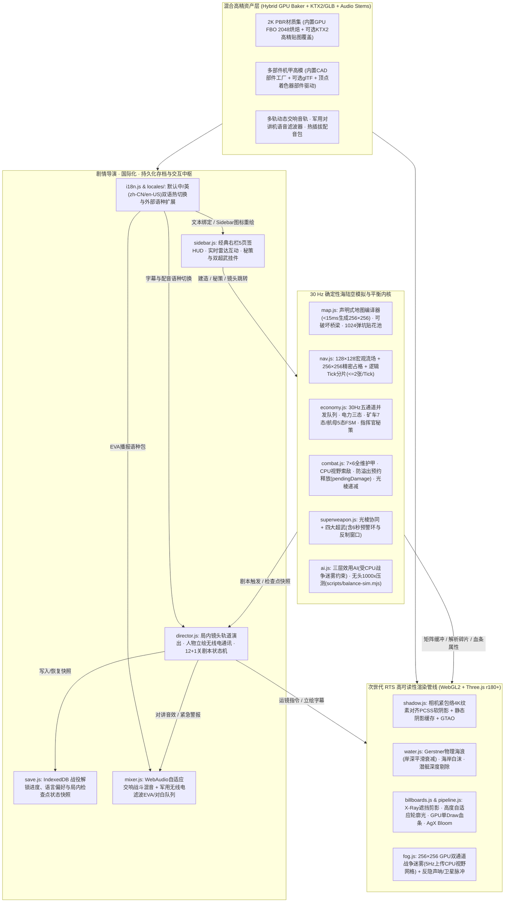
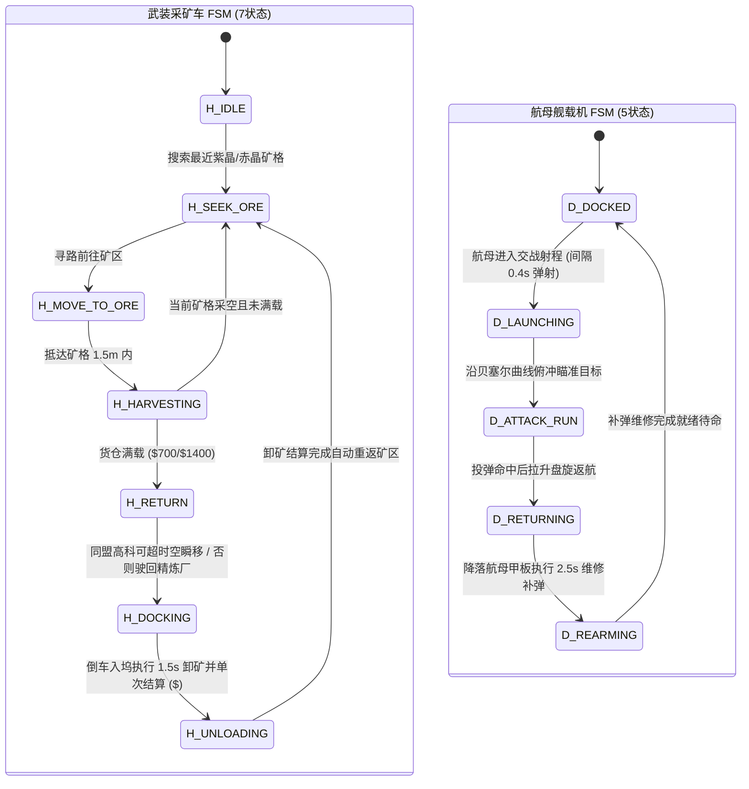

# 《墨陆：赤潮警戒》(Mò Lù: Red Tide Alert) 软件设计方案 (SDD v2.2)

- **文档版本**：v2.2（技术栈与性能架构深化版 · 紧包络纹素软阴影 · GPU 部件合批 · 战术高可读性与降维高效工程）
- **项目代号**：`RedAlert3A`
- **技术基准**：从 [`3Agame`](https://github.com/mullvadcat/3Agame) 过程化内核演进升级，**不设 `< 2 MB` 单文件体积限制**，全面采用 **Vite 模块化工程 + 混合高精度资产管线（GPU 2K PBR 烘焙 & 程序化高模底座 + 可选 glTF/KTX2 热替换）+ 军事无线电与自适应交响混音**。

---

## 1. 系统架构总览与 v2.2 技术栈决策

### 1.1 总体分层架构



### 1.2 从 `3Agame` 到 `RedAlert3A v2.2` 的高 ROI 工程原则
1. **混合零阻塞高精资产管线（Hybrid Asset Pipeline）**：
   - **内置底座保底**：`pbr.js` 启动时通过 WebGL2 多渲染目标（MRT Framebuffer）直接在显存烘焙 `2048×2048` 工业金属铆钉、复合装甲接缝、划痕污渍与地形贴图；`models.js` 提供高精度多部件机械模型工厂（履带滚轮、炮管、雷达支架、航母弹射轨）。
   - **外部资源无缝升级**：加载器优先探测 `assets/models/<id>.glb` 与 `assets/textures/<id>.ktx2`，存在即无缝热替换为外部美术资源，不存在则零延迟回退至高精度程序化底座，保证任意提交状态均可运行。
2. **用“解析算法 + 专用渲染技巧”替代过重通用引擎**：
   - 不用 4 级联 CSM，改用 **紧包络单级 4K 纹素对齐软阴影**（Shadow Pass 开销降低 `70%`、锐度更高）；
   - 不引入独立 3D 物理引擎，改用 **确定性解析抛物线碎片池**（`~50` 行实现带弹性反弹的建筑多阶段坍塌碎片）；
   - 不手写 21 个静态大地图数组，改用 **声明式参数化地图编译器**（`40` 行剧本描述 `15ms` 生成 `256×256` 完整海陆地形与触发器）。
3. **单一数值真理源与文档权威约定**：
   - 运行时全部单位/建筑/护甲数值与画质预设统一收口于 `src/core/config.js`（Single Source of Truth）；
   - 玩法需求与键位以 [`docs/PRD.md`](PRD.md)（v2.2）为准，技术架构与 `< 140 Draw Calls` 门禁以本 SDD（v2.2）为准，冲突裁决与统一命名对照见 [`docs/README.md`](README.md)。

---

## 2. 源码目录架构 (`RedAlert3A/`)

```text
RedAlert3A/
├── index.html                      # 应用入口与渐进式加载屏幕
├── vite.config.js                  # 现代 ES 模块化构建、KTX2/GLB 分包与静态输出配置
├── package.json                    # dev / build / sim:balance / bench 工程脚本
├── scripts/
│   └── balance-sim.mjs             # Node.js 无头 1000x 自动化对局与经济战损平衡压测器
├── assets/                         # 可选外置高精资产覆盖池（按战役/阵营异步懒加载）
│   ├── textures/                   # 2K BasisU(.ktx2) PBR 纹理覆盖集
│   ├── models/                     # glTF/GLB 精细多部件机械单位与建筑模型
│   ├── portraits/                  # 墨陆 / 林汐 / 雷泽将军 / EVA 动态立绘与表情层
│   └── audio/                      # 多轨交响配乐 Stems、武器采样与双语配音热插拔包
├── docs/
│   ├── assets/                     # PRD/README 概念图鉴（abyssal/crimson/infantry/superweapons.jpg）
│   ├── README.md                   # 文档中心索引、权威裁决顺序、统一命名表与版本历史
│   ├── PRD.md                      # 产品需求文档 v2.2
│   └── SDD.md                      # 软件设计方案 v2.2
└── src/
    ├── core/
    │   ├── engine.js               # 30Hz 固定逻辑步长主循环 + 资产流式与回退加载管理器
    │   ├── config.js               # 全量建筑/陆海空单位数值、科技树、7×6护甲表与画质预设
    │   ├── i18n.js                 # 多语种国际化运行时 (默认 zh-CN/en-US, t() 查询与热切换)
    │   ├── save.js                 # IndexedDB 战役进度、语言偏好与局内检查点状态序列化快照
    │   └── events.js               # 高性能零 GC 事件总线 + 确定性 PRNG
    ├── locales/                    # 模块化国际化语言词典（默认内置中/英双语，支持扩展更多语种）
    │   ├── zh-CN.js                # 简体中文完整词库（UI / 兵种简称与详情 / 12+1 关剧本对白）
    │   ├── en-US.js                # English full dictionary (UI / concise unit tags / 12+1 campaign scripts)
    │   └── index.js                # 语种注册表与外部 JSON Locale 动态挂载器
    ├── render/
    │   ├── pipeline.js             # WebGL2 HDR 9步后处理、AgX色调映射、Bloom、热浪折射
    │   ├── shadow.js               # 相机紧包络 4096×4096 纹素对齐 PCSS 软阴影 + 静态阴影缓存 + GTAO
    │   ├── billboards.js           # 单 Draw Call GPU 实例化战术血条、老兵星标、铁幕与载员指示器
    │   ├── water.js                # Gerstner 物理海浪(岸深平滑衰减)、尾流航迹与潜艇隐身滤镜
    │   ├── fog.js                  # 读取 CPU 视野网格 5Hz 上传生成 GPU 双通道战争迷雾 + 反隐脉冲遮罩
    │   └── decals.js               # 持久地面弹坑、焦土、核辐射荧光斑与坦克履带印环状池 (1024槽)
    ├── world/
    │   ├── map.js                  # 声明式地图编译器 + 256×256 海陆桥网格与双矿柱再生
    │   ├── models.js               # 单 Draw Call 顶点部件驱动 InstancedMesh + X-Ray遮挡 + 战损/轮廓光
    │   └── destruction.js          # 确定性解析抛物线碎片池 (vy*=-0.35弹跳)、黑烟火柱与残骸沉降
    ├── gameplay/
    │   ├── nav.js                  # 128×128 宏观流场 + 256×256 占格 + 30Hz 逻辑Tick分片(<=2/Tick) + Boids
    │   ├── entities.js             # 单位/建筑结构体数组池(playerId/teamId/faction)、老兵晋升、矿车与航母FSM
    │   ├── naval.js                # 造船厂 SEA 放置校验、潜艇潜浮隐身、反潜声呐探测、气垫船装卸抢滩
    │   ├── airforce.js             # 停机坪战机(风暴鹰/赤刃)起降补弹航线、基洛夫投弹与夜鹰隐身
    │   ├── production.js           # 五通道并发建造队列、逐逻辑Tick扣款/多厂加速、电力三态、秘策调度
    │   ├── combat.js               # 30Hz 确定性结算 + CPU视野索敌 + pendingDamage预约与释放 + 光棱衰减
    │   ├── superweapon.js          # 光棱充能 + 四大超武(6秒地面预警光圈与反制窗口)
    │   └── ai.js                   # 三层效用AI (内政官 · 防御官 · 跨海登陆与超武反制指挥官)
    ├── story/
    │   ├── director.js             # 剧情演出导演引擎（相机平滑切镜、任务触发、检查点触发器）
    │   ├── dialogue.js             # 无线电立绘通讯面板、军用对讲滤波音频队列与双语字幕
    │   └── campaigns/              # 12+1 关独立声明式战役剧本与地图蓝图（A01~A06 / C01~C06 / EX13）
    └── ui/
        ├── sidebar.js              # 右栏 5 页签经典 Sidebar、动态头像小窗、双超武倒计时挂件
        ├── minimap.js              # 256×256 高精互动小地图（海陆轮廓/核弹预警/左跳右指）
        └── menus.js                # 3D实时战区背景主菜单、战役分歧星图、遭遇战8图大厅与战后复盘
```

---

## 3. 次世代 RTS 高可读性渲染管线与性能预算

### 3.1 相机紧包络 4K 纹素对齐软阴影 (`shadow.js`) & GPU 部件实例化 (`models.js`)
1. **紧包络单级正交 PCSS（取代多级联 CSM）**：
   - RTS 固定斜俯视（`52°`、`14m~80m` 高度）仅覆盖约 `70m×70m` 可见区。用单张 **`4096×4096`（`Balanced` 档降为 `2048×2048`）紧包络正交阴影贴图**，精度高达 **`1.7cm/texel`**；
   - **纹素对齐（Texel-Snapping）** 将光源投影矩阵锚定到世界纹素网格，彻底消除移动镜头的阴影边缘闪烁；
   - **静态阴影缓存**：仅在建筑部署、坍塌或相机越出缓存边缘时重绘静物阴影层，阴影 Pass Draw Call 减少 `70%` 以上！
2. **单 Draw Call 顶点着色器部件驱动（Sub-Part Vertex Articulation）**：
   - 不再把同兵种的底盘和炮塔拆分为多个 `InstancedMesh`。在建模顶点数据中写入 `aPartId`（`0`: 底盘履带、`1`: 可旋转炮塔、`2`: 炮管/螺旋桨），并通过 `InstancedBufferAttribute` 每帧上传紧凑属性 `aUnitState = vec4(turretYaw, recoil, hpRatio, teamAndFlags)`；
   - 在 **Vertex Shader** 内一步完成炮塔偏航旋转与开火炮管后坐缩回，彻底消除多网格矩阵同步误差且 Draw Call 减半！

### 3.2 RTS 专属战术高可读性增强（混战分明）
- **高度自适应菲涅尔阵营轮廓光（Adaptive Fresnel Rim）**：在 `pbr.js` 片元着色器中结合相机高度 `uCamHeight` 调节边缘轮廓亮度——拉近（`14m`）欣赏写实金属划痕与 `< 50% HP` 战损焦黑（`uDamageMask`），拉远（`60~80m`）自动强化 `#2d7eff` / `#e83b3b` 阵营轮廓线，保证百单位混战依然一眼识别敌我。
- **建筑后方 `gl.GREATER` X-Ray 透视剪影**：紧随主场景建筑 Pass 之后，对深度被高大建筑（建造厂、核电站、船坞）遮挡的己方与可见敌方单位渲染一层纯色半透明 X-Ray 轮廓，彻底消灭建筑北侧微操盲区。
- **单 Draw Call GPU 实例化战术悬浮条 (`billboards.js`)**：严禁使用 DOM 绘制几百个血条导致重排卡顿。全图所有选中光环、分格血条、老兵军衔（`↑ / ★`）、铁幕无敌护盾条及气垫船载员点阵合并在 **1 个实例化广告牌网格** 内由着色器一次绘制完成。

### 3.3 Gerstner 岸深衰减海浪 (`water.js`) & 解析抛物线碎片池 (`destruction.js`)
- **岸深平滑衰减海浪**：`4` 组 Gerstner 波合成海面起伏供航母/战列舰采样计算纵摇与横摇，同时将波峰振幅乘以 `smoothstep(0.0, 2.0, waterDepth)`，使波浪靠近浅滩时平缓消融为动态岸线白沫，杜绝海浪穿透陆地岸边建筑与登陆载具。
- **台风潜艇隐身深度剔除**：潜航状态 `SUBMERGED` 仅在处于己方声呐单位探测圈或主动脉冲显影期时才渲染高亮轮廓与声波环。
- **无第三方物理引擎的多阶段建筑坍塌 & 持久弹坑池**：
  - `decals.js` 维护 `1024` 槽位 `Instanced Projected Decals` 环状池（炮坑、焦土、履带印、核爆 30s 绿色辐射区）。
  - `destruction.js` 对被毁建筑预拆的 `6~10` 个部件赋予确定性解析初速度与角速度，触及 `y = terrainHeight` 时执行阻尼反弹（`vy *= -0.35`）并停留在废墟上冒黑烟，零物理库开销且 100% 确定可重现。

### 3.4 60 FPS（`16.6ms`）帧耗时与 Draw Call 预算表

| 渲染/模拟阶段 | `1080p High` 预算 | 核心保障措施 |
| :--- | :---: | :--- |
| **30Hz 确定性模拟 Tick** | `<= 2.0 ms` | TypedArray 网格 + 宏观 `128×128` 逻辑分片流场（`<= 2` 张/Tick）+ SpatialHash 零 GC |
| **紧包络 4K 软阴影 + GTAO** | `<= 3.0 ms` | 静态建筑阴影缓存 + 纹素对齐单阴影 Pass + 半分辨率 GTAO |
| **主场景 + 水面 + X-Ray** | `<= 5.5 ms` | 顶点部件驱动单 `InstancedMesh`（3 级距离 LOD），**全帧（含阴影/水面/后处理全部 Pass）总 Draw Calls `< 140`** |
| **GPU 血条 + Bloom + 迷雾** | `<= 2.0 ms` | 单 Draw Call 血条广告牌 + 6 级 Bloom 降采样 + `5 Hz` 上传 CPU 视野网格至 GPU |
| **Sidebar HUD + WebAudio** | `<= 1.0 ms` | 脏区域 Canvas 2D 更新 + 原生 WebAudio 节点混音（合计 `<= 13.5ms`，保留 `3.1ms` 余量） |

---

## 4. 四重分层导航、声明式地图编译器与双端状态机

### 4.1 宏观流场 + 精密占格 (`nav.js`)、CPU 战争迷雾与造船厂海域校验
为避免 `256×256`（`65,536` 格）全图流场同步重算引发卡顿，并保证模拟层完全独立于浏览器渲染帧率：
- **双分辨率混合导航**：
  - **宏观流场层（`128×128` · `4m/Cell`）**：分别维护 `LAND`、`SEA`、`AMPHIBIOUS`（打通海陆浅滩供气垫艇与“幽影”登陆）、`AIR`（仅靠 3D Spatial Hash 防重叠）四类通路权重；
  - **精密局部与 Boids 层（`256×256` · `2m/Cell`）**：处理建筑精确占格碰撞与单位间距推力。
- **30 Hz 逻辑 Tick 时间片流场队列（Time-Sliced Queue）**：所有玩法状态只在 `30 Hz` 逻辑 Tick 内更新（渲染帧仅做插值），新建流场请求与断桥失效重算按固定顺序排入优先级队列，**每个逻辑 Tick 最多计算 `2` 张流场（约 `0.4ms`）**；既保证渲染无尖峰，也确保不同显示器刷新率（`60Hz/144Hz`）与 Node 无头仿真拥有一致的寻路与经济节奏；`FlowFieldCache` 缓存最近 `16` 个流场。
- **CPU 模拟侧视野位掩码网格（Bitmask · 单机公平与无头迷雾基础）**：模拟层按 `teamId` 维护 `Uint8Array(256×256)` 视野与反隐状态掩码——**`Bit 0 (1) = EXPLORED`（永久探索记录）、`Bit 1 (2) = VISIBLE`（当前可见）、`Bit 2 (4) = DETECTED`（反隐声呐/卫星显影）**。每逻辑 Tick 先执行 `grid[i] &= 1` 保留已探索位并清零临时位；随后重算视野覆盖时对常规格统一置位 **`grid[i] |= 3`（同步写入 `EXPLORED | VISIBLE`）**，对反隐探测区额外置位 **`grid[i] |= 4`（`DETECTED`）**（验收基准：侦察单位离开视野圈后，原地仍永久保持 `grid[i] === 1` 已探索状态）。`combat.js`、`ai.js` 与无头压测均严格按位判定（普通敌军需 `(mask & 2) !== 0`、敌方深潜/隐形目标需 `(mask & 6) === 6` 方可索敌；己方及盟友单位与潜艇对本队恒可见）；`fog.js` 仅作为渲染表现层每 `5 Hz` 读取该网格生成平滑视觉雾效。
- **造船厂海域校验与可破坏桥梁**：与 `PRD §5` 保持统一——造船厂（`4×4`）须全部落于可通航深/近海格 `gridTerrain === SEA` 且出海方向连通开放海域，同时中心距己方建造厂 `<= 18` 格，或距任一己方已建陆地建筑 `<= 12` 格；桥梁被毁后，桥面格转为 `BROKEN_BRIDGE`，桥上非两栖单位判定落水，桥下通航并标记受影响流场缓存失效。

### 4.2 声明式参数化地图编译器 (`map.js`)
所有 `13` 关战役与 `8` 张遭遇战地图不再保存冗长静态数组，而是以 `30~50` 行**声明式地图蓝图（Seed + 地形多边形/海峡曲线 + 桥梁起止点 + 赤/紫晶矿柱与再生点 + 中立油井/机场坐标 + 剧情触发区域）**定义，开局在 **`15ms`** 内编译生成确定性 `256×256` 网格与地面 PBR 纹理遮罩。

### 4.3 武装采矿车 7 状态机 & 航母舰载机 5 状态机



- **孤儿状态与多阵营/双科技树归属契约**：
  - **异常兜底与重建唤醒**：目标精炼厂被摧毁时，返程矿车自动切寻次近友方精炼厂（若全失则停止于 `H_IDLE`）；新建或夺回友方精炼厂时自动唤醒处于 `H_IDLE` 的矿车（满载直接切回 `H_RETURN`，空仓/半仓进入 `H_SEEK_ORE`）。航空母舰被击沉时，尚在空中的舰载机在燃料耗尽后直接坠毁。
  - **多人与双科技树归属 (`entities.js`)**：每个实体显式分离存储 `playerId (0..3，单机玩家 + 最多 3 名遭遇战 AI 席位)`、`teamId` 与 `factionId`（配色绑定 `playerId`，2v2 同队按 `teamId` 共享 CPU 视野与胜负，EX-13 则按玩家已拥有的不同阵营建筑并集解锁对应科技树建造项）。

---

## 5. 确定性战斗、平衡性算法保障与五通道经济

### 5.1 `7 × 6` 海陆空护甲克制矩阵

| 伤害类型 \ 护甲分类 | 无甲 (`None`) | 重装步兵 (`HeavyInfantry`) | 轻甲 (`Light`) | 重甲 (`Heavy`) | 超重甲 (`SuperHeavy`) | 空甲 (`Air`) |
| :--- | :---: | :---: | :---: | :---: | :---: | :---: |
| **`Bullet` (机枪/大兵/碉堡)** | **`100%`** | `65%` | `45%` | `20%` | `10%` | `0%` (飞行兵 `60%`) |
| **`APShell` (灰熊/犀牛/天启炮)** | `25%` | `45%` | `85%` | **`100%`** | `90%` | `0%` |
| **`Missile` (IFV/爱国者/神盾/赤蝎)** | `40%` | `50%` | **`100%`** | `75%` | `65%` | **`130%`** (神盾 `160%`) |
| **`HighExplosive` (V3/无畏/基洛夫/赤刃)** | **`150%`** | **`115%`** | **`115%`** | `95%` | `90%` (建筑 `135%`) | `0%` |
| **`Prism` (光棱坦克/光棱塔)** | **`125%`** | `90%` | **`115%`** | `80%` | `75%` (建筑 `130%`) | `0%` |
| **`Tesla` (磁暴步兵/磁暴线圈)** | **`160%`** | `85%` | **`120%`** | **`100%`** | `85%` | `0%` |
| **`Torpedo` (台风鱼雷 / 海豚声呐)** | `0%` | `0%` | **`125%`** | **`120%`** | **`110%`** | `0%` |

> **护甲目标域与特例覆盖规则**：
> 1. **合法目标域优先**：武器索敌与开火前先校验 `targetDomain ∈ {GROUND, SEA, SUBMERGED, AIR}`，通过后再读取上表护甲倍率（例如鱼雷仅允许打击 `SEA` / 未隐身潜浮舰船，不可因重甲 `120%` 倍率误打陆地坦克）。
> 2. **特例直接覆盖（Override）**：表中括号特例（如 `建筑 135%`、`建筑 130%`、`飞行兵 60%`、`神盾 160%`）为**直接覆盖该格基础倍率**，不与基础倍率叠乘（例如 `HighExplosive` 对 `SuperHeavy + Structure` 建筑直接造成 **`135%`** 伤害，而非 `90% × 135%`）。
> 3. **统一归类**：全部建筑默认 `SuperHeavy` + `Structure` 标签；**基洛夫空艇**统一归入 `Air`（依托 `2000 HP` 高血池承伤）。

### 5.2 游戏平衡性的三大模拟层动态保障 (`combat.js` & `scripts/balance-sim.mjs`)
1. **智能防伤害溢出索敌与幂等预约释放（Overkill Prevention / `pendingDamage`）**：
   - 每发慢速弹道/出击任务（V3 火箭、无畏巡航导弹、防空导弹、航母轰炸机等）生成唯一预约并绑定 **`reservedDamage` 与幂等开关 `released = false`**，同步累加 `target.pendingDamage += reservedDamage`；其余同队单位扫敌发现 `target.hp - target.pendingDamage <= 0` 时自动转火。
   - **单次幂等释放契约**：仅当在途投射物命中结算、被防空拦截或超时自毁，且 `!released` 时执行 `released = true; target.pendingDamage = Math.max(0, target.pendingDamage - reservedDamage)`。**发射单位被击毁不会提前取消已发射在途的弹道预约**（仅持续引导光束或未投弹前即被击落的航母舰载机在失活时触发一次幂等释放）。
2. **光棱折射边际递减与光束池上限**：
   - 同一逻辑帧内，同一个目标遭受超过 `3` 条光棱折射次级光束打击后，第 `k` 条（`k > 3`）伤害按 $0.7^{k-3}$ 指数递减；全局活跃折射光束上限固定 `128` 条（超限自动合并为更粗主光束），防止“光棱海”无脑秒杀天启坦克。
3. **Node.js `1000×` 无头自动平衡压测 (`scripts/balance-sim.mjs`)**：
   - 利用模拟层与 WebGL 渲染层完全解耦的特点，命令行执行 `npm run sim:balance` 可在纯 Node 环境下以目标 **`1000×` 倍速**自动跑完 **`200` 场镜像种子对局**：其中小规模等造价对轰（如 **`7× 犀牛 ($6,300) vs 9× 灰熊 ($6,300)`**）重点输出各兵种**平均战损回本率**，完整海陆空 `AI vs AI` 对抗重点验收双阵营**胜率区间（目标控制于 `48% ~ 52%`）**。

### 5.3 五通道并发生产队列、Sidebar 映射与多厂加速守卫
- **五通道队列与右栏 5 页签 1:1 映射**：`queues = { main: null, defense: null, infantry: [], vehicle: [], air_naval: [] }` 分别严格对应右侧 Sidebar 快捷键 `Q`(主建筑) / `W`(防御超武) / `E`(步兵) / `R`(陆军载具) / `T`(海空军)。其中 **`T` 页签内提供 `[空军] / [海军]` 双子分组过滤切换**，二者共享同一个 `air_naval` 后台并发建造队列（逐 `30 Hz` 逻辑 Tick 按进度平滑扣款，资金归零自动 `PAUSED`，确保海空军与陆军/步兵并行造兵）。
- **多厂加速守卫公式**：按制造项显式定义的 `producerType` 统计**存活兼容生产建筑数 `N`**（步兵→`barracks` 兵营；陆军载具及**工厂直出空军夜鹰/基洛夫**→`war_factory` 战车工厂；停机坪战机风暴鹰/赤刃→`airforce_radar` 空指部；海军舰船→`naval_yard` 造船厂；避免造船厂或空指部误加速基洛夫；建筑受损不剥夺或降低制造效率，仅发电厂受损按比例减少电力）：
  - **当 $N = 0$ 时**：立即将该生产队列置为 **`PAUSED` 暂停状态**（绝不套用公式计算 `0.75`）；若该阵营已彻底失去兼容生产建筑，右键手动取消或队列终止时全额退还已扣除的制造费用；
  - **当 $N \ge 1$ 时**：按公式加速计算：
    $$\text{SpeedMultiplier} = \left(1 + 0.25 \cdot \min(N - 1, 4)\right) \times \text{PowerFactor}$$
    （绿电 `1.0` / 黄电 `0.5` / 红电 `0.35`）。
- **三层效用 AI (`ai.js`)**：内政官（电厂/矿车/MCV 分矿/海陆选址）+ 防御官（受击拦截 + 动态反制配兵）+ 海陆空战术指挥官（跨海气垫奇袭 + 航母打击 + 超武瞄准）。

### 5.4 四大超级武器“6 秒预警与反制窗口”及指挥官秘策

| 系统 | 核心机制与战术反制窗口 (`superweapon.js`) | 视听渲染 |
| :--- | :--- | :--- |
| **超时空传送仪** | `3×3` 己方地面/水面机动载具瞬移（不含建筑与任何空中单位，步兵抹除），可用于将坦克或舰船瞬移出敌方核爆锁定圈进行急救躲避 | 源点/终点同步青白量子护盾 + 屏幕空间折射波动 |
| **铁幕装置** | `3×3` 己方地面/水面机动载具及`基洛夫空艇` `15s` 无敌（不含常规战机/夜鹰与建筑，步兵触死），可在核弹/闪电风暴预警期内紧急开盾硬抗核爆 | 暗红+漆黑金属流动脉冲护盾着色器 `uIronCurtainOverlay` |
| **天气控制机** | **激活后进入 `6s` 乌云汇聚全图预警圈**，随后 `12s` 在 `18m` 半径内降下 `18` 道强力落雷 | 地面亮起青色警告雷环，天空旋涡压暗光照 + 分支闪电与滚雷 |
| **核弹发射井** | **激活后全图广播 + 目标地面亮起 `6s` 红色核弹锁定预警圈**（发射井发射升空与俯冲），给予防守方开启铁幕、超时空转移或 `X` 变卖关键建筑的反制窗口 | 暴露闪白 + 冲天蘑菇云粒子 + 地表 `30s` 绿色辐射区 |
| **指挥官秘策 (`F1~F4`)** | 卫星驱雾显影、伞兵空降、纳米维修（回血 `35%`）、范围 EMP 瘫痪（`8s` 停机） | 独立冷却槽 + 运输机飞越投送与脉冲冲击环 |

---

## 6. 剧情导演、军用无线电滤波音频、i18n 与存档

### 6.1 剧情导演 (`director.js`) & 军用无线电滤波音频管线 (`mixer.js`)
- **声明式剧本与相机导演**：`A01~A06`、`C01~C06` 与隐藏双线合流终章 `EX13` 各由一份双语剧本脚本驱动（开场运镜、`onAreaEntered / onCapture / onTimer` 触发器、关键反转 3 秒无缝焦点切镜）。
- **“军用对讲机滤波器 + 双语 TTS / 热插拔语音”降维方案**：
  - 无需在开发初期就录制数百条外部音频阻塞上线。`mixer.js` 在 `WebAudio` 中串联 **`Bandpass (450Hz~2600Hz)` 带通滤波 + `WaveShaper` 轻度电台过载 + PTT 对讲按下/松开咔哒声（Squelch Click）与微弱无线电底噪**；
  - 默认以内置双语语音 / 无线电加密合成音实时驱动全部 13 关人物对白与 EVA 播报，同时支持 `assets/audio/voices/<locale>/<voiceId>.ogg` 外部配音文件存在即自动热插拔覆盖，兼具极低包体负担与极高《红警》前线指挥部沉浸质感。
- **自适应 32 轨交响混音**：跟踪最近 `5s` 战损烈度与超武警告状态，在 **潜伏侦查 → 常规行军 → 重金属战斗高潮** 间无缝交叉淡入。

### 6.2 战役进度与局内检查点存档 (`src/core/save.js`)
依托 `IndexedDB` 持久化档案进度（`schemaVersion` 版本号、关卡解锁、`EX-13` 双线通关标记、界面/语音语种、画质与键位）与局内自动检查点状态快照——快照显式保存 **`tickCount` 逻辑时间、PRNG 确定性种子状态、各队 CPU 已探索视野位掩码（`grid & 1`）、活跃区域效果（`F1` 侦察卫星 15s 显影圈、核辐射污染区、闪电风暴倒计时的中心坐标/半径/所属队伍与到期 Tick；读档后由当前单位、建筑及有效区域效果共同重建 `VISIBLE`/`DETECTED`）、实体池 `TypedArray`、五通道生产队列、在途投射物及 `reservedDamage` 预约态（确保读档后不重复扣款发奖或残留幽灵预约）、与剧本触发器状态**，并通过 `IndexedDB` 事务原子写入，异常时回退上一合法检查点。

### 6.3 多语种国际化引擎 (`src/core/i18n.js`) 与双语音频路由设计
1. **默认语言解析与降级链**：优先级 `URL (?lang=zh|en)` > `IndexedDB 偏好` > `navigator.language`（匹配 `zh*` 激活 `zh-CN`，其余激活 `en-US`）；查找函数 `t(key, params)` 按 `activeLocale -> 'zh-CN' -> 'en-US' -> key` 安全回退。
2. **战局零中断热切换**：HTML `[data-i18n]` 自动绑定，按 `L` 键触发 `locale:change` 时，`sidebar.js` 立刻按新语种简称（`光棱` / `Prism`、`天启` / `Apoc`）重绘 Canvas 2D 图标与自适应字号。
3. **文本与语音双轨独立切换**：`voiceLocale` 可独立配置于文本语言（允许 **中文界面 + 经典英文 EVA *“Unit Ready / Kirov Reporting”*** 或 **全中文配音**），并通过 `registerLocale(code, label, dict)` 开放第三语种包扩展。

### 6.4 研发与验收专用 URL / CLI 参数
- `?lang=zh` / `?lang=en`：指定初始中文或英文界面调试 UI 排版与双语对讲语音；
- `?show=gallery`：全 3D 模型检阅展厅（切换红/蓝涂装、查看 `< 50%` 战损状态、试放武器与解析碎片坍塌）；
- `?mission=A01..A06 / C01..C06 / EX13`：直跳指定战役关卡调试触发器与过场镜头；
- `?nofog=1&fastbuild=1`：全图透视 AI 与 10 倍速建造调试双超武及防溢出逻辑；
- `?bench=1`：浏览器实机 `250+` 单位同屏海陆空大混战压测（输出 Avg / P99 耗时与 Draw Calls）；
- `npm run sim:balance`：Node.js 无头 `1000×` 自动对抗平衡校验。

### 6.5 关键工程风险登记与应对预案

| 风险类别 | 触发场景与潜在影响 | 工程缓解措施与降级预案 |
| :--- | :--- | :--- |
| **WebGL2 显存与上下文丢失** | 长时间多场连续对战、低显存核显设备或系统休眠导致 `webglcontextlost`，阴影/PBR FBO 被浏览器回收 | `pbr.js` / `shadow.js` 严格复用固定容量纹理池；`Balanced` 档自动降级为 `2048×2048` 阴影并缩减 PBR Mip 常驻；监听 `webglcontextlost` 暂停模拟并自动重建 GPU 资源 |
| **浏览器 WebAudio 自动播放拦截** | Chromium / Safari 阻止未获用户手势前创建或运行 `AudioContext`，导致首屏背景乐与开场 EVA 静音 | `mixer.js` 启动时检查 `ctx.state === 'suspended'`，强制绑定主菜单“进入战局/开始游戏”首次点击事件触发 `ctx.resume()` 并延迟播放首条 EVA 语音 |
| **断桥与多队指令流场尖峰** | 桥梁被炸毁或 `200+` 单位同时发出跨海寻路，触发多张 `128×128` 流场重算导致单帧超过 `16.6ms` | `nav.js` 时间片队列严格限流 **`<= 2` 张流场/逻辑 Tick（约 `0.4ms`）** + `16` 槽 LRU 缓存；极高负载队列排期期间单位先按局部 Boids 与直线引导移动，不阻塞主渲染帧 |
| **浏览器快捷键劫持与玩家习惯差异** | 部分快捷键或 `Alt` 组合在特定 OS/浏览器下存在焦点问题，或部分玩家仍偏好 `WASD` 移动相机 | 默认方案严格执行方向键平移 + 无冲突指令键位（`A/S/D` 与 `Q/W/E/R/T` 分离）；输入管理层内置可配置 Keymap（存 `IndexedDB`），`Esc` 统一退出建造/瞄准锁定状态 |
