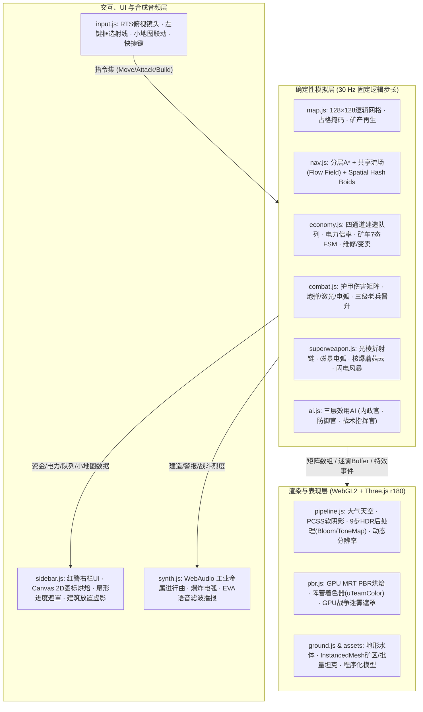
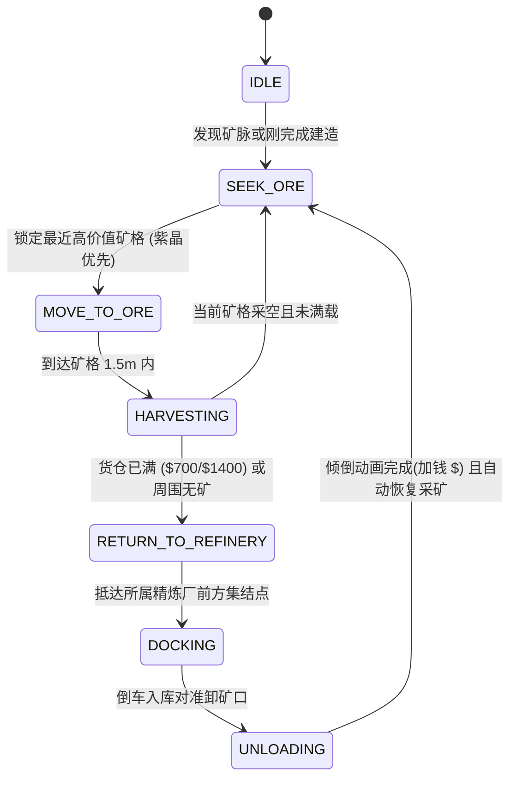

# 《墨陆：赤潮警戒》(Mò Lù: Red Tide Alert) 软件设计方案 (SDD)

- **文档版本**：v1.0
- **项目代号**：`RedAlert3A`
- **架构基准**：复用与演进 [`3Agame`](https://github.com/mullvadcat/3Agame) 单文件零依赖 WebGL2 + WebAudio 引擎

---

## 1. 系统架构总览与引擎复用矩阵

### 1.1 总体分层架构



### 1.2 与前作《墨陆：暗潮泊位》(`3Agame`) 引擎复用矩阵

| 模块/子系统 | 前作来源 (`3Agame`) | 处置策略 | RTS 专项演进要点 |
| :--- | :--- | :--- | :--- |
| **内联 Three.js r180** | `src/vendor/three.r180.js` | **直接复用** | 零变动复用内联 WebGL2 核心库，保持单文件零外链能力 |
| **9 步后处理 & 阴影渲染器** | `src/render/pipeline.js` | **轻量裁剪复用** | 移除 FPS 武器副相机与高耗仓库体积光，保留 PCSS 软阴影、6 级 Bloom 泛光（极适配光棱/磁暴/核爆）、AgX/ACES 色调映射与 DRS 动态分辨率 |
| **GPU MRT PBR 烘焙器** | `src/materials/pbr.js` | **扩展复用** | 延续 MRT 贴图烘焙；注入 `uTeamColor`（红/蓝阵营涂装识别色）及 `uFogTex` 战争迷雾着色器补丁 |
| **参数化构建器 `jn`** | `src/world/props.js` | **改造升级** | 从港区集装箱建模扩展为 `12+` 建筑与 `15+` 陆空单位过程化建模工厂，支持炮塔/基座父子枢轴分离旋转 |
| **粒子池与弹孔特效** | `src/fx/particles.js` | **扩充复用** | 延续零 GC 对象池机制，新增光棱折射光束、磁暴电弧段、核爆蘑菇云翻页粒子、维修扳手粒子与矿车卸矿粉尘 |
| **WebAudio 离线合成器** | `src/audio/synth.js` | **改造扩充** | 改用俯视全局混音台；新增工业金属进行曲配乐合成、核弹/闪电/激光音效，并接入 EVA 战术语音提示 |
| **物理与 A\* 寻路** | `src/physics/world.js` | **重构为 `nav.js` + `map.js`** | 从 FPS 3D 胶囊体碰撞重构为 **2D 网格建筑占格 + 多单位流场寻路 + Spatial Hash 避障** |
| **玩家 / 武器 / 敌人 AI** | `player.js` / `weapon.js` / `enemies.js` | **彻底替换为 RTS 实体系统** | 拆分为建筑实体、单位实体（步兵/载具/空军）、战斗结算与三层策略 AI |
| **HUD 与菜单** | `src/ui/hud.js` / `menus.js` | **重构为 `sidebar.js`** | 实现经典红警右侧 200px Sidebar、实时雷达小地图与扇形建造进度按钮 |

---

## 2. 源码目录与 24 模块分片规划 (`src/`)

延续 `3Agame` 的无打包器极简工程哲学——日常开发分模块编写，通过 Node.js `scripts/build.mjs` 无损拼合为单文件 HTML 并进行 SHA-256 校验（`--check`），或反向 `split.mjs`：

```text
RedAlert3A/src/
├── template/
│   ├── head.html          # [01] <head> 与页面标题定义
│   ├── body.html          # [03] Canvas #view、Sidebar DOM 骨架与 Boot 进度遮罩
│   └── foot.html          # [24] 闭包包尾与 </html>
├── styles/
│   └── ui.css             # [02] 红警右侧 200px 钢铁风格 Sidebar、扇形遮罩、编队角标与主菜单样式
├── vendor/
│   └── three.r180.js      # [04] 内联 Three.js r180
├── core/
│   ├── shared.js          # [05] PRNG、事件总线、画质预设、几何合批工具、定点数随机源
│   └── data.js            # [06] 全量双阵营建筑/单位配置字典、科技树前置图与 6×4 护甲克制表
├── render/
│   ├── pipeline.js        # [07] 俯视相机阴影裁剪、Bloom 后处理与 DRS 自适应分辨率
│   └── fog.js             # [08] GPU 双通道战争迷雾 (DataTexture 更新 + 地形/单位可见性着色过滤)
├── materials/
│   └── pbr.js             # [09] 过程化金属/泥土/赤晶材质烘焙 + uTeamColor 阵营染色注入
├── world/
│   ├── map.js             # [10] 128×128 地形网格生成、水陆坡度、矿脉分布与矿柱周期再生
│   ├── models.js          # [11] 参数化建筑与载具/步兵 3D 蓝图工厂 + 展开/打包关键帧动画
│   └── ground.js          # [12] 战场地形网格、海浪边框与 InstancedMesh 赤晶/紫晶矿群渲染
├── fx/
│   └── particles.js       # [13] 炮口焰、弹道曳光、光棱折射线、磁暴电弧、爆炸与核爆蘑菇云池
├── audio/
│   └── synth.js           # [14] 工业金属进行曲、战斗/警报音效合成与 EVA Web Speech 滤波播报
├── gameplay/
│   ├── nav.js             # [15] 空间哈希 (Spatial Hash)、A* 寻路、共享流场 (Flow Field) 与 Boids
│   ├── entities.js        # [16] 建筑与单位数据池、老兵经验升级、采矿车 7 状态自动机
│   ├── production.js      # [17] 四通道生产队列、电力三态惩罚、建筑放置校验与维修/变卖控制器
│   ├── combat.js          # [18] 30Hz 确定性炮弹/即时命中结算、溅射、压路机碾压、工程师占领
│   ├── superweapon.js     # [19] 光棱协同充能、核弹轨迹/辐射区、天气控制机落雷调度
│   ├── ai.js              # [20] 内政官 + 防御官 + 战术指挥官 三层效用遭遇战 AI
│   └── flow.js            # [21] 胜负判定、遭遇战配置启动与 3 关战役剧本状态机
├── ui/
│   ├── sidebar.js         # [22] 右栏交互控制器、Canvas 2D 图标生成器、小地图 Canvas 渲染与点击
│   └── menus.js           # [23] 遭遇战阵营/难度配置面板、战役选择、暂停与战报统计弹窗
└── main.js                # 启动调度、URL 调试展厅开关与 30Hz 模拟 / 可变帧率渲染主循环
```

---

## 3. 地形网格、GPU 战争迷雾与实例化渲染

### 3.1 `128 × 128` 逻辑网格（2m/Cell）
地图核心数据全部存储在紧凑的 TypedArray 中，确保寻路与建房零对象分配：
- `gridTerrain`: `Uint8Array(16384)` — `0`: 平原可建, `1`: 水域, `2`: 不可建矿石/斜坡/悬崖。
- `gridOccupy`: `Int32Array(16384)` — `0`: 空闲; `> 0`: 占用该格的建筑实例 ID（用于建房冲突检测与 A* 不可通行阻塞）。
- `gridOre`: `Uint8Array(16384)` — `0`: 无矿; `1~10`: 赤晶矿储量等级; `11~20`: 富集紫晶矿储量等级。

### 3.2 GPU 双通道战争迷雾（Fog of War）
还原红警特色的“**未探索纯黑迷雾（Shroud）+ 已探索无实时视野半暗阴影（Fog）**”：
1. **CPU 视图光栅化**：每 `200ms`（5 Hz，无需每帧重算）遍历己方所有单位与建筑的 `(gx, gz, sightRadius)`：
   - 清空临时 `fogVis`（当前帧可见数组）为 `0`；
   - 使用 Bresenham 中点画圆算法将视野内格子设为 `fogVis[idx] = 255`，同时将历史探索数组置位 `fogExplored[idx] = 255`（雷达断电时不回退，但敌方隐蔽）。
2. **双缓冲平滑渐变**：`fogTexture` 为一张 `128 × 128` 的 `THREE.RGBAFormat` `DataTexture`：
   - `R` 通道每秒以指数平滑速率逼近 `fogVis`（消除 5Hz 刷新导致的边缘闪烁跳变）；
   - `G` 通道逼近 `fogExplored`；
   - `B` 通道标记反隐/雷达侦测脉冲。
3. **着色器注入与单位裁剪**：
   - 在地表、矿石与静态建筑 `onBeforeCompile` 中按世界坐标 `uMapWorldBounds` 采样 `uFogTex`：
     - `G == 0`：输出纯黑（未探索遮罩）；
     - `G > 0 && R == 0`：色彩压暗至 `0.38` 倍且降饱和度（战争阴影，保留静态地形与玩家记忆中的建筑轮廓）；
     - `R > 0`：全亮度真实照明。
   - **敌方动态单位隐藏**：渲染与框选前检测 `fogVis[unit.cellIdx] > 40`，非可见区的敌方单位直接跳过渲染更新并屏蔽攻击锁定（仅核弹/基洛夫全局音效警报触发位置提示）。

### 3.3 大规模 `InstancedMesh` 渲染预算
- **矿物水晶簇**：全图最多 `4096` 个赤晶/紫晶矿格合并为 2 个 `InstancedMesh`，仅在采矿消耗或矿柱再生时局部更新对应实例的 `scale` 与矩阵。
- **高频同型作战单位**：动员兵、大兵、灰熊/犀牛坦克将**底盘**与**旋转炮塔**拆分为独立 `InstancedMesh` 批处理（最多预分配 `256` 实例槽位），单帧只需提交 2 次 Draw Call 与 1 次 `instanceMatrix`/`instanceColor` 上传即可渲染百辆坦克军团！

---

## 4. 过程化 3D 硬表面建模、阵营染色与建筑展开动画

### 4.1 `uTeamColor` 阵营着色器注入
在 `pbr.js` 材质系统中新增 Uniform `uTeamColor`（每个阵营/玩家共享一个克隆材质实例组）：
- 建模时，需要将涂装阵营色的局部几何体（如坦克炮塔侧翼、基地车顶部装甲、建筑顶部旗帜与通风徽章）通过顶点色 `color` 通道打上特殊蓝道识别标记（例如 `color.b > 0.9` 表示阵营色遮罩区域，其余通道控制磨损污渍亮度）。
- 着色器内混合逻辑：`diffuseColor.rgb = mix(diffuseColor.rgb, uTeamColor * maskShade, teamMask)`，确保金属旧化划痕与环境反射效果完整叠加在红/蓝涂装之上。

### 4.2 建筑“展开与拆解”关键帧动画
还原红警经典的建筑从地下脚手架/折叠结构瞬间生长展开的效果：
- **展开动画（Deploy / Construct `0.8s`）**：每个建筑模型分为 `base`（地基垫层）、`scaffold`（临时脚手架线框）、`mainBody`（主体结构）和 `top`（雷达天线/光棱水晶/烟囱）4 个子节点；
  - `t = 0.0 ~ 0.4`：地基拍平落定，四边升起黄色脚手架；
  - `t = 0.4 ~ 0.9`：`mainBody` 沿 Y 轴平滑伸缩弹出并伴有灰尘粒子喷发，底座材质逐渐由蓝图全息转为实景 PBR；
  - `t = 0.9 ~ 1.0`：脚手架回收，`top` 部件就位，雷达/电厂风扇开始旋转。
- **变卖（Sell）**：反向从 `t = 1.0` 播回 `0.0` 并在结束时返还资金并生成步兵。

### 4.3 建筑放置预览与网格校验
当玩家点击右侧“就绪”的建筑图标时：
- 光标在地形平面拾取当前对齐的整格原点 `(gx, gz)`，生成一个带有半透明方格地板的 3D 线框建筑幽灵投影（Ghost Preview）；
- 逐格检查目标 `w × h` 区域内是否满足：
  1. 无地形阻挡（非水域/悬崖/矿格）且高度一致；
  2. 无其他建筑/己方与敌方单位实体占据该格（若有己方单位站在上面，自动发出散开指令让位）；
  3. 至少有一格在任一己方已部署建筑的 `buildRadius` 曼哈顿/欧氏建造半径内；
- 每个底座小方格独立着色：合法为半透明亮绿 `#39ff7a`，冲突为闪烁警示红 `#ff4040`。全绿状态下左键点击立即扣款进入放置队列（实际上红警是在队列完成时才不扣款或建造时扣款——详见下节队列机制）。

---

## 5. 三层导航架构（网格占格 + A\* / 流场 Flow Field + Boids 避障）与矿车 FSM

### 5.1 混合寻路：小队 A\* + 集群流场（Flow Field）
为保证 200 单位同时编队跨地图冲锋不掉帧：
1. **指令分组**：单次右键点击下达移动/攻击指令时，生成一个共享 `MoveGroup { targetCell, mode, flowField? }`。
2. **小规模小队（`units.length <= 10`）**：直接逐单位调用 8 邻域二叉堆 A\*（复用自 `3Agame` `world.js` 的 `A*` 实现并增加建筑占地动态阻挡 + 对角线穿角校验）与路径拉直平滑。
3. **大规模军团（`units.length > 10`）**：以目标格子（或目的地区域）为根，执行一次 **BFS/Dijkstra 积分场（Integration Field `Uint16Array(16384)`）**，计算所有可通行格到目标的代价梯度并生成一个 `Int8Array(16384 * 2)` 的二维 **方向流场向量**（Cache 缓存最近 8 个目标流场，相同目标格直接复用！）。场内任意 `N` 辆坦克只需 `O(1)` 查表获取期望方向向量即可同步推进，彻底杜绝数百单位同时跑 A\* 引发的帧耗时尖峰。

### 5.2 空间哈希（Spatial Hash）与 Boids 软避障
- 每帧模拟步长开始时，将全部活体地面单位注册进 `cellSize = 3.0m` 的 `SpatialHashGrid`（固定数组链表，零 GC 分配）。
- 单位移动速度融合 3 个权重分量：
  - **寻路方向分量**：流场/A\* 下一路点方向（权重 `1.0`）；
  - **邻居分离力（Separation）**：查询周边 9 个哈希桶内距自身 `< (r_i + r_j) * 1.15` 的单位施加平滑互斥推力（防止坦克模型重合穿模）；
  - **到点收敛防抖（Arrival）**：同一 `MoveGroup` 内若有核心成员已停稳占住终点周边半径内，外围后续到达单位将目标点判定半径自适应扩大并在空闲位停火警戒，彻底避免红警老版本常见“一群坦克挤成一团死锁原地打转”的毛病。
- **碾压判定**：重甲履带坦克（灰熊/犀牛/天启/MCV）与无甲步兵（除磁暴步兵/展开的大兵沙袋状态）距离 `< 0.9m` 且相对速度指向步兵时，触发步兵碾压秒杀、血花/铁屑粒子与碾压音效。

### 5.3 武装采矿车 7 状态自动机（Harvester FSM）



- **智能让矿与容错**：若矿区矿格被其他矿车占满，采矿车在 3 秒等待后自动评估次近矿点或外圈空矿格；若玩家手动右键指定某片矿脉，则强制将当前矿区中心切换至玩家指示区域；遭遇攻击时优先启动车顶机枪自卫并向玩家播报“矿车正在遭受攻击”。

---

## 6. 确定性战斗结算、护甲克制矩阵与特色武器/超武特效

### 6.1 30 Hz 固定步长模拟循环
为使伤害、射速、建造倒计时和单位移动绝对稳定且不受显示器 60Hz/120Hz/144Hz 刷新率波动影响：
- 主循环积累 `accumulator += Math.min(dt, 0.1)`；
- 每次消耗 `FIXED_DT = 1 / 30` 执行确定性逻辑 Tick，渲染层按 `alpha = accumulator / FIXED_DT` 对单位坐标与炮塔朝向进行线性/球面插值平滑显示。

### 6.2 护甲克制矩阵（6 类伤害 × 4 类护甲）

| 伤害类型 \ 护甲类型 | 无甲 (None · 步兵) | 轻甲 (Light · IFV/V3/光棱/建筑) | 重甲 (Heavy · 主战/天启/矿车/主建筑) | 空甲 (Air · 基洛夫) |
| :--- | :---: | :---: | :---: | :---: |
| **Bullet (机枪/大兵/碉堡)** | **`100%`** | `50%` | `20%` | `0%`（无法对空） |
| **APShell (坦克穿甲炮弹)** | `25%`（建议直接碾压） | `85%` | **`100%`** | `0%` |
| **Missile (防空/IFV 导弹)** | `40%` | **`100%`** | `75%` | **`125%`** |
| **HighExplosive (V3 火箭/基洛夫炸弹)** | **`150%`** | **`110%`** | `90%`（对建筑 **`130%`**） | `0%` |
| **Prism (光棱聚集激光)** | **`120%`** | **`110%`** | `75%`（对建筑 **`125%`**） | `0%` |
| **Tesla (磁暴高压电弧)** | **`150%`**（秒杀普通步兵） | **`115%`** | **`95%`** | `0%` |

### 6.3 招牌武器与超级武器渲染设计
1. **光棱折射链（Prism Refraction）**：
   - 主塔/光棱坦克开火时发射高亮纯白核心 + 蔚蓝外晕的自定义着色器光柱线段（命中后以 `0.28s` 衰减淡出，配合 Bloom 极度耀眼）；
   - **折射算法**：命中目标点 `P0` 后，在 `SpatialHash` 中检索半径 `7m` 内的最多 `5` 个敌方单位/建筑 `[T1..T5]`，依次生成 `P0 -> Ti` 的分叉折射光束，每个次级目标承受主伤害 `40%` 的范围伤害；
   - **光棱塔充能协同**：若周边 `14m` 内有待命的己方光棱塔且均有电力，最多 4 座辅助光棱塔会朝主攻塔顶部棱镜发出细辅助汇聚光束，主塔单发基础伤害乘以 `(1 + 0.5 * 辅助塔数)`！
2. **磁暴电弧（Tesla Arc）**：
   - 使用一维**中点位移法（Midpoint Displacement）**动态生成 1 条主电弧折线 + 2 条细微支流电弧折线，`BufferGeometry` 更新 `pos` 顶点并附加紫白色高亮发光材质，触发点光源瞬间闪烁照明周边坦克甲板。
3. **核弹发射井（Nuclear Strike）**：
   - 激活后在发射井井盖滑开并升起白烟尾迹导弹（持续 `4s` 高空爬升后向目标点俯冲）；
   - 撞击后触发 5 阶段粒子与后处理序列：
     - `0.0s ~ 0.3s`：极高曝光全屏闪白（后处理 `exposure` 瞬间峰值拉高）；
     - `0.3s ~ 1.5s`：球形白色激波穹顶迅速扩散，中心 `10m` 内即死级 `1800` 高爆伤害，外圈 `22m` 衰减伤害；
     - `1.0s ~ 6.0s`：利用 `particles.js` 翻页烟火纹理生成直冲高空的火柱与巨型翻滚蘑菇云伞盖；
     - `6.0s ~ 30.0s`：地表生成泛绿荧光污染半径纹理，经过的步兵持续掉血。
4. **天气控制机（Lightning Storm）**：
   - 激活后 `render/pipeline.js` 天空穹顶动态滑向压抑青紫色乌云层，整片战场光照临时调暗，并在指定半径 `16m` 内持续 `12s` 随机生成 `18` 道直劈地面的狂暴蓝白闪电柱 + 多发爆裂火花 + 轰鸣雷声循环。

---

## 7. 四通道生产队列、电力倍率与分层效用 AI

### 7.1 四通道并发生产队列（Production Manager）
完全还原红警的核心体验：玩家可**同时**建造 1 个主建筑、1 个防御建筑、1 个步兵（或排长队）与 1 辆载具：
- `queues = { main: null, defense: null, infantry: [], vehicle: [] }`；
- **逐帧平稳扣款**：生产过程中**每秒按当前进度等比例扣除资金**（而非下单一次性扣光），当玩家资金归零时队列自动暂停，矿车回厂卸矿瞬间自动恢复生产并发出 EVA 提示；
- **多厂加速公式**：某类生产建筑（如兵营或战车工厂）数量为 $N$ 且均未停电损坏时，加速系数为：
  $$\text{SpeedMultiplier} = \left(1 + 0.25 \cdot \min(N - 1, 4)\right) \times \text{PowerFactor}$$
  （其中 `PowerFactor` 在绿电为 `1.0`，黄电为 `0.5`，红电为 `0.35`）。

### 7.2 遭遇战三层效用 AI（Hierarchical Utility AI）
AI 与玩家共享完全一致的经济、战争迷雾（冷酷模式可适当缩短探索周期但严格遵守建筑/资金规则）和建造队列 API：
1. **内政官（Economy & Build Order Manager）**：
   - 每 `2s` 评估基地健康度：无电厂/低电时最高优先级排产电厂；矿车损坏 `< 目标矿车数` 时优先在战车工厂补矿车；资金盈余且科技未满时沿预设阵营开局序（电厂 → 精炼厂 → 兵营 → 战车工厂 → 雷达 → 实验室 → 二矿精炼厂）稳步推进；
   - 智能选址器：在自身建造辐射圆环内扫描距中心 `6~15m` 的空闲 `w × h` 平地网格，防御塔优先朝向玩家主基地矢量方向的基地外缘落子。
2. **防御官（Base Defense & Harvester Escort）**：
   - 监听 `building:hit` 与 `harvester:hit` 事件，立即抽出距基地最近的闲置驻防部队（`GarrisonGroup`）拦截入侵者，消灭威胁后回防基地集结点。
3. **战术指挥官（Wave Staging & Attack Timing）**：
   - 在基地集结点按预设兵种配比（如早期：6 步兵 + 4 坦克；后期：6 犀牛 + 2 天启 + 2 V3 + 1 基洛夫）凑齐编队实力阈值 `TargetPower` 后，选取玩家探测到的暴露建筑物、矿车或薄弱分矿，统一下达 `Attack-Move` 总攻指令；
   - 超级武器就绪时，智能搜索玩家价值最高且密集的建筑群落点（如战车工厂+精炼厂簇）精准释放！

---

## 8. WebAudio 过程化工业金属配乐与 EVA 战术语音系统

延续 `3Agame` 离线 Generator 合成架构，严禁任何外部 `.mp3`/`.ogg` 下载：
1. **电子工业金属进行曲（Procedural Hell-March Inspired Synth）**：
   - 利用时间片 Generator 在启动后渐进合成 4 条无缝循环音轨（128 BPM）：重金属失真锯齿低音贝斯循环（A-小调工业节奏）、机械行军军鼓踏步与工业铁锤撞击声、合成器尖啸主旋律与警报泛音，支持根据交战烈度动态混音叠加。
2. **RTS 特色音效包**：
   - 光棱蓄能高亮扫频 + 折射激光脆响；
   - 磁暴线圈低频 50Hz 交流嗡鸣 + 高压瞬时击穿爆裂白噪；
   - 按钮点击清脆机械微动开关声、资金跳字嘀嗒声、建造完成“咚——”重金属合拢音效。
3. **零资产 EVA 战术语音提示**：
   - 优先调用浏览器原生 `window.speechSynthesis`（筛选 `zh-CN` 沉稳女/男声线，调整 `rate=1.08, pitch=0.92`）配合 WebAudio 状态字幕提示框，并做好全兼容降级方案：当环境禁用 TTS 或参数 `?noaudio=1` 时，自动切换为简洁的三音阶过程化无线电电子蜂鸣声码 + 左侧经典发光文字战术广播（如：`“建造完成”`、`“资金不足”`、`“电力不足”`、`“我方基地正在遭受攻击”`、`“警告：检测到核弹发射”`）。

---

## 9. 五阶段研发里程碑（M1 – M5）与调试展厅参数设计

### 9.1 阶段交付标准
- **M1（第 1 周 · 核心地基）**：搭通 `RedAlert3A/scripts/build.mjs` 模块化打包流水线，实现斜向俯视镜头、左键框选投影框、`128×128` 地图与 GPU 双通道战争迷雾可视化。
- **M2（第 2 周 · 经济建造）**：完成右侧 Sidebar UI、全套建筑模型与展开动画、网格放置预览及武装矿车 7 状态自动采矿加钱闭环。
- **M3（第 3 周 · 群体作战）**：打通全部兵种模型、A\* + 流场 + Boids 群集编队走位、护甲克制战斗与光棱/磁暴核心特效。
- **M4（第 4 周 · 终局完整）**：接入三层效用遭遇战 AI、核弹与闪电风暴超武、互动小地图雷达与 WebAudio 进行曲/EVA 语音。
- **M5（第 5 周 · 战役与验收）**：制作 3 关战役剧本、执行 `200` 单位同屏帧率压测优化并输出 `< 2.0 MB` 终版 `墨陆赤潮警戒_V1.html`。

### 9.2 研发与验收专用 URL 参数
继承前作优秀的可观测工程规范，所有系统均支持直接通过 URL 查询参数切入测试模式：
- `?show=units` / `?show=buildings`：进入独立 3D 图鉴展厅，按阵营一字排开展示全部单位与建筑建模（支持切换红/蓝涂装与点击播放展开动画）。
- `?show=fx`：循环演示光棱折射链、磁暴电弧、核弹蘑菇云与天气控制闪电风暴特效。
- `?nofog=1` 或 `?reveal=1`：关闭黑雾 / 全图开图透视敌方 AI 运作过程，方便调优 AI 内政与建造逻辑。
- `?fastbuild=1`：开启 `10x` 急速建造与 `$99,999` 测试资金，快速验收高科科技树与超级武器。
- `?bench=1`：启动 200 单位双向交锋自动巡航性能测试，在左上角输出 Avg / Median / P99 帧耗时与 Draw Call 统计。
- `?noaudio=1`：跳过 WebAudio 合成管线初始化，便于快速自动化测试。
