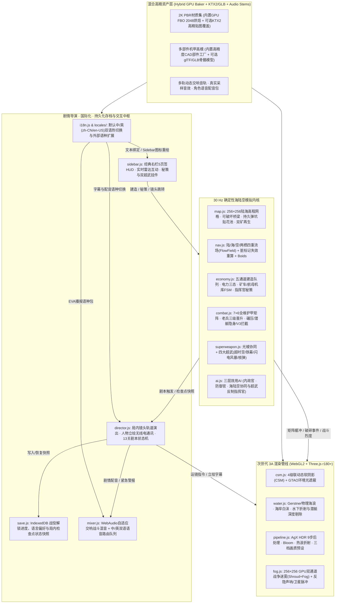
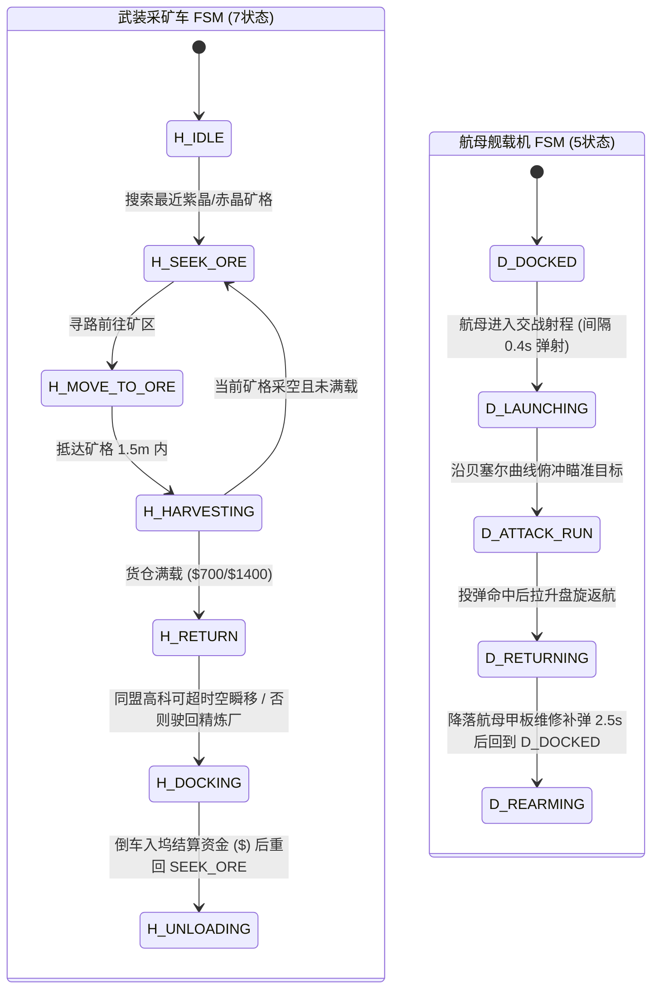

# 《墨陆：赤潮警戒》(Mò Lù: Red Tide Alert) 软件设计方案 (SDD v2.1)

- **文档版本**：v2.1（架构评审修订定稿 · 混合高模管线 · 全护甲公式 · 检查点存档与 16.6ms 性能预算）
- **项目代号**：`RedAlert3A`
- **技术基准**：从 [`3Agame`](https://github.com/mullvadcat/3Agame) 过程化内核演进升级，**不设 `< 2 MB` 单文件体积限制**，全面采用 **Vite 模块化工程 + 混合高精度资产管线（GPU 2K PBR 烘焙 & 程序化高模底座 + 可选 glTF/KTX2 热替换外部高精度美术资源 + 高采样交响音轨与过场导演引擎）**。

---

## 1. 系统架构总览与 v2.1 技术栈跃迁

### 1.1 总体分层架构



### 1.2 从 `3Agame` 演进至 `RedAlert3A v2.1` 的核心工程策略
1. **混合零阻塞高精资产管线（Hybrid Asset Pipeline）**：
   - 解决了纯依赖外部 `.glb/.ktx2` 在早期研发期会阻塞开发进度的问题：
   - **内置底座保底**：`pbr.js` 在初始化阶段通过 WebGL2 多渲染目标（MRT Framebuffer）直接向显存烘焙 `2048×2048` 工业金属铆钉、复合装甲接缝、划痕污渍与地形地貌贴图集；`models.js` 提供精细化参数多部件建模工厂（履带滚轮、炮管后座、雷达支架、航母弹射轨）。
   - **外部资源无缝升级**：`assets.js` 加载任何单位/纹理前优先请求 `assets/models/<id>.glb` 与 `assets/textures/<id>.ktx2`，存在即平滑切换为美术团队制作的高精雕塑模型，不存在则零延迟回退至高精度程序化底座，确保项目从 M1 起 **任何提交状态均 100% 可编译运行**。

---

## 2. 源码目录架构 (`RedAlert3A/`)

```text
RedAlert3A/
├── index.html                      # 应用入口与渐进式加载屏幕
├── vite.config.js                  # 现代 ES 模块化构建、KTX2/GLB 分包与静态输出配置
├── package.json                    # dev / build / test / bench 工程脚本
├── assets/                         # 可选外置高精资产覆盖池（按战役/阵营异步懒加载）
│   ├── textures/                   # 2K BasisU(.ktx2) PBR 纹理覆盖集
│   ├── models/                     # glTF/GLB 精细多部件机械单位与建筑模型
│   ├── portraits/                  # 墨陆 / 林汐 / 雷泽将军 / EVA 动态立绘与表情层
│   ├── audio/                      # 多轨交响配乐 Stems、武器采样与战役双语配音包 (voices/zh-CN, en-US)
├── docs/
│   ├── assets/                     # PRD/README 概念图鉴（abyssal/crimson/infantry/superweapons.jpg）
│   ├── PRD.md                      # 产品需求文档 v2.1
│   └── SDD.md                      # 软件设计方案 v2.1
└── src/
    ├── core/
    │   ├── engine.js               # 30Hz 固定逻辑步长主循环 + 资产流式与回退加载管理器
    │   ├── config.js               # 全量建筑/陆海空单位数值、科技树、7×6护甲表与画质预设
    │   ├── i18n.js                 # 多语种国际化运行时 (默认 zh-CN/en-US, t() 查询、热切换与扩展包注册)
    │   ├── save.js                 # IndexedDB 战役进度、语言偏好与局内检查点状态序列化快照
    │   └── events.js               # 高性能零 GC 事件总线 + 确定性 PRNG
    ├── locales/                    # 模块化国际化语言词典（默认开箱内置中/英双语，支持扩展更多语种）
    │   ├── zh-CN.js                # 简体中文完整词库（UI / 兵种简称与详情 / 12+1 关剧本对白）
    │   ├── en-US.js                # English full dictionary (UI / concise unit tags / 12+1 campaign scripts)
    │   └── index.js                # 语种注册表与外部 JSON Locale 动态挂载器
    ├── render/
    │   ├── pipeline.js             # WebGL2 HDR 9步后处理、AgX色调映射、Bloom、热浪折射
    │   ├── csm.js                  # 4级联软阴影 (CSM) + GTAO 环境光遮蔽 + 动态战斗点光源池
    │   ├── water.js                # Gerstner 物理海浪、岸线深浅渐变、尾流航迹与潜艇隐身滤镜
    │   ├── fog.js                  # 256×256 GPU 双通道战争迷雾 + 反隐声呐/间谍卫星显影遮罩
    │   └── decals.js               # 持久地面弹坑、焦土、核辐射荧光斑与坦克履带印环状池
    ├── world/
    │   ├── map.js                  # 256×256 大战场地形、海岸掩码、可破坏桥梁与赤/紫晶矿柱再生
    │   ├── models.js               # 混合模型工厂 (GLB优先/程序化CAD兜底)、uTeamColor、战损uDamageMask
    │   └── destruction.js          # 多阶段刚体碎片飞溅、黑烟火柱与建筑残骸物理坍塌系统
    ├── gameplay/
    │   ├── nav.js                  # 陆/海/空/两栖四重流场(FlowField) + 桥梁脏标记失效 + Boids
    │   ├── entities.js             # 单位/建筑结构体数组池、老兵三级晋升、矿车与航母机库FSM
    │   ├── naval.js                # 造船厂海域校验、潜艇潜浮隐身、反潜声呐探测、气垫船装卸抢滩
    │   ├── airforce.js             # 停机坪战机(风暴鹰/赤刃)起降补弹航线、基洛夫投弹与夜鹰隐身
    │   ├── production.js           # 五通道并发建造队列、逐帧扣款/多厂加速、电力三态、秘策调度
    │   ├── combat.js               # 30Hz 确定性炮弹/光束/防空拦截（拦截V3）、碾压、工程师占领
    │   ├── superweapon.js          # 光棱充能 + 四大超武(超时空传送/铁幕无敌场/天气闪电/战术核弹)
    │   └── ai.js                   # 三层效用AI (内政官 · 防御官 · 跨海登陆与超武反制指挥官)
    ├── story/
    │   ├── director.js             # 剧情演出导演引擎（相机平滑切镜、任务触发、检查点触发器）
    │   ├── dialogue.js             # 无线电立绘通讯面板、语音音频队列同步与多语言字幕
    │   └── campaigns/              # 12+1 关独立剧情剧本脚本（A01~A06 / C01~C06 / EX13）
    └── ui/
        ├── sidebar.js              # 右栏 5 页签经典 Sidebar、动态头像小窗、双超武倒计时挂件
        ├── minimap.js              # 256×256 高精互动小地图（海陆轮廓/核弹预警/左跳右指）
        └── menus.js                # 3D实时战区背景主菜单、战役分歧星图、遭遇战8图大厅与战后复盘
```

---

## 3. 次世代 3A 渲染管线、视效与性能预算

### 3.1 4 级联阴影（CSM）、GTAO 与“可见战损” PBR 着色
- **4 级联阴影贴图（CSM）**：覆盖相机前方 `0~35m`（近距 `2048×2048` 锐利履带螺栓阴影）、`35~90m`、`90~180m`、`180~360m`（山脉、基洛夫空艇巨影与航母甲板），在 `Balanced` 档位下可自动降级为 2 级联。
- **阵营染色与可见战损（`uTeamColor` + `uDamageMask`）**：通过顶点颜色通道区分阵营迷彩区域；当实体生命值 `< 65%` 和 `< 30%` 时，片元着色器混入渐进式烧灼炭黑纹理、金属撕裂法线，并挂接固定池黑烟/电火花粒子。

### 3.2 Gerstner 物理海浪与潜艇隐身着色器
- `render/water.js` 由 `4` 组不同波矢量的 Gerstner 波合成实时起伏海面与法线，大型舰船按舰体前后 4 个采样点计算真实纵摇与横摇角，并在深浅水交界渲染动态白沫。
- **潜艇深度剔除**：台风攻击潜艇处于 `SUBMERGED` 状态时，仅在己方视野且距己方海豚声呐艇/赤蝎/反潜探测区以内才高亮渲染轮廓与水波圈；对无反潜能力的敌方单位完全跳过渲染、屏蔽框选与武器自动索敌。

### 3.3 多阶段刚体破坏与持久弹坑池 (`destruction.js` & `decals.js`)
- 预设 `1024` 槽位 `Instanced Projected Decals` 环状复用池：炮弹炸坑、V3 熔岩焦土、履带车辙、核弹 `30s` 持续荧光辐射区均零 GC 循环更新。
- 建筑销毁时先内爆喷射火焰，主骨架按受击矢量倾斜倒塌并喷出随机 `6~12` 块带简单垂直弹性物理的碎甲残片，随后残骸沉降消融。

### 3.4 60 FPS（`16.6ms`）帧耗时与 Draw Call 严格预算表
为防止高画质叠加 `250+` 单位同屏激战时掉帧，`pipeline.js` 与 `models.js` 遵循以下硬性渲染预算：

| 渲染/模拟阶段 | 高画质档（`1080p 60FPS`）预算 | 关键优化手段 |
| :--- | :---: | :--- |
| **30Hz 确定性模拟 Tick** | `<= 2.5 ms` | 紧凑 TypedArray 地图 + SpatialHash 零 GC + 流场 LRU(12) 缓存（平均每帧分摊 `< 0.5 Tick`） |
| **CSM 4 级联阴影 Pass** | `<= 3.5 ms` | 静态建筑阴影按 Dirty Flag 低频重绘；高频小兵/坦克远级联 `InstancedMesh` 合批投影 |
| **主场景 + 物理水面 Pass** | `<= 6.0 ms` | 同型步兵/坦克分底盘/炮塔合并为 **`InstancedMesh`（3 级距离 LOD：100m 外退化为简模）**，总 **Draw Calls `< 180`** |
| **GTAO + Bloom + GPU 战争迷雾** | `<= 2.5 ms` | 半分辨率（`0.5×`）计算 GTAO 与 6 级 Bloom 降采样；迷雾仅 CPU `5 Hz` 更新 `256×256` DataTexture |
| **HUD Canvas + WebAudio** | `<= 1.5 ms` | 仅资金/队列/小地图像素脏更新，交响 Stems 使用原生 WebAudio `AudioBufferSourceNode` 硬件混音 |

---

## 4. 陆·海·空·两栖四重导航、建筑校验与实体状态机

### 4.1 `256 × 256` 网格与四重流场（`nav.js`）
地图扩展为 **`256 × 256` 逻辑网格（`2m/Cell`，`512m×512m` 战场）**：
- `gridTerrain`: `0` 平原可建陆地、`1` 深水区、`2` 近岸浅滩（可涉水两栖切换区）、`3` 可通行桥面（Bridge）、`4` 断桥水域、`5` 不可通行悬崖/高坡。
- **四层共享流场**：
  1. `LAND`：plains (`0`) + intact bridges (`3`)；
  2. `SEA`：deep water (`1`) + shallow (`2`) + broken bridges (`4`)；
  3. `AMPHIBIOUS`（气垫运输艇 / 同盟特种兵“幽影”）：打通 `LAND + SEA + SHALLOW`，无缝跨过海岸线抢滩；
  4. `AIR`（战机/飞行兵/基洛夫/夜鹰）：无视地形占用，仅依赖 3D Spatial Hash 高空分离力防重叠。
- **可破坏桥梁物理与流场失效**：每座桥拥有独立桥梁实体 HP；一旦桥梁被炸毁，`gridTerrain` 中对应格切换为 `4`（断桥水域），桥面上的非两栖单位直接判定落水销毁，桥下方航道对船只开放，同时 **流场缓存（`FlowFieldCache`）立刻标记 `dirty = true` 清空重建**；派遣战地工程师靠近断桥桥头即可瞬间重建修复为 `3`。

### 4.2 陆地建筑 vs 造船厂放置校验掩码 (`naval.js`)
- **普通陆地建筑（`placementMask: LAND`）**：所占 `w × h` 网格须全为 `gridTerrain === 0` 且无建筑/矿石占格，且至少一格落入己方建造半径内。
- **造船厂（`placementMask: COAST_SEA`）**：所占 `4×4` 网格须全为深水/近岸通航海域（`gridTerrain === 1 || 2`），且矩形中心距离任一己方已建成**陆地建筑**（建造厂、电厂、兵营等）不得超过 `18 格`（`36m`），确保玩家无需先建在海上即可由陆地向海洋辐射扩展造船厂。

### 4.3 武装采矿车 7 状态机 & 航母舰载机 5 状态机



---

## 5. 确定性战斗、`7 × 6` 全维护甲矩阵与五通道经济体系

### 5.1 `7 × 6` 海陆空护甲克制矩阵（7 类武器伤害 × 6 类护甲）
所有攻击都在 `30Hz` 固定模拟步长中完成：

| 伤害类型 \ 护甲分类 | 无甲步兵 (`None`) | 重装/特种步兵 (`HeavyInfantry`) | 轻甲载具/塔 (`Light`) | 重甲主战/舰船 (`Heavy`) | 超重甲 (`SuperHeavy`) | 空甲 (`Air`) |
| :--- | :---: | :---: | :---: | :---: | :---: | :---: |
| **`Bullet` (机枪/大兵/碉堡)** | **`100%`** | `65%` | `45%` | `20%` | `10%` | `0%` (除飞行兵可命中 `60%`) |
| **`APShell` (灰熊/犀牛/天启主炮)** | `25%` | `45%` | `85%` | **`100%`** | `90%` | `0%` |
| **`Missile` (IFV/爱国者/神盾/赤蝎)** | `40%` | `50%` | **`100%`** | `75%` | `65%` | **`130%`** (神盾对空 `160%`) |
| **`HighExplosive` (V3/无畏/基洛夫/红刀)** | **`150%`** | **`115%`** | **`115%`** | `95%` | `90%` (对建筑 `135%`) | `0%` |
| **`Prism` (光棱坦克/光棱塔)** | **`125%`** | `90%` | **`115%`** | `80%` | `75%` (对建筑 `130%`) | `0%` |
| **`Tesla` (磁暴步兵/磁暴线圈)** | **`160%`** | `85%` | **`120%`** | **`100%`** | `85%` | `0%` |
| **`Torpedo` (台风鱼雷 / 海豚声呐)** | `0%` | `0%` | **`125%`** | **`120%`** | **`110%`** | `0%` |

### 5.2 五通道并发生产队列与多厂加速公式 (`production.js`)
完美还原红警并发建造手感，划分 5 条互不阻塞的生产通道：
- `queues = { main: null, defense: null, infantry: [], vehicle: [], air_naval: [] }`
- **逐帧平稳扣款**：生产进行中按 `unitCost * (progressDelta)` 实时平滑扣除玩家当前资金；当资金降为 `0` 时，队列自动 `PAUSED` 并发出 EVA 语音 *“资金不足”*，采矿车回厂卸矿瞬间自动恢复生产。
- **多厂加速与电力三态系数**：某类生产建筑（如兵营、战车工厂或造船厂）拥有未停电未摧毁的活跃数量 $N$ 时，最终生产速率为：
  $$\text{SpeedMultiplier} = \left(1 + 0.25 \cdot \min(N - 1, 4)\right) \times \text{PowerFactor}$$
  其中 `PowerFactor` 在绿电为 `1.0`、黄电为 `0.5`、红电瘫痪为 `0.35`。

### 5.3 三层效用遭遇战 AI（`ai.js`）
AI 与玩家严格共用同一建造、电力与战争迷雾规则（冷酷模式仅缩减侦查频次）：
1. **内政官（Economy & Base Layout）**：实时监控电厂余量、矿车数量（每座矿场配 `2` 辆）与分矿扩张（自动造 MCV 迁至次近紫晶/赤晶富矿区）；扫描水陆海岸边界，在海陆地图中建造造船厂。
2. **防御官（Defense & Counter-Intel）**：响应 `building:hit` / `harvester:hit` 事件调度驻防编队拦截，并根据敌方暴露兵力动态切换建造优先级（侦测基洛夫/战机即急造爱国者/神盾/赤蝎；侦测潜艇即补充声呐反潜艇）。
3. **海陆空战术指挥官（Multi-Domain Commander）**：组织陆军集群进攻线、装载气垫两栖登陆艇或夜鹰直升机偷袭敌后矿区，并在超武倒计时完成时精确锁定玩家高价值建筑簇（如高科+重工+电厂区）释放核弹或闪电风暴。

### 5.4 四大超级武器与指挥官秘策状态机

| 系统 | 核心代码机制 (`superweapon.js`) | 视听渲染 |
| :--- | :--- | :--- |
| **超时空传送仪** | `3×3` 选区步兵瞬间抹除，载具世界坐标瞬间跃迁至目标空闲点（若目标与建筑重叠产生错位自毁） | 源点/终点同步旋转青白量子护盾 + 屏幕空间折射波动 |
| **铁幕装置** | `3×3` 选区重甲坦克/船只赋予 `invulnerableTimer = 15.0s`（步兵触及直接阵亡） | 动态附加暗红+漆黑金属流动脉冲护盾着色器 `uIronCurtainOverlay` |
| **天气控制机** | `12s` 内在 `targetPos` 半径 `18m` 调度 `18` 道强力高空落雷 | 天空乌云旋涡压暗光照 + 程序化分支闪电圆柱 + 滚雷音爆 |
| **核弹发射井** | 发射井滑盖开启，实体 ICBM 导弹爬升 `4s` 后俯冲命中目标 | 暴露拉高闪白 + 冲天蘑菇云粒子 + 地表 `30s` 绿色辐射持续伤害区 |
| **指挥官秘策 (`F1~F4`)** | 卫星驱雾显影、伞兵空降、纳米维修、范围 EMP 瘫痪（`8s` 停机） | 独立冷却按钮组与空投运输机飞越轨迹 |

---

## 6. 剧情导演引擎、持久化存档与调试接口

### 6.1 剧情导演引擎（`director.js`）与自适应交响混音（`mixer.js`）
- **结构化关卡剧本**：`A01~A06`、`C01~C06` 与隐藏双阵营终局 `EX13` 各为独立剧本模块，包含开场运镜轨（Intro Camera Track）、立绘无线电通话队列（`dialogue.js`）、`onAreaEntered / onCapture / onTimer` 剧情触发器及重要时刻 3 秒无缝焦点运镜。
- **自适应 32 轨 WebAudio 混音**：动态跟踪最近 `5s` 战场伤害与超武警报，在 **潜伏侦查 → 常规进行曲 → 重金属高潮** 音轨之间实现无接缝交叉淡入。

### 6.2 战役进度与局内检查点存档（`src/core/save.js`）
依托浏览器原生 **`IndexedDB`（支持较大二进制状态压缩存储）** 持久化两类数据：
1. **档案进度（Profile）**：已通关关卡星级与评分、阵营分歧抉择记录（解锁 `EX-13` 判定）、界面语种/语音语种、画质与键位偏好。
2. **局内自动检查点（Checkpoint Snapshot）**：每当战役进入新阶段剧本触发器（如 A-02 击沉首艘敌舰后、或玩家主动点击“保存战局”）时，序列化全部 `TypedArray` 迷雾/矿产、建筑与单位状态池 ID、建造队列进度及剧本触发器已执行标记，允许玩家阵亡时一键读档重试当前战局节点。

### 6.3 多语种国际化引擎 (`src/core/i18n.js`) 与双语音频路由设计
为了从首行代码开始杜绝硬编码文案，全部 UI、兵种数值说明与战役台词统一接入轻量级响应式 `i18n` 引擎：
1. **默认语言解析与降级链**：启动时优先级为 `URL 参数 (?lang=zh|en)` > `IndexedDB 用户偏好` > `navigator.language`（匹配 `zh*` 激活 `zh-CN`，其余激活 `en-US`）；查找函数 `t(key, params)` 按 `activeLocale -> 'zh-CN' -> 'en-US' -> key` 安全回退，防止任何词条缺失导致界面空白。
2. **DOM 自动绑定与 Canvas 图标重绘**：HTML 静态面板节点使用 `[data-i18n="key"]` 与 `[data-i18n-tip="key"]` 声明式绑定；触发 `events.emit('locale:change', locale)`（如玩家按下 `L` 键）后，`sidebar.js` 立刻按新语种的简称（如 `光棱` / `Prism`、`天启` / `Apoc`）与自适应字号重新烘焙 Canvas 2D 建造按钮图块，**战局零中断热切换**。
3. **双语战役剧本结构**：`src/story/campaigns/*.js` 统一采用结构化双语对象，例如 `{ speaker: 'linxi', text: { 'zh-CN': '...', 'en-US': '...' }, voiceId: 'a01_04' }`，由 `dialogue.js` 与 `mixer.js` 按用户选择的 **语音语种 (`voiceLocale`)** 独立加载 `assets/audio/voices/<voiceLocale>/<voiceId>` 或切换 `window.speechSynthesis`（支持中文界面搭配经典英文 EVA *“Unit Ready / Kirov Reporting”*）。
4. **可扩展语种包注册**：`src/locales/index.js` 提供 `registerLocale(code, label, dict)` 接口，后续新增繁体中文、日语或俄语包只需新增一份纯 JSON/JS 词典并注册即可。

### 6.4 研发与验收专用 URL 参数
- `?lang=zh` / `?lang=en`：强制以简体中文或英文启动测试 UI、Sidebar 按钮宽度适应性与双语 EVA 播报；
- `?show=gallery`：打开全 3D 可旋转双阵营模型检阅展厅（切换红/蓝涂装、预览 `< 50%` 战损状态、试放全套武器与展开/坍塌动画）；
- `?mission=A01..A06 / C01..C06 / EX13`：直跳指定战役关卡调试剧本与分镜演出；
- `?nofog=1` / `?fastbuild=1`：全图透视 AI 海陆空运营逻辑，10 倍速测试双超武协同；
- `?bench=1`：250+ 海陆空大混战自动化性能压测，左上角输出 Avg / P99 帧耗时与实时 Draw Calls 监控。
