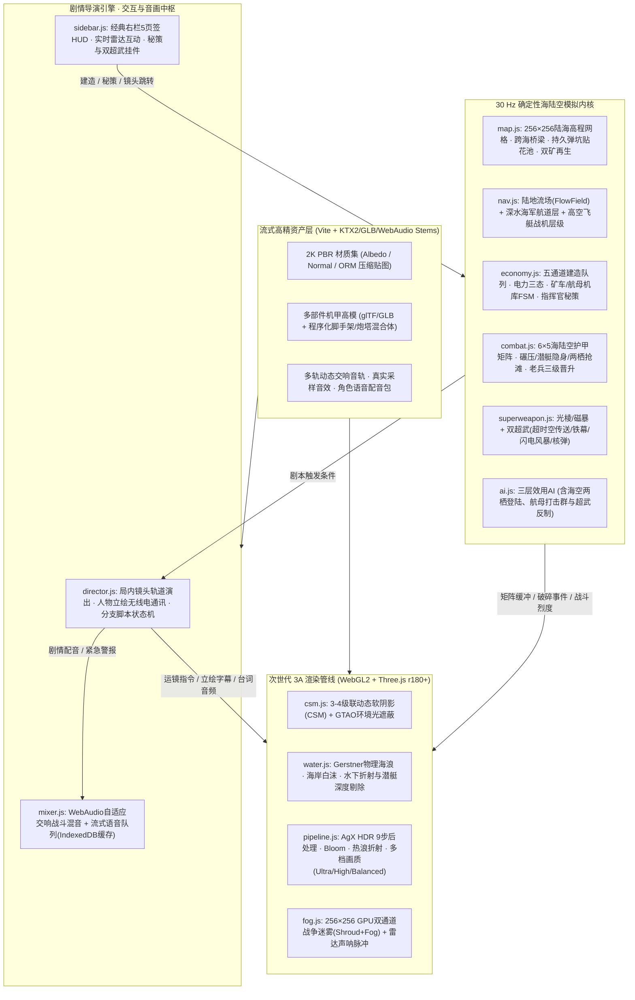

# 《墨陆：赤潮警戒》(Mò Lù: Red Tide Alert) 软件设计方案 (SDD v2.0)

- **文档版本**：v2.0（次世代高画质 · 流式资产 · 陆海空立体战 · 剧情演出架构）
- **项目代号**：`RedAlert3A`
- **技术基准**：从 [`3Agame`](https://github.com/mullvadcat/3Agame) 过程化内核演进升级，**取消 `< 2 MB` 单文件体积约束**，全面采用 **Vite 现代模块化工程 + 异步流式高精资产管线（2K PBR 纹理 + 高精度多部件 glTF/过程化混合模型 + 高采样音轨与配音 + 电影级过场剧本引擎）**，兼顾静态网页部署与可选桌面端离线包。

---

## 1. 系统架构总览与 v2.0 技术栈跃迁

### 1.1 总体分层架构



### 1.2 从 `3Agame` 演进至 `RedAlert3A v2.0` 的架构升级矩阵

| 核心子系统 | v1.0 早期构想 (`< 2 MB` 受限版) | v2.0 正式架构（画质与内容优先版） | 核心收益 |
| :--- | :--- | :--- | :--- |
| **工程与资产组织** | 手写脚本拼接单 `.html`，严禁外部图片/音频 | **Vite + ES Modules + 流式异步资产分包加载**（支持 PWA / Electron 离线桌面封包） | 彻底解除内存与代码体量限制，支持精细贴图、语音与 `12` 关独立战役资源按需懒加载 |
| **模型与材质品质** | 纯代码低面数几何合批 + 运行时小尺寸噪声贴图 | **高模多部件 glTF + 程序化阵营着色混合**：2K KTX2 (Basis Universal) 金属/战损法线贴图 + 履带滚轮独立动画 + 多阶段刚体破碎 | 坦克装甲铆钉、炮管后座、光棱晶体折射与战损焦黑质感达到次世代 3A 桌面 RTS 水准 |
| **阴影与光照渲染** | 单一方向光阴影贴图 | **3-4 级联阴影贴图（CSM） + GTAO 屏幕空间环境光遮蔽 + 局部动态点光源池（炮口/电弧照明地表）** | 无论相机拉近到 `14m` 特写还是拉远到 `80m` 俯瞰全局，建筑与坦克阴影边缘始终锐利无锯齿 |
| **水域与海战表现** | 简单半透明平面水面 | **`Gerstner` 多波叠加物理海浪 + 岸边浪花泡沫 + 舰船尾迹贴图 + 水下深度/折射着色器** | 完美支撑海军船坞、航母舰载机起降、神盾巡洋舰与台风潜艇潜伏水下的视觉奇观 |
| **剧情与过场演出** | 仅文本弹窗提示，3 关轻量遭遇战 | **专属剧本导演引擎 `director.js`**：开场/战中动态运镜、角色半身动态立绘通讯窗、中文配音台词、支线任务与双线 12 关战役状态机 | 打造真正带人物弧光、阴谋反转与视听沉浸感的长篇战争叙事 |

---

## 2. 源码目录与流式资产架构 (`RedAlert3A/`)

```text
RedAlert3A/
├── index.html                      # 应用入口与启动加载屏幕
├── vite.config.js                  # 现代 ES 模块化构建、KTX2/GLB 分包预加载策略
├── package.json                    # dev / build / test / asset-compress 脚本
├── assets/                         # 高精资产池（按战役/阵营异步懒加载，IndexedDB 本地缓存）
│   ├── textures/                   # 2K BasisU(.ktx2) PBR 纹理图集（金属/战损/地形/水沫/弹坑）
│   ├── models/                     # glTF/GLB 精细多部件机械单位与可破坏建筑骨架
│   ├── portraits/                  # 墨陆 / 林汐 / 雷泽将军 / EVA 角色动态立绘与战损表情层
│   └── audio/                      # 高采样多轨交响配乐 Stems、武器采样与战役全程配音
├── docs/
│   ├── assets/                     # PRD/SDD 概念图鉴（abyssal/crimson/infantry/superweapons.jpg）
│   ├── PRD.md                      # 产品需求文档 v2.0
│   └── SDD.md                      # 软件设计方案 v2.0
└── src/
    ├── core/
    │   ├── engine.js               # 30Hz 固定逻辑步长主循环 + 资源流式加载与缓存管理器
    │   ├── config.js               # 全量建筑/陆海空单位数值、科技树、6×5护甲表与画质预设
    │   └── events.js               # 高性能零 GC 事件总线 + 确定性 PRNG
    ├── render/
    │   ├── pipeline.js             # WebGL2 HDR 9步后处理、AgX色调映射、Bloom、热浪折射
    │   ├── csm.js                  # 级联软阴影 (CSM) + GTAO 环境光遮蔽 + 动态战斗点光源池
    │   ├── water.js                # Gerstner 物理海浪、岸线深浅渐变、尾流航迹与潜艇隐身滤镜
    │   ├── fog.js                  # 256×256 GPU 双通道战争迷雾 + 反隐声呐/间谍卫星显影遮罩
    │   └── decals.js               # 持久地面弹坑、焦土、核辐射荧光斑与坦克履带印环状池
    ├── world/
    │   ├── map.js                  # 256×256 大战场地形、双栖浅滩、可破坏桥梁与赤/紫晶矿柱再生
    │   ├── models.js               # glTF 加载与实例化包装、uTeamColor 阵营涂装、展开/坍塌骨骼动画
    │   └── destruction.js          # 多阶段刚体碎片飞溅、黑烟火柱与建筑残骸物理坍塌系统
    ├── gameplay/
    │   ├── nav.js                  # 陆地层 / 深海海军层 / 高空层 三层流场 (Flow Field) + Boids
    │   ├── entities.js             # 单位/建筑结构体数组池、老兵三级晋升、矿车与航空母舰机库FSM
    │   ├── naval.js                # 潜艇潜浮隐身机制、反潜声呐探测圈、两栖气垫船装载/抢滩
    │   ├── airforce.js             # 风暴鹰停机坪起降补弹航线、火箭兵高空避障、基洛夫投弹与夜鹰隐身
    │   ├── production.js           # 五通道并发建造队列、电力三态、维修/变卖与指挥官秘策调度
    │   ├── combat.js               # 30Hz 确定性炮弹/光束/防空拦截（可击落V3弹头）、碾压、工程师占领
    │   ├── superweapon.js          # 光棱充能 + 四大超武(超时空传送/铁幕无敌场/天气闪电/战术核弹)
    │   └── ai.js                   # 三层效用AI (含海陆空协同、跨海登陆艇编队与超武威胁反制)
    ├── story/
    │   ├── director.js             # 剧情演出导演引擎（相机平滑切镜、子弹时间、任务目标追踪）
    │   ├── dialogue.js             # 无线电立绘通讯面板、语音音频队列同步与多语言字幕
    │   └── campaigns/              # 12 关独立剧情剧本脚本（A01~A06 同盟线 / C01~C06 赤铁线）
    └── ui/
        ├── sidebar.js              # 右栏 5 页签经典 Sidebar、动态头像小窗、双超武倒计时挂件
        ├── minimap.js              # 256×256 高精互动小地图（海陆轮廓/核弹预警/左跳右指）
        └── menus.js                # 3D实时战区背景主菜单、战役星图选关、遭遇战大厅与战后复盘
```

---

## 3. 次世代 3A 画面渲染与视觉特效设计

### 3.1 级联阴影（CSM）与 GTAO 质感强化
- **4 级级联阴影贴图（CSM）**：分别覆盖相机前方 `0~35m`（近距离坦克履带螺栓/步兵细节，高分辨率 `2048×2048` 锐利阴影）、`35~90m`、`90~180m` 与 `180~360m`（山脉、基洛夫巨影与航母轮廓）。彻底解决传统单阴影贴图拉近糊、拉远闪烁的问题。
- **GTAO + 微表面战损 PBR 着色**：建筑与重坦装甲采用高模法线贴图 + ORM（Occlusion/Roughness/Metallic）通道，在装甲受击低于 `50% HP` 时通过 `uDamageMask` 自动混入烧灼黑斑、裂纹与冒烟粒子，**真正实现“战损可见”**。

### 3.2 Gerstner 物理海浪、水下折射与潜艇隐形
为了支撑大规模海战与两栖抢滩，`render/water.js` 实现完整的物理水面渲染：
1. **CPU-GPU 同步波浪**：`4` 组不同波长/方向的 Gerstner 波合成实时海面起伏与法线扰动，大型战舰（航母、无畏战列舰、神盾巡洋舰）依据舰体前后 4 点采样水高计算**俯仰纵摇与横摇角度**，劈波斩浪质感逼真。
2. **舰尾白沫与浅滩过渡**：利用水深缓冲（`uDepthTex`）在海岸线与两栖气垫船贴近浅滩时生成动态白沫浪花，在深海区呈现深邃碧蓝到墨青的次表面散射。
3. **潜艇隐身着色器**：台风级攻击潜艇在水下处于 `SUBMERGED` 状态时，仅绘制水下模糊深色剪影（对敌方完全屏蔽 `fogVis` 与框选）；当己方海豚声呐艇或防潜单位进入探测半径，水面触发“高频声呐波纹脉冲环”将潜艇轮廓高亮透视。

### 3.3 多阶段刚体破坏与持久弹坑池 (`destruction.js` & `decals.js`)
- **持久战场伤痕（Decal Ring Buffer）**：预设容量 `1024` 槽位的地面贴花渲染池（Instanced Projected Decals）。重炮爆炸留下焦黑弹坑、V3 击中留下灼热熔岩裂痕、坦克履带行驶碾过雪原/泥地留下逐渐淡化的车辙印、核爆留下持续 `30s` 泛绿光的放射性尘埃地貌。
- **建筑分体坍塌动画**：主基地、高科、电厂不再“原地突然消失”，而是先从顶部喷发火球与内爆闪光，主体钢架朝一侧倾倒折断并溅起飞舞的装甲残片（带简单地面弹跳物理），最后留下冒着黑烟的焦黑废墟基底（5 秒后平稳沉降消融）。

---

## 4. 陆·海·空三层导航引擎与双端实体状态机

### 4.1 三层共享寻路层 (`nav.js`)
地图逻辑尺寸升级至 **`256 × 256` 网格（`2m/Cell`，总面积 `512m × 512m` 宏大战场）**，支持大纵深海陆空拉锯：
1. **地面层 (`layer = LAND`)**： plains (`0`)、可通行浅滩 (`2`, 仅两栖气垫船与部分单位可涉水)、桥梁 (`3`, 可被狂轰滥炸摧毁并在工程师修复后重建)。
2. **海洋层 (`layer = SEA`)**：深水区 (`1`) + 浅滩 (`2`)，船坞与战舰共享独立的海洋流场，确保无畏舰编队绕过岛礁不卡船头。
3. **高空层 (`layer = AIR`)**：`y = 14m ~ 22m` 空中航道无视悬崖、水域与建筑占地，仅使用高频 Boids 分离力避免多架基洛夫空艇或火箭飞行兵模型重叠。

### 4.2 航空母舰机库 & 风暴鹰战机停机坪 FSM
- 暗潮航空母舰体内预挂载 `4` 架舰载无人/轻型轰炸机，进入射程后按 `0.4s` 间隔弹射起飞，沿贝塞尔俯冲轨迹对目标投弹后**自动拉升盘旋返航甲板补充弹药（`2.5s`）**；若战机在途中被神盾/防空火力击落，航母机库消耗微额时间周期重新装配补充战机。
- 空指部的风暴鹰攻击机支持 **“指定打击”与“停机坪待命/自动拦截”** 两种模式，弹药耗尽后沿安全折返高度返回停机坪装填并快速自动维修。

### 4.3 多功能步兵车 (IFV) 动态变形系统
当己方步兵进入 IFV 后，`models.js` 实时替换炮塔子节点网格并切换武器配置表：
- **空载**：标准 6 管全向微型导弹；
- **载入 工程师**：炮塔变更为**双臂高频电焊维修臂**（全图最快战地修理车）；
- **载入 战术大兵**：重型加特林防步兵火神炮；
- **载入 超时空军团兵**：极速机动版时空抹除车；
- **载入 磁暴步兵**：移动式迷你高压磁暴线圈战车！

---

## 5. 双超级武器与指挥官秘策实现规范

| 系统名称 | 技术实现机制 (`superweapon.js` / `production.js`) | 渲染与视听细节 |
| :--- | :--- | :--- |
| **超时空传送仪 (Chrono Sphere)** | 读取瞄准框 `3×3` 格内所有单位：步兵直接销毁并生成时空碎片；载具瞬间修改世界坐标至目标 `targetPos`（目标区域若被敌建占满则触发“空间错位伤害”） | 源点与终点同步张开双重旋转青白量子球面护盾 + 空间扭曲折射屏幕特效 + 经典时空折叠低鸣 |
| **铁幕装置 (Iron Curtain)** | 将 `3×3` 格内己方重型载具标记 `invulnerableTimer = 15.0s`，在 `combat.js` 结算前直接拦截所有武器伤害（无甲步兵直接判定致命辐射清除） | 为受保护坦克与建筑动态附加暗红+漆黑金属流动脉冲材质（`uIronCurtainOverlay`）与强磁嗡鸣声场 |
| **天气控制机 (Weather Control)** | 启动后平滑插值天空穹顶环境色与定向光强度；在 `targetPos` 上方生成乌云粒子旋涡，12 秒内按伪随机均匀分布调度 `18` 道强力落雷打击 | 每次雷击伴随高频程序化分支闪电圆柱网格 + 瞬间全屏微弱震动 + 延迟立体声滚雷轰鸣 |
| **核弹发射井 (Nuclear Silo)** | 发射井装甲大门液压滑开；生成带白烟粒子尾迹的 ICBM 实体导弹，先垂直爬升 `4s` 随后高速俯冲落点；触发爆炸 5 阶段序列并创建持续 `30s` 的辐射逻辑圈 | 核爆瞬间拉高后处理 `exposure` 触发全屏致盲闪白，生成多尺度翻滚火球与冲天蘑菇云，地表挂载绿色辐射贴花 |
| **指挥官秘策（4 项）** | 独立于建造资源的全局技能状态机，通过 `Sidebar` 上方的 `1~4` 秘策槽触发，由探索进度或时间充能激活 | 包含轨道扫描卫星扫描扇区、大型运输机高空伞兵空投群、纳米云雾回血光环与大范围 EMP 瘫痪电环 |

---

## 6. 电影级剧情导演引擎 (`director.js`) 与战役状态机

为了呈现极有代入感的战役故事，v2.0 专门设立 `src/story/` 子系统：

1. **剧本脚本驱动（Data-Driven Mission Scripts）**：
   每关战役为一个结构化 JSON/JS 剧本模块，包含：
   - **开场分镜序列（Intro Sequence）**：相机平滑飞越港口/冰川地形关键地标，配合角色半身立绘、无线电波纹动画、高音质中文配音与字幕框交代战前危机；
   - **局中动态事件触发器（Triggers）**：支持 `onAreaEntered`（我军潜艇进入伏击区）、`onUnitHPBelow`（关键核电受损）、`onTimer`（第 8 分钟敌军背叛/增援空降）、`onCapture`（占领中立雷达解开主线反转）；
   - **无缝切镜演出（In-Game Cinematics）**：重大剧情反转时刻（例如“零号赤潮”突破深海、或是内鬼引爆桥梁），相机可短暂平缓过渡至焦点位置突出粒子奇观，不丢失玩家当前选中编队并在 3 秒后丝滑切回指挥视角。
2. **动态交响 WebAudio 混音台 (`mixer.js`)**：
   - 将高采样工业摇滚/电子金属战曲拆分为 **探索/潜伏层（Ambient Bass）**、**常态建造层（Groove March）** 与 **激战高潮层（Heavy Shred + Brass）**；
   - 实时统计最近 5 秒内战场伤害总量与超武警告状态，动态无缝交叉淡入（Crossfade）配乐轨道，让战斗在天启碾压与核弹升空时瞬间燃至沸点！

---

## 7. 六阶段研发里程碑（M1 – M6）与验收参数

| 阶段 | 周期 | 核心目标与可交付里程碑 |
| :--- | :---: | :--- |
| **M1** | 第 1-2 周 | **Vite 架构、次世代管线与水陆地形底座**：搭通 `Vite + KTX2/GLB` 流式资源加载器、4 级联软阴影（CSM）、GTAO、Gerstner 物理海浪与 `256×256` GPU 双通道战争迷雾。 |
| **M2** | 第 3-4 周 | **经典 Sidebar、五通道建造与经济闭环**：完成经典右栏 UI、动态立绘无线电窗、陆海空全建筑展开/多阶段坍塌动画、双色晶矿与武装矿车自动采矿循环。 |
| **M3** | 第 5-6 周 | **全陆海空兵种与三层群集导航**：落地全部 8 步兵、8 陆军、3 空军、5 海军单位模型与武器；打通三层流场（陆/海/空）、IFV 变形、潜艇隐形反潜、航母舰载机与光棱/磁暴特效。 |
| **M4** | 第 7 周 | **四终极超武、秘策与海陆空遭遇战 AI**：完成超时空传送仪、铁幕无敌护盾、闪电风暴与核弹全套表现；接入 4 项指挥官秘策及支持抢滩登陆与超武反制的三层效用 AI。 |
| **M5** | 第 8-10 周 | **双阵营 12 关深度剧本战役与音画演出**：接入 `director.js` 分镜演出引擎，完成《蔚蓝折光》6 关 + 《赤铁洪流》6 关全剧情对话、反转触发器、动态交响混音与中文配音字幕。 |
| **M6** | 第 11 周 | **250+ 单位压测调优与正式发行验收**：完成 Ultra/High/Balanced 三档画质平衡、`?bench=1` 同屏 250+ 单位 60 FPS 优化及静态/离线桌面构建。 |

### 研发与验收专用 URL 参数
- `?show=gallery`：打开全 3D 可旋转双阵营模型检阅展厅（支持预览高模战损阶段、光棱/铁幕材质及武器开火测试）；
- `?mission=A01..A06 / C01..C06`：直接跳转任意一关战役剧本进行过场触发与胜负流程调试；
- `?nofog=1` / `?fastbuild=1`：全图透视 AI 海陆空运营逻辑，10 倍速测试双超武协同与多线攻防；
- `?bench=1`：250+ 海陆空大混战帧耗时、CSM 耗时与显存对象池稳定度自动化压测。
